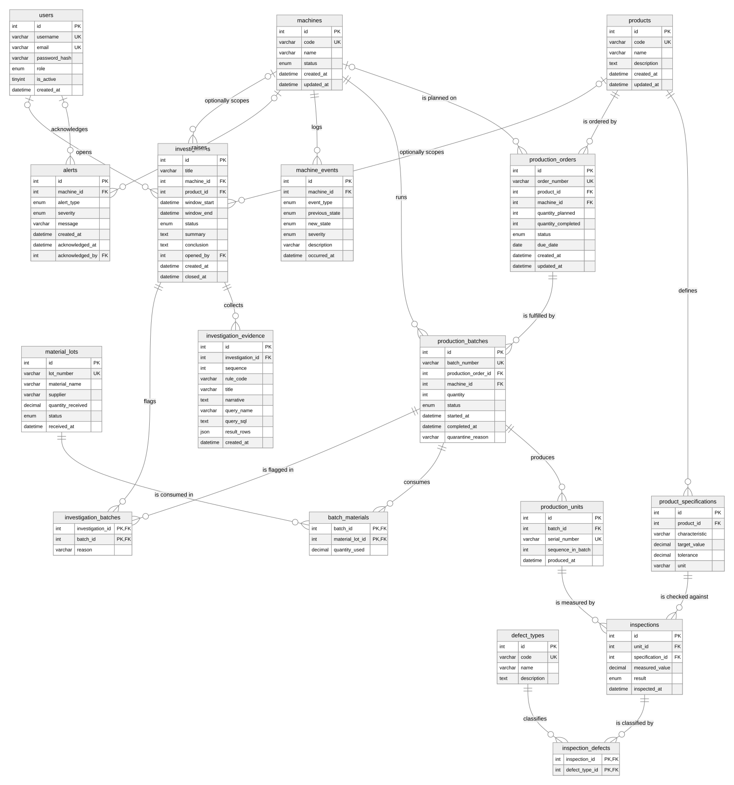

# Factory Sherlock

Smart manufacturing simulation, production intelligence, and quality investigation platform built on MySQL.

Factory Sherlock simulates a small machining line, records every order, batch, unit, inspection, and machine event in a normalized MySQL 8 database, and then helps an engineer answer the question that matters when quality drops: what changed, where, and when. The investigation case board shows every piece of evidence together with the SQL query that produced it, so a reader can check the reasoning rather than trust a summary.

This is the final project for CS3320 Database Systems at the Milwaukee School of Engineering (Fall 2026). It is an independent student project. It is inspired by the way industrial software such as Rockwell Automation FactoryTalk connects plant data to production and quality decisions, but it is not affiliated with, endorsed by, or derived from Rockwell Automation or any of its products.

## Contents

1. [Problem and motivation](#problem-and-motivation)
2. [What the platform does](#what-the-platform-does)
3. [The creative feature: show-the-SQL case board](#the-creative-feature-show-the-sql-case-board)
4. [Architecture](#architecture)
5. [Technology stack](#technology-stack)
6. [Database design](#database-design)
7. [Analytical queries](#analytical-queries)
8. [Repository structure](#repository-structure)
9. [Getting started](#getting-started)
10. [Running the application](#running-the-application)
11. [Testing and quality gates](#testing-and-quality-gates)
12. [API overview](#api-overview)
13. [Documentation](#documentation)
14. [Screenshots and video](#screenshots-and-video)
15. [Implementation status](#implementation-status)
16. [Roadmap](#roadmap)
17. [Known limitations](#known-limitations)
18. [Use of AI tools](#use-of-ai-tools)
19. [References](#references)
20. [License](#license)

## Problem and motivation

A manufacturing line produces data in several places at once: the production schedule, the machines, the inspection station, and the material receiving dock. When the defect rate on one machine climbs, the people responsible need to connect those sources quickly. Which batches are affected? Did a maintenance or tool wear event precede the change? Do the failing batches share a material lot? Which customer orders are at risk?

In most small shops this reconstruction happens by hand in spreadsheets and chat threads. The data model needed to answer these questions is a classic relational problem: orders, batches, units, inspections, machines, events, and materials are related through foreign keys, and the questions above are joins, aggregations, and window functions over those relationships.

Factory Sherlock exists to make that reasoning explicit and reproducible. It is a database project first. The simulator exists to generate realistic data, the API exists to expose the data safely, and the dashboard exists to show the SQL doing the work.

## What the platform does

The platform is organized into six modules. All six are implemented in the backend and covered by automated tests; the frontend status for each is listed under [Implementation status](#implementation-status).

| Module | What it does | Main code |
|--------|--------------|-----------|
| Factory simulator | Deterministic simulation of three CNC machines producing three products. Fault scenarios (tool wear, calibration drift, increased variation, material issue, downtime) change measurement distributions and machine states. Every run is reproducible from a seed. | `backend/app/simulation` |
| Manufacturing execution (MES) | Production orders, batches, and serialized units with explicit state machines, remaining-quantity checks, and transactional batch creation. | `backend/app/services/production_service.py` |
| Quality management | Inspections against product specifications with automatic pass or fail evaluation, defect classification, quality summaries, and CSV import of up to 5000 measurements in one transaction with row-level error reporting. | `backend/app/services/quality_service.py`, `backend/app/services/inspection_import.py`, `backend/app/domain/quality_rules.py` |
| Investigation engine | Seven evidence rules (R1 to R7) that compare defect rates, find recurring defects, locate the onset hour, list preceding machine events, flag batches for review, find shared material lots, and confirm the onset with a one-sided CUSUM over hourly defect rates. Each rule stores the SQL it ran and the rows it saw. | `backend/app/investigation` |
| Traceability | Forward trace from a material lot to the batches, units, and orders it touched; backward trace from a serial number to its lot, machine, and inspections; quarantine of a batch or a whole lot with cascading alerts. | `backend/app/services/traceability_service.py` |
| Production intelligence dashboard | React application with an overview, machine and order management, inspections with a CSV import panel, traceability search, the investigation case board, a SQL explorer for the analytical queries, a per-characteristic control chart, and a simulation control panel. | `frontend/src` |

Supporting capabilities:

- Authentication with JSON Web Tokens and four roles (viewer, operator, engineer, admin). Mutating endpoints require operator or engineer roles. Failed logins are throttled per account, and per client address once an attempt has failed (`backend/app/core/throttle.py`); the sixth failure inside the window returns 429 with a `Retry-After` header.
- Typed application errors mapped to a consistent JSON error shape, including field-level validation messages. Request bodies are capped before authentication (64 KiB, or 1 MiB + 64 KiB for the CSV import) and answered with 413 when over.
- Paginated lists: the six list endpoints take `limit` (1 to 500, default 50) and `offset` and return `{items, total, limit, offset}`.
- Request-scoped database transactions: a request either commits everything or nothing.
- Alembic migrations as the single source of schema truth, with a generated `schema.sql` for review.
- A least-privilege MySQL user created by the setup script; the application never connects as root.

## The creative feature: show-the-SQL case board

Most dashboards present conclusions. Factory Sherlock presents evidence.

When an engineer opens an investigation for a machine and a time window, the investigation engine runs its seven rules against MySQL. Each rule produces an evidence card containing:

- a title and a short narrative in plain language,
- the name of the SQL file that was executed,
- the exact SQL text that ran, with bound parameter names visible,
- the result rows, stored as JSON in the `investigation_evidence` table.

The case board in the frontend displays these cards in sequence. A reader can expand any card to see the SQL and the rows, which makes the project's database work visible in the product itself rather than only in documentation. The summary at the top of the case deliberately avoids causal claims: it reports what the evidence shows (for example, that a tool wear event preceded the onset of elevated defects) and states that the data does not by itself establish cause.

The same idea extends to the analytics page, where every dashboard chart has a disclosure that reveals the query behind it.

## Architecture

Factory Sherlock is a modular monolith: one FastAPI process, one React application, and one MySQL database. The backend is layered so that HTTP concerns, application services, pure domain rules, and data access stay separate.



Request flow for a typical mutation:

1. A route module in `backend/app/api/routes` validates the request body with a Pydantic schema and resolves the current user and role.
2. A service in `backend/app/services` applies business rules, calls the domain layer for state transitions and measurement evaluation, and writes through SQLAlchemy models.
3. The request-scoped session commits on success. Any application error, integrity error, or unexpected exception rolls the transaction back and is mapped to a JSON error response with a request id.

Analytical reads take a different path: services load SQL text from `database/queries` through the SQL loader and execute it with bound parameters through the query runner. The same files are the project's query documentation.



Further reading: [system overview](docs/architecture/system-overview.md), [component design](docs/architecture/component-design.md), [data flow](docs/architecture/data-flow.md), and the [architecture decision records](docs/decisions/README.md).

## Technology stack

Every component is free to use and runs on a laptop. No GPUs, paid services, or hosted databases are required.

| Layer | Choice | Why |
|-------|--------|-----|
| Database | MySQL 8.4 | Required by the course. Supports CHECK constraints, window functions, CTEs, LATERAL joins, ROLLUP, and JSON columns, all of which the project uses. |
| Migrations | Alembic | Versioned, reviewable schema changes. The three migration files are the authoritative DDL; `database/schema/schema.sql` is generated from the migrated database. |
| Backend | Python 3.12 or later (3.13 on the development machine), FastAPI, SQLAlchemy 2, Pydantic v2 | Typed request and response models, automatic OpenAPI documentation, a mature ORM with explicit transaction control, and first-class raw SQL support. |
| Authentication | PyJWT, bcrypt | Standard signed tokens and password hashing without an external identity service. |
| Python tooling | uv, ruff, mypy (strict), pytest, pytest-cov | Fast installs, one linter and formatter, strict static typing, and coverage reporting. |
| Frontend | React 19, TypeScript, Vite, Tailwind CSS 4, React Router 7, TanStack Query, Recharts | A typed component model, fast local builds, declarative data fetching with caching, and a charting library that works with plain data arrays. |
| Frontend tooling | pnpm, ESLint, Prettier, Vitest, Testing Library, Playwright | Reproducible installs, consistent style, component tests that exercise behaviour rather than implementation, and browser tests against the real backend. |
| Continuous integration | GitHub Actions | Five workflows: Backend CI, Frontend CI, Docs Lint, Compose Smoke, and End-to-End. Lint, type checks, and tests run against a MySQL service container on every push and pull request; End-to-End runs the Playwright suite against a seeded database. |
| Diagrams | Mermaid sources rendered to SVG | Diagrams live in version control as text and are rendered with `scripts/development/render_diagrams.py`. |
| Optional | Docker Compose | Provides MySQL for developers who prefer a container. The project was developed against a local MySQL binary; the compose path is verified by the Compose Smoke workflow, which starts the service in GitHub Actions, checks the schemas and the application user's grants, and connects as that user. |

## Database design

The schema has 17 tables, three of them many-to-many junction tables (`batch_materials`, `inspection_defects`, `investigation_batches`). Every table has a primary key, every foreign key is indexed, and business rules that can be expressed in the database are expressed there: ENUM domains for states, UNIQUE keys for business identifiers, and fourteen named CHECK constraints (for example, tolerance greater than zero, quantity completed never above quantity planned, investigation window end after window start, and a quarantine reason present exactly when a batch is quarantined).



Core entities and their relationships:

- `products` define `product_specifications` (characteristic, target value, tolerance).
- `production_orders` reference a product and optionally a machine; they are fulfilled by `production_batches`, which produce serialized `production_units`.
- `production_batches` consume `material_lots` through `batch_materials`.
- `inspections` measure one unit against one specification and are classified by `defect_types` through `inspection_defects`.
- `machines` log `machine_events` (state changes, tool wear, calibration, maintenance, downtime).
- `investigations` collect `investigation_evidence` and flag `production_batches` through `investigation_batches`; `alerts` are raised against machines or production orders and acknowledged by `users`.

Lifecycle states are enforced in two places. The database restricts each status column to its ENUM domain. The service layer enforces the allowed transitions between states (for example, an order moves PLANNED to RELEASED to IN_PROGRESS to COMPLETED, and a quarantined batch cannot leave quarantine) through transition tables in `backend/app/domain/state_machines.py`.

Full documentation: [database design](docs/database/database-design.md), [data dictionary](docs/database/data-dictionary.md), [normalization analysis](docs/database/normalization.md), and [seed data](docs/database/seed-data.md).

## Analytical queries

Fourteen SQL files under `database/queries` (ten numbered dashboard and traceability queries, four investigation queries) are loaded at runtime and documented in [queries.md](docs/database/queries.md). They use common table expressions, window functions (`RANK`, `SUM OVER`), `LATERAL` joins, `ROLLUP` with `GROUPING`, correlated `EXISTS`, `GROUP_CONCAT`, sample statistics (`STDDEV_SAMP`, `VAR_SAMP`), and an optional-parameter pattern so one query serves both the fleet view and a single machine. Eight of the ten numbered queries run through `GET /analytics/queries/{name}`; the two trace queries run through the traceability endpoints.

| File | Business question |
|------|-------------------|
| `01_machine_defect_rate_comparison.sql` | Which machines have a defect rate above the fleet average in a window? |
| `02_production_performance.sql` | Which orders are complete, in progress, on time, or overdue, and by how much? |
| `03_recurring_defects.sql` | Which defect types recur most on each machine? |
| `04_material_lot_forward_trace.sql` | Which batches, units, and orders did a material lot reach? |
| `05_unit_backward_trace.sql` | Where did a serial number come from, and what were its inspection results? |
| `06_quality_after_machine_events.sql` | Did the defect rate change in the hours after a machine event? |
| `07_order_completion_summary.sql` | Planned versus completed quantities by product and status, with subtotals. |
| `08_batches_requiring_review.sql` | Which batches exceed a defect-rate threshold and are not yet under investigation? |
| `09_daily_production_trend.sql` | Daily units produced and failed per machine. |
| `10_characteristic_control_chart.sql` | For one measured characteristic, how did the batch mean and spread move over a window, and which batches fall outside three-sigma control limits computed per subgroup? |
| `investigation/defect_onset.sql` | In which hour did the defect rate first rise, and how did it accumulate? |
| `investigation/hourly_defect_rates.sql` | Hour by hour, how many units did a machine inspect and how many failed (input to the R7 CUSUM test)? |
| `investigation/machine_events_before_onset.sql` | Which events happened on the machine in the hours before onset? |
| `investigation/shared_material_lots.sql` | Which material lots do the flagged batches have in common? |

## Repository structure

```
factory-sherlock/
  backend/            FastAPI application, Alembic migrations, tests
    app/
      api/            routes, dependencies, error handlers
      core/           settings, database session, security, logging
      domain/         pure rules: state machines, measurement evaluation
      investigation/  evidence rules R1 to R7, engine, summary
      jobs/           overdue order check command (make check-overdue)
      models/         SQLAlchemy models (17 tables)
      repositories/   SQL loader and query runner
      schemas/        Pydantic request and response models
      services/       application services
      simulation/     deterministic simulation engine and fault models
    migrations/       Alembic environment and versions
    tests/            unit, api, and integration tests
  database/
    queries/          fourteen documented SQL files loaded at runtime
    schema/           generated schema.sql
    seeds/            reference data SQL and demo scenario JSON
    documentation/    index for the database artefacts
  frontend/           React, TypeScript, Vite application; Playwright tests in e2e/
  docs/               architecture, api, database, simulation, investigation,
                      quality, requirements, development, testing, decisions,
                      milestones, media, ai_evidence
  scripts/            setup and development scripts
  .github/            CI workflows, issue and pull request templates
```

A file-by-file description is in [repository-structure.md](docs/architecture/repository-structure.md).

## Getting started

Prerequisites:

- Python 3.12 or later and [uv](https://docs.astral.sh/uv/)
- Node.js 20 or later and [pnpm](https://pnpm.io/) 10
- MySQL 8.4 server binaries on the machine, or Docker if you prefer the compose service
- Git

Clone and configure:

```bash
git clone https://github.com/shritej6/factory-sherlock.git
cd factory-sherlock
cp .env.example .env
```

Edit `.env`. At minimum set `MYSQL_PASSWORD`, `MYSQL_ROOT_PASSWORD`, `JWT_SECRET_KEY`, and `SEED_DEMO_PASSWORD` to values of your own. If another MySQL already listens on port 3306, change `MYSQL_PORT` (the development machine used 3307). The `.env` file is ignored by Git and must never be committed.

Start MySQL with the bundled script, which initialises a data directory under `.local/`, creates the application and test databases, and creates the least-privilege user:

```bash
make db-init     # one time
make db-start
```

Alternatively, with Docker:

```bash
docker compose up -d mysql
```

Install dependencies, apply migrations, and load the demonstration scenario:

```bash
cd backend && uv sync && cd ..
cd frontend && pnpm install && cd ..
make migrate
make seed-demo
```

`make seed-demo` loads the reference catalogue (three products, six specifications, three machines, five defect types, nine material lots), creates four demonstration accounts (`admin`, `engineer`, `operator`, `viewer`, all with the password from `SEED_DEMO_PASSWORD`), and runs the scenario in `database/seeds/demo_scenario.json`: a day of production in which machine CNC-03 develops tool wear and CNC-02 suffers a downtime event.

## Running the application

```bash
make backend     # FastAPI with reload on http://127.0.0.1:8000
make frontend    # Vite dev server on http://localhost:5173
```

Interactive API documentation is served at `http://127.0.0.1:8000/api/docs`. Sign in to the frontend with one of the demonstration accounts.

Other useful targets (run `make help` for the full list):

| Target | Purpose |
|--------|---------|
| `make reset-demo` | Drop all tables, re-run migrations, and reseed the demo scenario |
| `make export-schema` | Regenerate `database/schema/schema.sql` from the migrated database |
| `make export-openapi` | Regenerate `docs/api/openapi.json` |
| `make lint` | Ruff, mypy, ESLint, and TypeScript checks |
| `make check-docs` | Fail if any Markdown file contains an em dash, en dash, or emoji |
| `make check-overdue` | Raise `ORDER_OVERDUE` alerts for open orders past their due date; exits 0 after committing and 1 after rolling back on an error |
| `make screenshots` | Re-capture the fourteen screenshots in `docs/media/screenshots` from the running application |
| `make videos` | Record the silent walkthrough clips into `docs/media/videos` (writes to the database; reset the demo scenario first) |
| `make benchmark-sim` | Time simulation persistence for the demo shape and a large shape, rolled back |

## Testing and quality gates

Backend tests run against a real MySQL database (`factory_sherlock_test`) so that constraints, transactions, and the SQL files are exercised as they will run in production. Unit tests cover the pure domain, simulation, throttle, body cap, CSV parsing, and error mapping code without a database. Browser tests (Playwright) in `frontend/e2e` drive the real frontend against the real backend and a seeded demo database.

```bash
make test-backend
make test-frontend
cd frontend && pnpm test:e2e
```

Checks in this checkout on 2026-11-07 (Python 3.13):

| Check | Result |
|-------|--------|
| Backend tests (`pytest`) | 481 collected (254 unit, 174 API, 53 integration in 13, 16, and 6 files); the suite was not run against MySQL from this checkout. The last recorded coverage figure is in `docs/testing/test-matrix.md` |
| Ruff lint and format | no findings (122 files formatted) |
| mypy strict | no issues in 80 source files |
| Frontend tests (`vitest`) | 118 passed in 25 files |
| End-to-end tests (Playwright) | 9 tests in 5 spec files (login, roles, investigation, traceability, analytics); not run from this checkout, run by the End-to-End workflow |

What the backend suite covers:

- State machine tables and measurement evaluation (unit).
- Simulation determinism, fault effects, and machine state cycling (unit).
- Investigation rules with a fake query runner, including the R7 CUSUM arithmetic (unit).
- Login throttle window and reservation logic, request body caps, CSV parsing rules, and the MySQL error code mapping (unit).
- Every API module: authentication and role checks, validation errors with field names, duplicate detection (409), legal and illegal transitions, transactional batch creation with rollback, quarantine cascades, investigation creation with evidence, forward and backward traceability, simulation runs, the pagination envelope and its bounds, status filters and status counts, CSV import with row-level errors, the overdue order check, and the login throttle through the endpoint (API, against MySQL).
- CHECK, UNIQUE, ENUM, and foreign key enforcement, the list-ordering indexes, and all fourteen SQL files against simulated data (integration).
- Frontend components and hooks with Vitest and Testing Library; the demo workflows end to end with Playwright.

Continuous integration runs the same checks in GitHub Actions with a MySQL service container. The workflows are in `.github/workflows`. Backend CI, Frontend CI, and Docs Lint ran green on the first push on 2026-11-04 (run ids in `docs/development/development-roadmap.md`); Compose Smoke and End-to-End were added on 2026-11-07 and run on the next push.

## API overview

All endpoints live under `/api/v1` and return JSON. Errors use one shape: `error`, `message`, `details`, and a `request_id` that is also returned in the `X-Request-ID` header of every response so a user can quote it when reporting a problem. A throttled login returns 429 with `details.retry_after_seconds` and a matching `Retry-After` header; a body over the cap returns 413 with `details.limit_bytes`.

The six list endpoints (`GET /production-orders`, `GET /production-batches`, `GET /inspections`, `GET /investigations`, `GET /machines/{id}/events`, `GET /analytics/alerts`) take `limit` (1 to 500, default 50) and `offset` (at most 1,000,000) and return `{items, total, limit, offset}`. `GET /production-batches` and `GET /investigations` accept a repeatable `status` filter (`status=A&status=B`, any of them) applied before pagination, so `total` reflects the filter; every batch row carries its parent `order_number`.

| Area | Endpoints | Roles |
|------|-----------|-------|
| Health | `GET /health` | public |
| Auth | `POST /auth/login` (throttled), `GET /auth/me` | public, any |
| Catalog | products, `GET /specifications` (for the control chart picker), machines, machine status changes, paginated machine events, material lots, defect types | read: any; write: operator or engineer |
| Production | orders (create, paginated list, update, status change, `GET /production-orders/status-counts`), batches (create, paginated list with repeatable `status` and `order_number` on each row, detail, complete, quarantine) | read: any; write: operator or engineer |
| Quality | record inspections, `POST /inspections/import` (CSV, at most 1 MiB and 5000 rows, all or nothing), paginated inspection list, quality summary | read: any; write: operator or engineer |
| Traceability | forward trace by lot, backward trace by serial, quarantine lot | read: any; quarantine: engineer |
| Investigations | open, paginated list with repeatable `status`, detail with evidence, status change, close with conclusion | read: any; write: engineer |
| Analytics | query catalogue (14 entries, 8 runnable), run a dashboard query, paginated alerts, acknowledge alert, `POST /analytics/alerts/checks/overdue-orders` (no request body; the server clock is the check date) | any; acknowledge and overdue check: operator or engineer |
| Simulation | run a scenario and persist its output | engineer |

The full OpenAPI document (35 paths, 44 operations) is exported to [docs/api/openapi.json](docs/api/openapi.json).

## Documentation

| Area | Documents |
|------|-----------|
| Architecture | [system overview](docs/architecture/system-overview.md), [component design](docs/architecture/component-design.md), [data flow](docs/architecture/data-flow.md), [repository structure](docs/architecture/repository-structure.md) |
| Database | [database design](docs/database/database-design.md), [data dictionary](docs/database/data-dictionary.md), [normalization](docs/database/normalization.md), [queries](docs/database/queries.md), [seed data](docs/database/seed-data.md) |
| Simulation | [simulation design](docs/simulation/simulation-design.md), [fault models](docs/simulation/fault-models.md) |
| Investigation | [investigation engine](docs/investigation/investigation-engine.md), [traceability design](docs/investigation/traceability-design.md) |
| Quality | [inspection import](docs/quality/inspection-import.md) (CSV format, limits, error shape, body caps, benchmark) |
| API | [openapi.json](docs/api/openapi.json), regenerated with `make export-openapi` |
| Requirements | [functional](docs/requirements/functional-requirements.md), [non-functional](docs/requirements/non-functional-requirements.md), [business rules](docs/requirements/business-rules.md) |
| Development and testing | [docs/development](docs/development), [docs/testing](docs/testing), [CONTRIBUTING.md](CONTRIBUTING.md), [SECURITY.md](SECURITY.md) |
| Decisions | [ADR index](docs/decisions/README.md) (nine records) |
| Course milestones | [docs/milestones](docs/milestones): Week 8 proposal and the Week 8, 9, and 10 milestone reports as Markdown, DOCX, and PDF |
| AI evidence | [docs/ai_evidence](docs/ai_evidence): use record, conversation excerpts, reflection notes |

## Screenshots and video

Only genuine captures of the running application are committed. The plan for which screens to capture and what the walkthrough video will show is in [docs/media/media-plan.md](docs/media/media-plan.md). Fourteen screenshots captured on 2026-11-07 with `scripts/development/capture_screenshots.py` (`make screenshots`; Playwright driving Chrome against the running application and the demo scenario) are stored in `docs/media/screenshots` and listed in that plan. Videos 2 to 6 exist as silent screen recordings made by `scripts/development/record_walkthroughs.py` (`make videos`) and committed in `docs/media/videos` under [ADR-0010](docs/decisions/ADR-0010-commit-short-walkthrough-videos.md); the narrated versions and video 1 (project overview) have not been recorded.

## Implementation status

Implemented and verified by automated tests:

- MySQL schema (17 tables), three Alembic migrations (tables, `alerts.production_order_id`, list-ordering indexes), generated schema export, reference seed, demo scenario.
- Fourteen analytical SQL files, executed in tests against simulated data.
- Backend API for all six modules with authentication, roles, login throttling, request body caps, validation, typed errors, pagination, and transactions.
- CSV inspection import (bulk writes, row-level errors) and the overdue order check (`make check-overdue` and the endpoint).
- Deterministic simulation engine with five fault models, machine state tracking, and chunked bulk-insert persistence.
- Investigation engine with seven rules (R7 is a one-sided CUSUM), stored SQL evidence, and a non-causal summary.
- Forward and backward traceability and quarantine cascades.
- Frontend application with login, overview (with the overdue check), machines, orders, batches, inspections with the CSV import panel, traceability, investigations with the case board, analytics with the SQL explorer and the per-characteristic control chart, and simulation pages; paged tables on every list screen; an accessibility pass (labelled landmarks and row actions, focus management for disclosures and inline forms, WCAG 2.1 AA contrast in both themes).
- Five CI workflows, nine Playwright browser tests, contribution and security policies, issue and pull request templates.
- Documentation set, ten architecture decision records, rendered diagrams, milestone documents.

Planned or not yet done:

- Narration for the five silent walkthrough clips and video 1, the project overview (see the media plan).
- Observing the Compose Smoke and End-to-End workflows green on GitHub and recording their run ids in `docs/testing/test-matrix.md`.
- Deployment to any hosted environment; the project is designed to run locally.

## Roadmap

The items listed in the Week 10 report (pagination, CSV import, overdue order alerts, per-characteristic control charts, a CUSUM onset rule) were implemented on 2026-11-07; the per-item record is in [docs/development/development-roadmap.md](docs/development/development-roadmap.md). Remaining:

1. Record the narration for the walkthrough videos and the project overview video for the course submission.
2. Observe the Compose Smoke and End-to-End workflows on the next push and record the outcome in `docs/testing/test-matrix.md`.
3. Release from quarantine and the `CONSUMED` lot status (Phase 7 gaps in the roadmap document).
4. Schedule `make check-overdue`; nothing in the repository runs it on a timer.

## Known limitations

- The simulation models three machines and three products with simple measurement distributions. It is designed to produce plausible data for database work, not to reproduce real machining physics.
- Investigation rules use fixed thresholds (for example, a batch review rate of 10 percent). Thresholds are configurable in code but not through the API.
- `material_lots.quantity_received` is recorded but never decremented; material consumption is tracked per batch, not as a running balance.
- Timestamps are stored without a time zone and interpreted as local time of the server.
- Request limiting covers only `POST /auth/login` and is counted in memory per API process; several uvicorn workers would each keep their own counts. There is no general rate limit on authenticated endpoints and no token revocation.
- The simulation persists units, inspections, defects, and events with chunked multi-row inserts (1000 rows per statement); orders, batches, and alerts still go through the ORM one object at a time.
- The overdue order check is idempotent but nothing in the repository schedules it; run `make check-overdue` or call the endpoint.

## Use of AI tools

AI assistance (Claude Code) was used under the course's AI-integrated project guidelines. Every substantive use is recorded in [docs/ai_evidence/ai-use-record.md](docs/ai_evidence/ai-use-record.md) with what was proposed, whether it was accepted, revised, or rejected, and how it was verified. Conversation excerpts that show design decisions, bugs caught, and proposals rejected are in [docs/ai_evidence/conversations](docs/ai_evidence/conversations). The student's own reflection is in [reflection-notes.md](docs/ai_evidence/reflection-notes.md). Nothing in this repository presents AI output as verified without a test, a query result, or a review behind it.

## References

- MySQL 8.4 Reference Manual: https://dev.mysql.com/doc/refman/8.4/en/
- MySQL window functions: https://dev.mysql.com/doc/refman/8.4/en/window-functions.html
- MySQL CHECK constraints: https://dev.mysql.com/doc/refman/8.4/en/create-table-check-constraints.html
- SQLAlchemy 2.0 documentation: https://docs.sqlalchemy.org/en/20/
- Alembic documentation: https://alembic.sqlalchemy.org/
- FastAPI documentation: https://fastapi.tiangolo.com/
- Pydantic documentation: https://docs.pydantic.dev/
- React documentation: https://react.dev/
- TanStack Query documentation: https://tanstack.com/query/latest
- Recharts documentation: https://recharts.org/
- Vite documentation: https://vite.dev/
- Tailwind CSS documentation: https://tailwindcss.com/docs
- ISA-95 overview (enterprise and control system integration), International Society of Automation: https://www.isa.org/standards-and-publications/isa-standards/isa-standards-committees/isa95
- Rockwell Automation FactoryTalk product family (inspiration only, no affiliation): https://www.rockwellautomation.com/en-us/products/software/factorytalk.html
- Montgomery, D. C. Introduction to Statistical Quality Control. Wiley. (Background for control limits and defect rate reasoning.)
- Elmasri, R. and Navathe, S. Fundamentals of Database Systems. Pearson. (Normalization and ER modelling.)

## License

Released under the MIT License. See [LICENSE](LICENSE).
