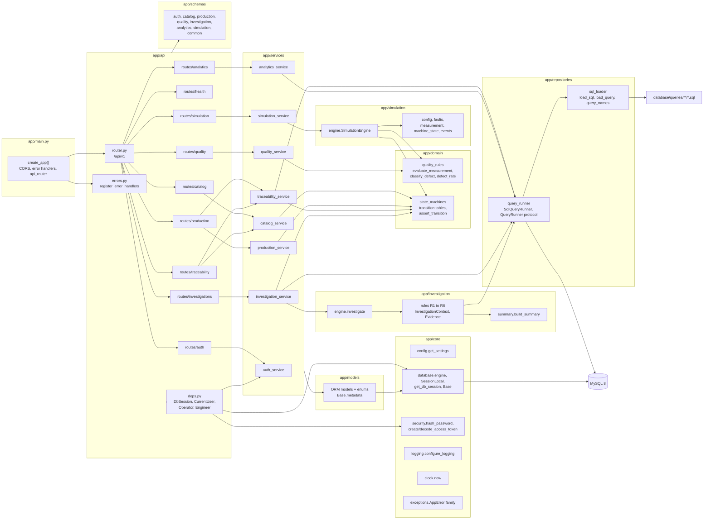
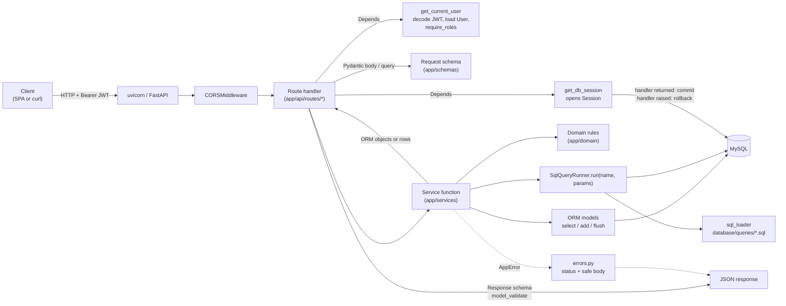
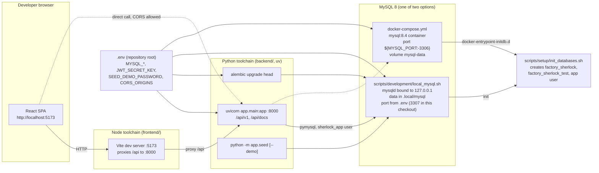

# Component design

This document describes the backend components in `backend/app`, how a request moves through them, and how the pieces are deployed on a developer machine. For the layer model and dependency rules see [system-overview.md](system-overview.md); for transaction-level sequences see [data-flow.md](data-flow.md).

## Backend component diagram

Mermaid source: [`docs/media/diagrams/backend-components.mmd`](../media/diagrams/backend-components.mmd).



## Packages and their responsibilities

### `app/main.py`

`create_app()` reads settings, configures JSON logging, builds the `FastAPI` instance (title "Factory Sherlock API", version 0.1.0, docs at `/api/docs`, OpenAPI at `/api/openapi.json`), adds `CORSMiddleware` with the configured origins and the methods `GET, POST, PATCH, DELETE, OPTIONS`, registers error handlers, and mounts `api_router`. The module-level `app` is what uvicorn serves (`app.main:app`).

### `app/core`

| Module | Main symbols | Responsibility |
|--------|--------------|----------------|
| `config.py` | `Settings`, `get_settings()` | Environment-backed configuration with computed `effective_database`, `database_url`, `cors_origin_list` |
| `database.py` | `Base`, `engine`, `SessionLocal`, `get_db_session()` | One engine per process; request-scoped session that commits on success and rolls back on error |
| `security.py` | `hash_password`, `verify_password`, `create_access_token`, `decode_access_token` | bcrypt hashing; HS256 JWT issue and verification; raises `AuthenticationError` on expired or invalid tokens; raises `RuntimeError` when `JWT_SECRET_KEY` is unset |
| `clock.py` | `now()` | Current time without microseconds, matching the precision of the `DATETIME` columns; used by the services instead of `datetime.now()` |
| `logging.py` | `JsonFormatter`, `configure_logging` | Single-line JSON logs with optional `request_id`, `user_id`, `operation` |
| `exceptions.py` | `AppError`, `NotFoundError`, `ConflictError`, `ValidationError`, `InvalidTransitionError`, `AuthenticationError`, `AuthorizationError` | Typed errors with status codes and a `details` dictionary |

### `app/api`

| Module | Main symbols | Responsibility |
|--------|--------------|----------------|
| `router.py` | `api_router` | Mounts every route module under `/api/v1` |
| `deps.py` | `DbSession`, `CurrentUser`, `get_current_user`, `require_roles`, `Operator`, `Engineer`, role frozensets (`READ_ROLES`, `OPERATOR_ROLES`, `ENGINEER_ROLES`), `Paging`, `get_page_params` | Dependency injection for session, authenticated user, role guards, and the `limit`/`offset` query parameters of paginated lists |
| `errors.py` | `register_error_handlers` | Maps `AppError`, `RequestValidationError`, `IntegrityError`, `OperationalError`, and `Exception` to JSON responses |
| `routes/health.py` | `health` | `GET /health`, runs `SELECT 1` |
| `routes/auth.py` | `login`, `me` | `POST /auth/login`, `GET /auth/me` |
| `routes/catalog.py` | product, machine, material lot, defect type handlers | Products (list, create, get, patch), machines (list, create, get, status change, events), material lots (list, create), defect types (list) |
| `routes/production.py` | order and batch handlers | Production orders (list with status filter, create, get, patch, status change) and production batches (list with order and machine filters, create, get, complete, quarantine) |
| `routes/quality.py` | `list_inspections`, `record_inspection`, `quality_summary` | Inspections and the aggregated quality summary |
| `routes/investigations.py` | `list_investigations`, `open_investigation`, `get_investigation`, `change_status` | Investigation lifecycle |
| `routes/traceability.py` | `forward_trace`, `backward_trace`, `quarantine_lot` | Lot forward trace, serial backward trace, lot quarantine |
| `routes/analytics.py` | `list_queries`, `run_query`, `recent_alerts`, `acknowledge_alert` | SQL explorer catalog (`QueryCatalogEntry`, 12 entries, 7 runnable), parameterised dashboard queries (`QueryResult`), alerts |
| `routes/simulation.py` | `run_simulation` | `POST /simulation/runs` |

Role requirements as implemented in the route signatures:

| Dependency | Roles allowed | Used by |
|------------|---------------|---------|
| `CurrentUser` | ADMIN, ENGINEER, OPERATOR, VIEWER | All reads, `auth/me`, alert list |
| `Operator` | ADMIN, ENGINEER, OPERATOR | Machine status change, order status change, batch create, batch complete, inspection record, alert acknowledge |
| `Engineer` | ADMIN, ENGINEER | Product create and update, machine create, material lot create, order create and update, batch quarantine, lot quarantine, investigation open and status change, simulation run |

ADMIN is a member of every write set. No route is admin-only, so `deps.py` defines no separate admin guard. A VIEWER can read everything but receives 403 on every mutating route, including alert acknowledgement.

#### Pagination contract

Six list endpoints read from tables that grow with every simulation run and therefore return one page at a time: `GET /production-orders`, `GET /production-batches`, `GET /inspections`, `GET /investigations`, `GET /machines/{machine_id}/events`, and `GET /analytics/alerts`. Each accepts `limit` (default 50, between 1 and 500) and `offset` (default 0, at least 0) in addition to its existing filters, and answers with the `Page[T]` envelope from `schemas/common.py`:

```json
{"items": [...], "total": 123, "limit": 50, "offset": 0}
```

`total` counts every row that matches the filters, ignoring `limit` and `offset`. Values outside the allowed ranges are rejected with 422; an `offset` beyond the last row returns an empty `items` list with the unchanged `total`. The query parameters are parsed once by `get_page_params` in `deps.py` into a frozen `PageParams`; services pass it to `repositories.pagination.paginate`, which runs a `SELECT COUNT(*)` over the filtered statement (ordering removed) and then the windowed statement. Every paginated ordering ends in `id` so that two requests with adjacent offsets never overlap or skip a row when timestamps tie. Catalog lists (products, machines, material lots, defect types) and the SQL query catalogue stay plain arrays because they are small and bounded.

### `app/schemas`

Pydantic v2 models. Input models set `extra="forbid"` so unknown fields are rejected; response models extend `ApiModel` (`from_attributes=True`) so they can be built from ORM objects. `common.py` also defines the generic `Page[T]` envelope (`items`, `total`, `limit`, `offset`) used by the paginated list endpoints, and `ErrorResponse`, which is attached to every route through `responses=` in `main.py` (401, 403, 404, 409, 422), so the OpenAPI document carries error schemas. `analytics.py` defines `QueryCatalogEntry` (`name`, `description`, `sql`, `runnable`, `parameters`) and `QueryResult` (`query`, `sql`, `params`, `rows`), used as `response_model` of the two analytics query endpoints. `EvidenceRead` in `investigation.py` rebuilds ordered row dictionaries from the stored `{"columns", "rows"}` JSON so the API returns a list of row objects in SQL column order. Codes (product, machine, lot, order number) share the pattern `^[A-Z0-9][A-Z0-9_-]{1,29}$`.

### `app/services`

| Module | Main functions | Notes |
|--------|----------------|-------|
| `auth_service.py` | `authenticate`, `get_active_user` | Same error for unknown user and wrong password; logs `login accepted` or `login rejected` with `operation` |
| `catalog_service.py` | `list_products`, `get_product`, `create_product`, `update_product`, `list_machines`, `get_machine`, `create_machine`, `change_machine_status`, `list_machine_events`, `list_material_lots`, `get_material_lot`, `create_material_lot`, `list_defect_types`, `_flush_or_conflict` | Machine status change records a `MachineEvent` of type `STATE_CHANGE` in the same transaction |
| `production_service.py` | `list_orders`, `get_order`, `create_order`, `update_order`, `change_order_status`, `list_batches`, `get_batch`, `next_batch_number`, `create_batch`, `complete_batch` | `create_batch` validates order state, machine assignment, remaining quantity, lot availability and uniqueness; creates batch, `BatchMaterial` rows, and `ProductionUnit` rows |
| `quality_service.py` | `record_inspection`, `to_read`, `list_inspections`, `quality_summary` | Pass or fail is computed server-side from the specification; defect codes are validated against `defect_types` |
| `traceability_service.py` | `forward_trace`, `backward_trace`, `quarantine_batch`, `quarantine_lot` | Traces run SQL files 04 and 05; quarantine writes an `Alert` |
| `investigation_service.py` | `list_investigations`, `get_investigation`, `open_investigation`, `change_status` | Runs `investigate()` and persists evidence and batch links; closing requires a conclusion |
| `analytics_service.py` | `run_dashboard_query`, `list_query_catalog`, `recent_alerts`, `acknowledge_alert` | `DASHBOARD_QUERIES` whitelists seven queries and their parameters |
| `simulation_service.py` | `load_catalog`, `to_config`, `run_simulation`, `persist`, `_next_run_tag` | Maps `SimulationOutput` to ORM rows; order numbers `SIMnnnn-<machine>-nn` |

### `app/domain`

`quality_rules.py`: `evaluate_measurement(measured, target, tolerance, characteristic)` returns an `Evaluation` (result, deviation, defect code). `classify_defect` maps diameter characteristics to `OVERSIZE_DIAMETER` or `UNDERSIZE_DIAMETER`, `hole_position` to `HOLE_POSITION_DEVIATION`, and everything else to `DIMENSIONAL_DEVIATION`. `defect_rate(failed, inspected)` is the single definition used by the API, the simulator, and the investigation engine.

`state_machines.py`: `MACHINE_TRANSITIONS`, `ORDER_TRANSITIONS`, `BATCH_TRANSITIONS`, `INVESTIGATION_TRANSITIONS`, and the generic `assert_transition(table, current, target, entity=...)` that raises `InvalidTransitionError` with the allowed targets in `details`.

### `app/simulation`

| Module | Main symbols | Responsibility |
|--------|--------------|----------------|
| `config.py` | `FaultKind`, `FaultScenario`, `SimulationConfig`, `SpecRef`, `ProductRef`, `MachineRef`, `Catalog` | Frozen inputs; constructors validate minimums |
| `engine.py` | `SimulationEngine.run`, `_run_machine`, `_make_order`, `_product_for`, `_inject_fault`, `_produce_batch`, `_inspect` | Drives each machine through `batches_per_machine` batches; one order per `batches_per_order` batches; raises `HIGH_DEFECT_RATE` alerts when a batch reaches `alert_defect_rate` |
| `faults.py` | `ActiveFault`, `MeasurementEffect`, `combined_effect`, tuning constants | How each fault distorts measurements relative to tolerance |
| `measurement.py` | `MeasurementGenerator.generate` | Normal distribution with sigma of one third of tolerance, plus fault offset, spread, and gross defects |
| `machine_state.py` | `MachineStateTracker` | In-memory state tracker using the shared `MACHINE_TRANSITIONS` table |
| `events.py` | `StateChange`, `FaultEvent`, `SimulatedInspection`, `SimulatedUnit`, `SimulatedBatch`, `SimulatedOrder`, `SimulatedAlert`, `SimulationOutput` | Plain dataclasses returned by the engine |

### `app/investigation`

| Module | Main symbols | Responsibility |
|--------|--------------|----------------|
| `rules.py` | `RuleThresholds`, `InvestigationContext`, `Evidence`, `rule_defect_rate_elevation` (R1), `rule_dominant_defect` (R2), `rule_defect_onset` (R3), `rule_related_machine_events` (R4), `rule_affected_batches` (R5), `rule_shared_material_lots` (R6), `RULES` | Each rule runs one named query and returns an evidence card or `None` |
| `engine.py` | `InvestigationReport`, `investigate` | Runs `RULES` in order, collects evidence, builds the summary |
| `summary.py` | `build_summary` | Writes the summary from the context; wording describes associations, not causes |

Rule to query mapping: R1 `machine_defect_rate_comparison` (file 01), R2 `recurring_defects` (03), R3 `investigation.defect_onset`, R4 `investigation.machine_events_before_onset`, R5 `batches_requiring_review` (08), R6 `investigation.shared_material_lots`. R3, R4, and R6 are skipped when their preconditions (machine selected, onset found, affected batches present) are not met.

### `app/repositories`

`sql_loader.py` builds a cached catalog of every `.sql` file under `database/queries` (`QUERIES_DIR` resolves relative to the backend package, three levels up). `load_sql(name)` returns the raw text including the comment header; `load_query(name, expanding=...)` returns a SQLAlchemy `TextClause` with expanding bind parameters where needed; `query_names()` lists the catalog; `UnknownQueryError` is a `KeyError`. `query_runner.py` defines the `QueryRunner` protocol (`run`, `sql`) and `SqlQueryRunner`, which executes a query with a dictionary of parameters and converts `Decimal`, `date`, `datetime`, and `bytes` values into JSON-friendly Python types. `EXPANDING_PARAMS` registers `batch_ids` for `investigation.shared_material_lots`. `pagination.py` defines the frozen `PageParams` and `PageResult[T]` dataclasses and `paginate(session, stmt, paging)`, which issues the count and the windowed select for the paginated list endpoints.

### `app/models`

One module per aggregate. `__init__.py` imports every model so that importing the package registers all 17 tables on `Base.metadata` (Alembic's `env.py` relies on this). `base_mixins.TimestampMixin` adds `created_at` and `updated_at` with server defaults. `enums.py` holds the ten `StrEnum`s that become MySQL `ENUM` columns. Relationship loading is explicit: services use `selectinload` for collections they return (specifications, material links, evidence, batch links, defect links).

### `app/seed.py`

Command-line entry point (`uv run python -m app.seed [--demo]`). Applies `database/seeds/01_reference_data.sql` statement by statement, creates or refreshes the four demo accounts (`admin`, `engineer`, `operator`, `viewer`) with `SEED_DEMO_PASSWORD`, and with `--demo` runs `database/seeds/demo_scenario.json` through `simulation_service.run_simulation`. Everything runs in one session and is committed once; the command refuses to run without `SEED_DEMO_PASSWORD`.

## Request flow

Every request follows the same path. The diagram shows the general shape; concrete sequences are in [data-flow.md](data-flow.md).



Step by step:

1. `CORSMiddleware` handles preflight and origin checks using `Settings.cors_origin_list`.
2. FastAPI resolves dependencies. `DbSession` opens a `Session` from `SessionLocal`. `CurrentUser` reads the `Authorization: Bearer` header, decodes the token with `decode_access_token`, parses `sub` as the user id, and calls `auth_service.get_active_user`; an inactive or missing user yields 401. Role dependencies (`Operator`, `Engineer`) wrap `CurrentUser` and yield 403 with the required roles in `details` when the role is not allowed.
3. The request body or query parameters are validated by the schema; failures return 422 with per-field messages.
4. The route calls exactly one service function with the session and validated input.
5. The service loads rows with ORM `select` or `session.get`, applies domain rules (state transitions, measurement evaluation), writes ORM objects, or runs a named SQL file through `SqlQueryRunner`. It calls `session.flush()` where ids are needed or where a uniqueness violation should surface as a 409.
6. The route converts the result with `Schema.model_validate(obj)` (or a hand-built schema such as `quality_service.to_read`) and returns it.
7. `get_db_session` commits when the handler returns and rolls back when it raises. Error handlers in `errors.py` produce the response body for any exception.

## Local deployment architecture

Mermaid source: [`docs/media/diagrams/local-deployment.mmd`](../media/diagrams/local-deployment.mmd).



Notes on the two MySQL options:

- `scripts/development/local_mysql.sh {init|start|stop|status|shell}` runs a private `mysqld` without Docker. State lives in `.local/mysql` (ignored by Git), the server binds to loopback, uses `utf8mb4`, strict SQL mode, and the port from `.env`. In this checkout `.env` sets `MYSQL_PORT=3307` to avoid clashing with any system MySQL on 3306; `.env.example` ships with 3306. `init` initialises the data directory with a passwordless root (loopback only, never used by the application) and then runs `scripts/setup/init_databases.sh` over the socket.
- `docker-compose.yml` starts `mysql:8.4` with the same character set and SQL mode, publishes `${MYSQL_PORT:-3306}` on `127.0.0.1` only, and mounts `scripts/setup/init_databases.sh` as `/docker-entrypoint-initdb.d/01_init.sh`. The container receives only `MYSQL_ROOT_PASSWORD`, the application values as `APP_DB_NAME`, `APP_DB_USER`, and `APP_DB_PASSWORD` (not `MYSQL_DATABASE` or `MYSQL_USER`, which would make the image grant the user `ALL`), and `MYSQL_ROOT_ARGS` and `MYSQL_CLIENT_ARGS` because the entrypoint's temporary server listens only on its local socket; the healthcheck pings over TCP so the container is healthy only after the init script has run. The compose file has not been executed on this machine because Docker is not installed, so this path is unverified.

The backend is started from `backend/` with `uv run uvicorn app.main:app --reload` (or `make backend`). Interactive API documentation is served at `http://localhost:8000/api/docs`. The frontend is started from `frontend/` with `pnpm dev` (or `make frontend`); `vite.config.ts` sets the port to 5173 and proxies `/api` to `http://127.0.0.1:8000`, so the SPA calls same-origin paths under `/api/v1` during development. The frontend application is implemented: a routed screen exists for login, overview, machines, orders, batches, inspections, traceability, the investigations list, the investigation detail case board, analytics with the SQL explorer, and simulation, with Vitest tests alongside the code.

The root `Makefile` wraps these commands (`db-init`, `db-start`, `db-stop`, `migrate`, `seed`, `seed-demo`, `reset-demo`, `backend`, `frontend`, `test-backend`, `test-frontend`, `lint`, `format`, `export-schema`, `export-openapi`, `render-diagrams`, `check-docs`).
