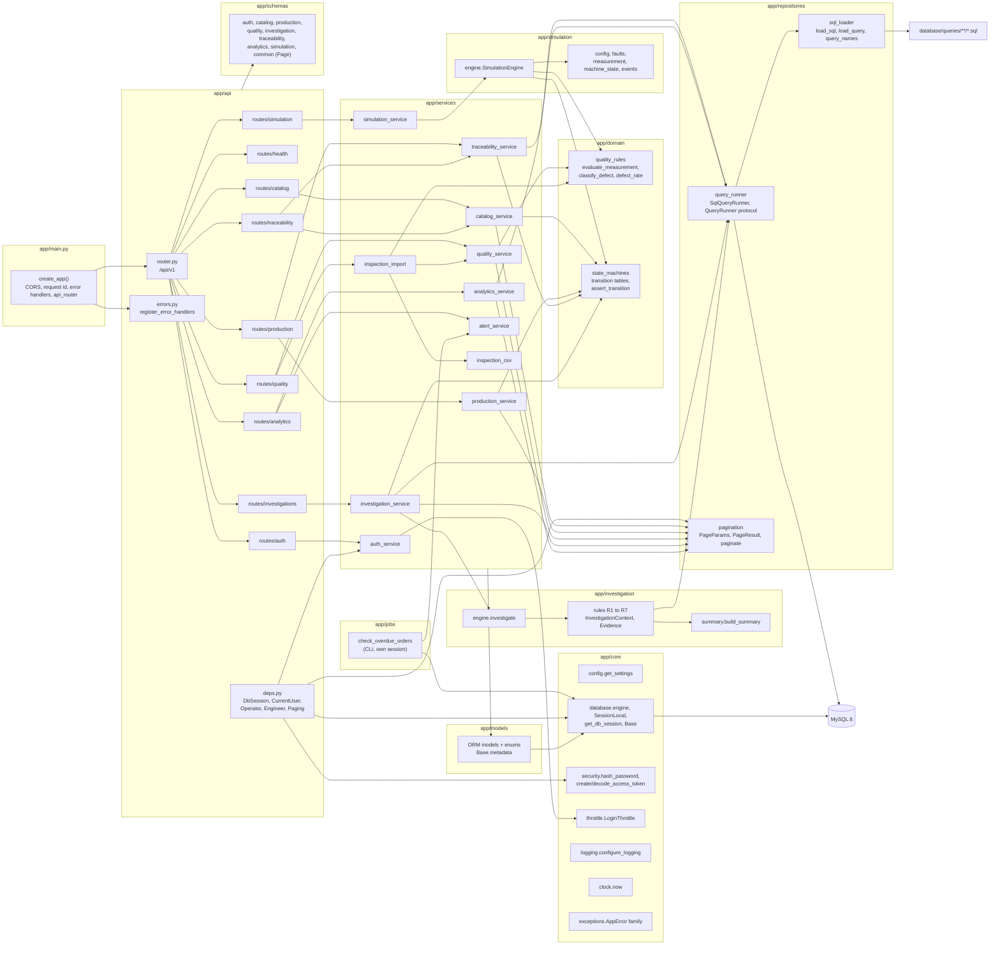
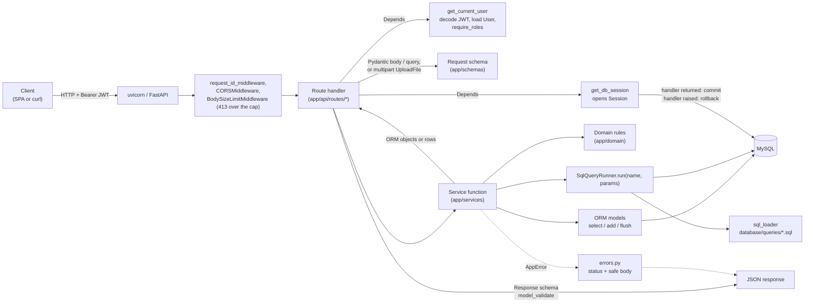
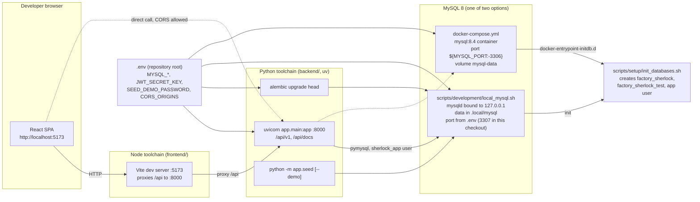

# Component design

This document describes the backend components in `backend/app`, how a request moves through them, and how the pieces are deployed on a developer machine. For the layer model and dependency rules see [system-overview.md](system-overview.md); for transaction-level sequences see [data-flow.md](data-flow.md).

## Backend component diagram

Mermaid source: [`docs/media/diagrams/backend-components.mmd`](../media/diagrams/backend-components.mmd).



## Packages and their responsibilities

### `app/main.py`

`create_app()` reads settings, configures JSON logging, builds the `FastAPI` instance (title "Factory Sherlock API", version 0.1.0, docs at `/api/docs`, OpenAPI at `/api/openapi.json`; both are disabled when `APP_ENV` is `production`), adds `BodySizeLimitMiddleware` (`app/api/body_limit.py`; registered first, so Starlette places it innermost: a request body over 64 KiB, or over 1 MiB + 64 KiB for `POST /api/v1/inspections/import`, is answered with 413 before authentication and before the body is parsed), adds `CORSMiddleware` with the configured origins, the methods `GET, POST, PATCH, DELETE, OPTIONS`, and the headers `Authorization` and `Content-Type`, registers `request_id_middleware` (outermost, so the 413 also carries `X-Request-ID`), registers error handlers, and mounts `api_router` with the shared 422, 500, and 503 error responses. The module-level `app` is what uvicorn serves (`app.main:app`).

### `app/core`

| Module | Main symbols | Responsibility |
|--------|--------------|----------------|
| `config.py` | `Settings`, `get_settings()` | Environment-backed configuration with computed `effective_database`, `database_url`, `cors_origin_list`; `login_max_failures` (default 5) and `login_window_seconds` (default 900) for the throttle |
| `database.py` | `Base`, `engine`, `SessionLocal`, `get_db_session()` | One engine per process; request-scoped session that commits on success and rolls back on error |
| `security.py` | `hash_password`, `verify_password`, `create_access_token`, `decode_access_token` | bcrypt hashing; HS256 JWT issue and verification; raises `AuthenticationError` on expired or invalid tokens; raises `RuntimeError` when `JWT_SECRET_KEY` is unset |
| `throttle.py` | `LoginThrottle` (`check(account)`, `record_failure(account, client_ip)`, `record_success(account)`, `reset`, `tracked_keys`, `pending_slots`), `account_key`, `normalise_username`, `get_login_throttle()` | Sliding-window count of failed logins per account (user id when known, otherwise the NFKD, mark-stripped, casefolded username) and per client address, in a lock-guarded dictionary in one process; `check` reserves a slot and raises `RateLimitedError` when the account is over the limit; `record_failure` counts the address and raises `RateLimitedError` when the address was already over the limit, so a correct password is never blocked by the address alone; a `None` address skips the address dimension; expired stamps are pruned on every call; time comes from `clock.now()`; `get_login_throttle` is cached with `lru_cache` |
| `clock.py` | `now()` | Current time without microseconds, matching the precision of the `DATETIME` columns; used by the services and the throttle instead of `datetime.now()` |
| `logging.py` | `JsonFormatter`, `configure_logging`, `LOGGED_FIELDS` | Single-line JSON logs; the allowlisted record fields `request_id`, `user_id`, `operation`, `error`, `status`, and `retry_after_seconds` are emitted when present |
| `mysql_errors.py` | `MYSQL_DUPLICATE_KEY` (1062), `driver_args`, `mysql_error_code` | Reads the `(errno, message)` pair pymysql attaches to a wrapped SQLAlchemy error; shared by `catalog_service._flush_or_conflict`, `inspection_import`, and `api/errors.py` |
| `exceptions.py` | `AppError`, `NotFoundError`, `ConflictError`, `ValidationError`, `InvalidTransitionError`, `AuthenticationError`, `AuthorizationError`, `RateLimitedError` | Typed errors with status codes and a `details` dictionary; `RateLimitedError` (429) also carries `retry_after_seconds` |

### `app/api`

| Module | Main symbols | Responsibility |
|--------|--------------|----------------|
| `router.py` | `api_router` | Mounts every route module under `/api/v1` |
| `deps.py` | `DbSession`, `CurrentUser`, `get_current_user`, `require_roles`, `Operator`, `Engineer`, role frozensets (`READ_ROLES`, `OPERATOR_ROLES`, `ENGINEER_ROLES`), `Paging`, `get_page_params` | Dependency injection for session, authenticated user, role guards, and the `limit`/`offset` query parameters of paginated lists |
| `request_id.py` | `REQUEST_ID_HEADER`, `request_id_middleware`, `request_id_of` | Stores a 12 character id on `request.state` and returns it in `X-Request-ID` on every response |
| `errors.py` | `register_error_handlers`, `classify_integrity`, `classify_operational`, `classify_data`, `ErrorMapping` | Maps `AppError` (with `Retry-After` for `RateLimitedError`), `RequestValidationError`, `IntegrityError` (1062 to 409, 1452 to 422, else 500), `OperationalError` and `sqlalchemy.exc.TimeoutError` (1205 and 1213 to 409; 3819 check constraint to 422 with `details.constraint` parsed from the driver message; 2002, 2003, 2006, 2013 and pool timeouts to 503 "The database is not reachable"; any other `OperationalError` to 503 "The database is unavailable"), `DataError` (1406 data too long to 422, else 500), and `Exception` (500) to JSON responses carrying the request id; the `classify_*` functions are pure and unit tested in `tests/unit/test_error_mapping.py` |
| `body_limit.py` | `BodySizeLimitMiddleware`, `body_limit_for`, `DEFAULT_BODY_LIMIT` (64 KiB), `IMPORT_BODY_LIMIT` (1 MiB + 64 KiB), `PayloadTooLarge` | Pure ASGI request body cap: a declared `Content-Length` over the route's cap is answered with 413 before the application runs; a chunked body is counted per `http.request` message and cut off with 413 once it passes the cap; body `{"error": "payload_too_large", "message", "details": {"limit_bytes"}, "request_id"}` |
| `routes/health.py` | `health` | `GET /health`, runs `SELECT 1` |
| `routes/auth.py` | `login`, `me`, `_client_ip` | `POST /auth/login` (passes `request.client.host`, or `None` when the server reports no peer, to the throttle; uvicorn is started with `--no-proxy-headers` so this is the TCP peer; documents 429), `GET /auth/me` |
| `routes/catalog.py` | product, specification, machine, material lot, defect type handlers | Products (list, create, get, patch), specifications (flat list `GET /specifications` as `SpecificationListItem`), machines (list, create, get, status change, paged events), material lots (list, create), defect types (list) |
| `routes/production.py` | order and batch handlers, `order_status_counts` | Production orders (paged list with status filter, create, `GET /production-orders/status-counts` returning `{"PLANNED": n, "RELEASED": n, "IN_PROGRESS": n, "COMPLETED": n, "CANCELLED": n}` from one `GROUP BY` with every status present, get, patch, status change) and production batches (paged list with order, machine, and repeatable `status` filters applied in SQL before pagination; each batch carries its parent `order_number`; create, get, complete, quarantine) |
| `routes/quality.py` | `list_inspections`, `record_inspection`, `import_inspections`, `quality_summary` | Paged inspections, manual entry, CSV import (`POST /inspections/import`, multipart `file`, 201 with `InspectionImportResult`), and the aggregated quality summary |
| `routes/investigations.py` | `list_investigations`, `open_investigation`, `get_investigation`, `change_status` | Investigation lifecycle; the list is paged and takes a repeatable `status` filter (`OPEN`, `IN_REVIEW`, `CLOSED`; any of the given values) applied before the count |
| `routes/traceability.py` | `forward_trace`, `backward_trace`, `quarantine_lot` | Lot forward trace (`ForwardTraceRead`), serial backward trace (`BackwardTraceRead`), lot quarantine (`LotQuarantineRead`) |
| `routes/analytics.py` | `list_queries`, `run_query`, `recent_alerts`, `acknowledge_alert`, `check_overdue_orders` | SQL explorer catalog (`QueryCatalogEntry`, 14 entries, 8 runnable), parameterised dashboard queries (`QueryResult`; `specification_id` added for the control chart), paged alerts, acknowledgement, and `POST /analytics/alerts/checks/overdue-orders` (no request body, `OverdueCheckResponse`) |
| `routes/simulation.py` | `run_simulation` | `POST /simulation/runs` |

Role requirements as implemented in the route signatures:

| Dependency | Roles allowed | Used by |
|------------|---------------|---------|
| `CurrentUser` | ADMIN, ENGINEER, OPERATOR, VIEWER | All reads, `auth/me`, alert list |
| `Operator` | ADMIN, ENGINEER, OPERATOR | Machine status change, order status change, batch create, batch complete, inspection record, inspection import, alert acknowledge, overdue order check |
| `Engineer` | ADMIN, ENGINEER | Product create and update, machine create, material lot create, order create and update, batch quarantine, lot quarantine, investigation open and status change, simulation run |

ADMIN is a member of every write set. No route is admin-only, so `deps.py` defines no separate admin guard. A VIEWER can read everything but receives 403 on every mutating route, including alert acknowledgement.

#### Pagination contract

Six list endpoints read from tables that grow with every simulation run and therefore return one page at a time: `GET /production-orders`, `GET /production-batches`, `GET /inspections`, `GET /investigations`, `GET /machines/{machine_id}/events`, and `GET /analytics/alerts`. Each accepts `limit` (default 50, between 1 and 500) and `offset` (default 0, between 0 and `MAX_OFFSET` = 1,000,000) in addition to its existing filters, and answers with the `Page[T]` envelope from `schemas/common.py`:

```json
{"items": [...], "total": 123, "limit": 50, "offset": 0}
```

`total` counts every row that matches the filters, ignoring `limit` and `offset`. Values outside the allowed ranges are rejected with 422; an `offset` beyond the last row returns an empty `items` list with the unchanged `total`. The query parameters are parsed once by `get_page_params` in `deps.py` into a frozen `PageParams`; services pass it to `repositories.pagination.paginate`, which runs a `SELECT COUNT(*)` over the filtered statement (ordering removed) and then the windowed statement, and return a `PageResult` (`items`, `total`). The route builds the envelope with `Page[T].from_result(result, paging, convert)`, where `convert` is the response model's `model_validate` or, for inspections, `quality_service.to_read`. Every paginated ordering ends in `id` (`created_at desc, id desc` for orders, alerts, and investigations; `started_at desc, id desc` for batches; `inspected_at desc, id desc` for inspections; `occurred_at desc, id desc` for machine events) so that two requests with adjacent offsets never overlap or skip a row when timestamps tie. `GET /production-batches` and `GET /investigations` also take a repeatable `status` parameter; the values go into the `WHERE` clause before the count, so `total` reflects the filter and an unknown value is a 422. Catalog lists (products, specifications, machines, material lots, defect types) and the SQL query catalogue stay plain arrays because they are small and bounded. On the frontend, `components/ui/Pagination.tsx` renders the range text, the previous and next buttons, and the page-size selector (25, 50, 100) from the envelope and, when `offset` is at or past `total`, shows the last page that has rows and calls `onChange` with that offset; `hooks/usePageState.ts` holds `limit` and `offset` per screen and resets the offset when a filter changes; lookups request `limit=500`; the Overview and Analytics screens read order counts from `GET /production-orders/status-counts` (`useOrderStatusCounts`), and the Overview reads the open investigation count from the `total` of a one-row page filtered by `status=OPEN&status=IN_REVIEW` (`useOpenInvestigationCount`). The contract is tested end to end by `tests/api/test_pagination_api.py` and `tests/api/test_status_filters_api.py`.

### `app/schemas`

Pydantic v2 models. Input models set `extra="forbid"` so unknown fields are rejected; response models extend `ApiModel` (`from_attributes=True`) so they can be built from ORM objects. `common.py` also defines the generic `Page[T]` envelope (`items`, `total`, `limit`, `offset`) with its `from_result` constructor, and `ErrorResponse` (`error`, `message`, `details`, `request_id`), which is attached to the routes through `responses=` in `main.py` (422, 500, 503) and `router.py` (401, 403, 404, 409 for the protected routers), so the OpenAPI document carries error schemas. `analytics.py` defines `QueryCatalogEntry` (`name`, `description`, `sql`, `runnable`, `parameters`), `QueryResult` (`query`, `sql`, `params`, `rows`), and `OverdueCheckResponse` (`checked`, `raised`, `alerts`); the overdue check has no request model. `production.py` adds `OrderStatusCounts` (one integer field per `OrderStatus` value; `tests/unit/test_schemas.py` keeps it in step with the enum) and gives `ProductionBatchRead` an `order_number` field read from the loaded `order` relationship through `AliasPath("order", "order_number")`. `catalog.py` adds `SpecificationListItem` (specification fields plus `product_id` and `product_code`) for the control chart picker. `quality.py` adds `InspectionImportResult` (`imported`, `failed_inspections`, `inspection_ids`). `traceability.py` types the trace responses (`ForwardTraceRead` with `ForwardTraceRow` items, `BackwardTraceRead` with `BackwardTraceRow` items, `LotQuarantineRead`). `AlertRead` in `investigation.py` exposes `production_order_id`, and `EvidenceRead` rebuilds ordered row dictionaries from the stored `{"columns", "rows"}` JSON so the API returns a list of row objects in SQL column order. Codes (product, machine, lot, order number, defect type codes in the CSV import) share the pattern `^[A-Z0-9][A-Z0-9_-]{1,29}$`.

### `app/services`

| Module | Main functions | Notes |
|--------|----------------|-------|
| `auth_service.py` | `authenticate(session, username, password, client_ip)`, `get_active_user` | Looks the user up, calls `LoginThrottle.check` with the account key (user id or normalised username) before the bcrypt check, verifies against a fixed placeholder hash when the user is unknown so timing does not reveal usernames, records a failure (with the client address) or a success on the throttle; same error for unknown user, inactive user, and wrong password; logs `login accepted` or `login rejected` with `operation` |
| `catalog_service.py` | `list_products`, `get_product`, `create_product`, `update_product`, `list_specifications`, `list_machines`, `get_machine`, `create_machine`, `change_machine_status`, `list_machine_events(session, machine_id, paging)`, `list_material_lots`, `get_material_lot`, `create_material_lot`, `list_defect_types`, `_flush_or_conflict` | Machine status change records a `MachineEvent` of type `STATE_CHANGE` in the same transaction; `list_specifications` joins the product and orders by product code then characteristic; machine events are paged |
| `production_service.py` | `list_orders(session, paging, status=)`, `count_orders_by_status`, `get_order`, `create_order`, `update_order`, `change_order_status`, `list_batches(session, paging, order_id=, machine_id=, statuses=)`, `get_batch`, `next_batch_number`, `create_batch`, `complete_batch`, `_BATCH_LOAD` | `create_batch` validates order state, machine assignment, remaining quantity, lot availability and uniqueness; creates batch, `BatchMaterial` rows, and `ProductionUnit` rows; both lists return `PageResult`; `count_orders_by_status` runs `SELECT status, COUNT(*) ... GROUP BY status` and fills missing statuses with 0; `_BATCH_LOAD` (`selectinload` of `material_links` and `order`) is shared by `list_batches` and `get_batch`, so `order_number` costs one extra statement per page, not one per row |
| `quality_service.py` | `record_inspection`, `to_read`, `list_inspections(session, paging, batch_id=, result=)`, `quality_summary` | Pass or fail is computed server-side from the specification; defect codes are validated against `defect_types`; the CSV import evaluates each row with the same `evaluate_measurement` call but writes in bulk (see `inspection_import.py`) |
| `inspection_csv.py` | `REQUIRED_COLUMNS`, `OPTIONAL_COLUMNS`, `MAX_FILE_BYTES` (1 MiB), `MAX_DATA_ROWS` (5000), `MAX_DEFECT_CODES` (10), `MAX_HEADER_ECHO` (50), `MEASURED_FORMAT`, `RowError`, `ImportRow`, `parse_csv`, `import_error`, `file_error` | Pure parser over `csv.reader(strict=True)` (a broken CSV structure is a file-level 422, not a crash): header check (unknown, duplicate, or missing columns reject the file; unknown names are echoed cut to 50 characters, blank cells as `(blank column N)`), per-field parsing with messages that name the row and column (`measured_value` must match `[+-]?[0-9]+(\.[0-9]{1,3})?`: ASCII digits, optional sign, no exponent), serial numbers upper-cased, in-file duplicate detection on (upper-cased `serial_number`, lower-cased `characteristic`), blank lines skipped, rows numbered by record position; never opens a session and logs nothing |
| `inspection_import.py` | `ACCEPTED_CONTENT_TYPES`, `BULK_CHUNK_SIZE` (1000), `import_csv(session, content, content_type=, filename=)`, `decode_upload`, `_resolve_rows`, `_load_lookups`, `_resolve_row`, `_rule_errors`, `_Planned`, `_write_inspections`, `_insert_plans`, `_bulk_insert`, `_race_error` | Decodes the upload (`utf-8-sig`), parses it, resolves serial numbers to units and products, characteristics to specifications, checks defect codes, existing inspections, and codes on passing measurements (one query per lookup table), evaluates every row in memory with `domain.quality_rules.evaluate_measurement`, then either raises one 422 with every row error in `details.errors` or writes the rows inside a savepoint with chunked multi-row `INSERT`s: `inspections` first, ids selected back by (`unit_id`, `specification_id`), then `inspection_defects`; a duplicate-key error (1062) during the write rolls back to the savepoint, re-reads the pairs with a locking read, and reports the rows another transaction recorded first as a 422 row error; any other integrity error is re-raised for `api/errors.py` |
| `traceability_service.py` | `forward_trace`, `backward_trace`, `quarantine_batch`, `quarantine_lot` | Traces run SQL files 04 and 05; quarantine writes an `Alert` |
| `investigation_service.py` | `list_investigations(session, paging, statuses=)`, `get_investigation`, `open_investigation`, `evidence_payload`, `change_status` | Runs `investigate()` and persists evidence and batch links; closing requires a conclusion; the list is paged and `statuses` becomes `WHERE status IN (...)` before `paginate` |
| `analytics_service.py` | `run_dashboard_query`, `list_query_catalog`, `recent_alerts(session, paging)`, `acknowledge_alert` | `DASHBOARD_QUERIES` whitelists eight queries and their parameters; `characteristic_control_chart` requires `specification_id` (422 without it); alerts are paged |
| `alert_service.py` | `OPEN_ORDER_STATES`, `CRITICAL_AFTER_DAYS` (2), `OverdueCheckResult`, `days_late`, `overdue_severity`, `overdue_message`, `overdue_orders`, `raise_overdue_order_alerts(session, as_of=)` | Selects open orders (not `COMPLETED` or `CANCELLED`) with `due_date` before the check date, skips orders that already have an unacknowledged `ORDER_OVERDUE` alert, and adds one `Alert` per remaining order with `production_order_id`, `WARNING` up to two days late and `CRITICAL` from the third day, stamped with the check date (server clock, or `as_of` from the job); reads the orders and their open alerts with `SELECT ... FOR UPDATE` so concurrent checks serialise; flushes, never commits |
| `simulation_service.py` | `load_catalog`, `to_config`, `run_simulation`, `persist`, `_next_run_tag`, `_persist_orders`, `_persist_batches`, `_complete_orders`, `_unit_rows`, `_unit_ids_by_serial`, `_inspection_rows`, `_inspection_ids_by_unit_and_spec`, `_defect_rows`, `_event_rows`, `_persist_alerts`, `_bulk_insert`, `BULK_CHUNK_SIZE` (1000) | Orders, batches, and alerts go through the ORM; units, inspections, inspection defects, and machine events go through chunked multi-row `INSERT`s, with ids selected back by serial number and by (`unit_id`, `specification_id`); order numbers `SIMnnnn-<machine>-nn` |

### `app/domain`

`quality_rules.py`: `evaluate_measurement(measured, target, tolerance, characteristic)` returns an `Evaluation` (result, deviation, defect code). `classify_defect` maps diameter characteristics to `OVERSIZE_DIAMETER` or `UNDERSIZE_DIAMETER`, `hole_position` to `HOLE_POSITION_DEVIATION`, and everything else to `DIMENSIONAL_DEVIATION`. `defect_rate(failed, inspected)` is the single definition used by the API, the simulator, and the investigation engine.

`state_machines.py`: `MACHINE_TRANSITIONS`, `ORDER_TRANSITIONS`, `BATCH_TRANSITIONS`, `INVESTIGATION_TRANSITIONS`, and the generic `assert_transition(table, current, target, entity=...)` that raises `InvalidTransitionError` with the allowed targets in `details`.

### `app/simulation`

| Module | Main symbols | Responsibility |
|--------|--------------|----------------|
| `config.py` | `FaultKind`, `FaultScenario`, `SimulationConfig`, `SpecRef`, `ProductRef`, `MachineRef`, `Catalog` | Frozen inputs; constructors validate minimums |
| `engine.py` | `SimulationEngine.run`, `_run_machine`, `_make_order`, `_product_for`, `_inject_fault`, `_produce_batch`, `_inspect` | Drives each machine through `batches_per_machine` batches; one order per `batches_per_order` batches; raises `HIGH_DEFECT_RATE` alerts when a batch reaches `alert_defect_rate` |
| `faults.py` | `ActiveFault`, `MeasurementEffect`, `combined_effect`, tuning constants | How each fault distorts measurements relative to tolerance |
| `measurement.py` | `MeasurementGenerator.generate` | Normal distribution with sigma of one third of tolerance, plus fault offset, spread, and gross defects |
| `machine_state.py` | `MachineStateTracker` | In-memory state tracker using the shared `MACHINE_TRANSITIONS` table |
| `events.py` | `StateChange`, `FaultEvent`, `SimulatedInspection`, `SimulatedUnit`, `SimulatedBatch`, `SimulatedOrder`, `SimulatedAlert`, `SimulationOutput` | Plain dataclasses returned by the engine |

### `app/investigation`

| Module | Main symbols | Responsibility |
|--------|--------------|----------------|
| `rules.py` | `RuleThresholds` (including `cusum_baseline_hours` 3, `cusum_decision_interval` 0.10, and the derived `cusum_allowance` of half `elevated_min_rate`), `InvestigationContext` (with `cusum_onset_time`), `Evidence`, `rule_defect_rate_elevation` (R1), `rule_dominant_defect` (R2), `rule_defect_onset` (R3), `rule_related_machine_events` (R4), `rule_affected_batches` (R5), `rule_shared_material_lots` (R6), `rule_cusum_onset` (R7) with `_cusum_rows` and `_cusum_narrative`, `RULES` | Each rule runs one named query and returns an evidence card or `None`; R7 appends `cusum` and `signal` to each hourly row in Python (one-sided CUSUM with the reference rate pooled from the first three hourly buckets) |
| `engine.py` | `InvestigationReport`, `investigate` | Runs `RULES` in order, collects evidence, builds the summary |
| `summary.py` | `build_summary`, `_onset_agreement` | Writes the summary from the context; when R3 and R7 both found an onset it states whether they fall in the same hour; wording describes associations, not causes |

Rule to query mapping: R1 `machine_defect_rate_comparison` (file 01), R2 `recurring_defects` (03), R3 `investigation.defect_onset`, R4 `investigation.machine_events_before_onset`, R5 `batches_requiring_review` (08), R6 `investigation.shared_material_lots`, R7 `investigation.hourly_defect_rates`. R3, R4, R6, and R7 are skipped when their preconditions (machine selected, onset found, affected batches present, at least three hourly rows) are not met.

### `app/repositories`

`sql_loader.py` builds a cached catalog of every `.sql` file under `database/queries` (`QUERIES_DIR` resolves relative to the backend package, three levels up). `load_sql(name)` returns the raw text including the comment header; `load_query(name, expanding=...)` returns a SQLAlchemy `TextClause` with expanding bind parameters where needed; `query_names()` lists the catalog; `UnknownQueryError` is a `KeyError`. `query_runner.py` defines the `QueryRunner` protocol (`run`, `sql`) and `SqlQueryRunner`, which executes a query with a dictionary of parameters and converts `Decimal`, `date`, `datetime`, and `bytes` values into JSON-friendly Python types. `EXPANDING_PARAMS` registers `batch_ids` for `investigation.shared_material_lots`. `pagination.py` defines the frozen `PageParams` and `PageResult[T]` dataclasses and `paginate(session, stmt, paging)`, which issues the count (over the filtered statement with `order_by(None)` as a subquery) and the windowed select for the paginated list endpoints.

### `app/models`

One module per aggregate. `__init__.py` imports every model so that importing the package registers all 17 tables on `Base.metadata` (Alembic's `env.py` relies on this). `base_mixins.TimestampMixin` adds `created_at` and `updated_at` with server defaults. `enums.py` holds the ten `StrEnum`s that become MySQL `ENUM` columns. `Alert` carries two optional references, `machine_id` (set by the simulation and the batch quarantine) and `production_order_id` (set by the overdue check; added by the second migration with the index `ix_alerts_production_order` and the named foreign key `fk_alerts_production_order`, `SET NULL` on delete). The third migration (`6c1f0d2a9b47`) adds five indexes declared in the models' `__table_args__`: `ix_inspections_time_id (inspected_at, id)`, `ix_production_batches_started_id (started_at, id)`, `ix_production_orders_created_id (created_at, id)`, and `ix_investigations_created_id (created_at, id)` match the paginated orderings, and `ix_inspections_spec_time (specification_id, inspected_at)` serves both predicates of query 10. Creating `ix_inspections_spec_time` made MySQL drop the implicit single-column `specification_id` foreign key index on `inspections`; the composite index backs the foreign key instead, and the migration's downgrade recreates the single-column index before dropping it. Relationship loading is explicit: services use `selectinload` for collections they return (specifications, material links, evidence, batch links, defect links) and `joinedload` for the product of each specification in `list_specifications`.

### `app/jobs`

Commands run on a schedule rather than per request; the package docstring states the pattern: open a session, call one service function, commit, log one JSON line. `check_overdue_orders.py` is split into `parse_args` (`--as-of`, ISO 8601, default now; it exists to replay a past check), `run_check` (opens `SessionLocal()`, calls `alert_service.raise_overdue_order_alerts`, commits, or rolls back and re-raises), and `main`, which configures logging, logs `overdue order check finished` with `checked`, `raised`, and `alert_ids` under `operation=check_overdue_orders`, and returns 0; on any exception it rolls back, logs the traceback under the same `operation`, and returns 1. `make check-overdue` wraps it; `tests/integration/test_alert_order_link.py::test_job_commits_and_exits_zero` and `test_job_rolls_back_logs_and_exits_one_on_failure` run it in process.

### `app/seed.py`

Command-line entry point (`uv run python -m app.seed [--demo]`). Applies `database/seeds/01_reference_data.sql` statement by statement, creates or refreshes the four demo accounts (`admin`, `engineer`, `operator`, `viewer`) with `SEED_DEMO_PASSWORD`, and with `--demo` runs `database/seeds/demo_scenario.json` through `simulation_service.run_simulation`. Everything runs in one session and is committed once; the command refuses to run without `SEED_DEMO_PASSWORD`.

## Request flow

Every request follows the same path. The diagram shows the general shape; concrete sequences are in [data-flow.md](data-flow.md).



Step by step:

1. `request_id_middleware` assigns the request id, `CORSMiddleware` handles preflight and origin checks using `Settings.cors_origin_list`, and `BodySizeLimitMiddleware` answers 413 before any dependency runs when the body is over the route's cap (64 KiB; 1 MiB + 64 KiB for the CSV import).
2. FastAPI resolves dependencies. `DbSession` opens a `Session` from `SessionLocal` (declared with `scope="function"`, so it closes and commits before the response is sent). `CurrentUser` reads the `Authorization: Bearer` header, decodes the token with `decode_access_token`, parses `sub` as the user id, and calls `auth_service.get_active_user`; an inactive or missing user yields 401. Role dependencies (`Operator`, `Engineer`) wrap `CurrentUser` and yield 403 with the required roles in `details` when the role is not allowed. Paged list routes also take `Paging`, which parses `limit` and `offset`.
3. The request body or query parameters are validated by the schema; failures return 422 with per-field messages. `POST /inspections/import` instead declares `file: UploadFile` from a `multipart/form-data` body: FastAPI (through `python-multipart`) parses the part, the route reads at most `MAX_FILE_BYTES + 1` bytes from it, and the import service checks the content type (`text/csv`, `application/csv`, `application/vnd.ms-excel`, or `application/octet-stream` with a `.csv` name), the size, and the UTF-8 decoding before parsing. `POST /auth/login` has no token; after the user lookup it runs the throttle check on the account key before the bcrypt check and answers 429 with `Retry-After` when the account is over the limit; a failed attempt from an address that is already over its limit is also answered 429 instead of 401.
4. The route calls exactly one service function with the session and validated input.
5. The service loads rows with ORM `select` or `session.get`, applies domain rules (state transitions, measurement evaluation), writes ORM objects, or runs a named SQL file through `SqlQueryRunner`. It calls `session.flush()` where ids are needed or where a uniqueness violation should surface as a 409.
6. The route converts the result with `Schema.model_validate(obj)` (or a hand-built schema such as `quality_service.to_read`) and returns it.
7. `get_db_session` commits when the handler returns and rolls back when it raises. Error handlers in `errors.py` produce the response body for any exception.

## Local deployment architecture

Mermaid source: [`docs/media/diagrams/local-deployment.mmd`](../media/diagrams/local-deployment.mmd).



Notes on the two MySQL options:

- `scripts/development/local_mysql.sh {init|start|stop|status|shell}` runs a private `mysqld` without Docker. State lives in `.local/mysql` (ignored by Git), the server binds to loopback, uses `utf8mb4`, strict SQL mode, and the port from `.env`. In this checkout `.env` sets `MYSQL_PORT=3307` to avoid clashing with any system MySQL on 3306; `.env.example` ships with 3306. `init` initialises the data directory with a passwordless root (loopback only, never used by the application) and then runs `scripts/setup/init_databases.sh` over the socket.
- `docker-compose.yml` starts `mysql:8.4` with the same character set and SQL mode, publishes `${MYSQL_PORT:-3306}` on `127.0.0.1` only, and mounts `scripts/setup/init_databases.sh` as `/docker-entrypoint-initdb.d/01_init.sh`. The container receives only `MYSQL_ROOT_PASSWORD`, the application values as `APP_DB_NAME`, `APP_DB_USER`, and `APP_DB_PASSWORD` (not `MYSQL_DATABASE` or `MYSQL_USER`, which would make the image grant the user `ALL`), and `MYSQL_ROOT_ARGS` and `MYSQL_CLIENT_ARGS` because the entrypoint's temporary server listens only on its local socket; the healthcheck pings over TCP so the container is healthy only after the init script has run. The compose file has not been executed on this machine because Docker is not installed, so this path is unverified.

The backend is started from `backend/` with `uv run uvicorn app.main:app --reload` (or `make backend`). Interactive API documentation is served at `http://localhost:8000/api/docs`. The frontend is started from `frontend/` with `pnpm dev` (or `make frontend`); `vite.config.ts` sets the port to 5173 and proxies `/api` to `http://127.0.0.1:8000` (or to `VITE_API_PROXY_TARGET` when set), so the SPA calls same-origin paths under `/api/v1` during development. The frontend application is implemented: a routed screen exists for login, overview, machines, orders, batches, inspections (with the CSV import panel), traceability, the investigations list, the investigation detail case board, analytics with the control chart and the SQL explorer, and simulation, with Vitest tests alongside the code. The Playwright suite (`pnpm test:e2e` from `frontend/`) starts its own backend on port 8013 and its own Vite server on port 5183 against the demo database, so it runs next to a normal development session.

The overdue order check runs on demand: `make check-overdue` (or `uv run python -m app.jobs.check_overdue_orders` from `backend/`) raises the alerts from the command line, and `POST /api/v1/analytics/alerts/checks/overdue-orders` does the same from the API. Neither is scheduled by the repository; a cron entry or task runner would call the command.

The root `Makefile` wraps these commands (`db-init`, `db-start`, `db-stop`, `migrate`, `seed`, `seed-demo`, `reset-demo`, `check-overdue`, `backend`, `frontend`, `test-backend`, `test-frontend`, `benchmark-sim`, `lint`, `format`, `export-schema`, `export-openapi`, `render-diagrams`, `render-figures`, `check-docs`).
