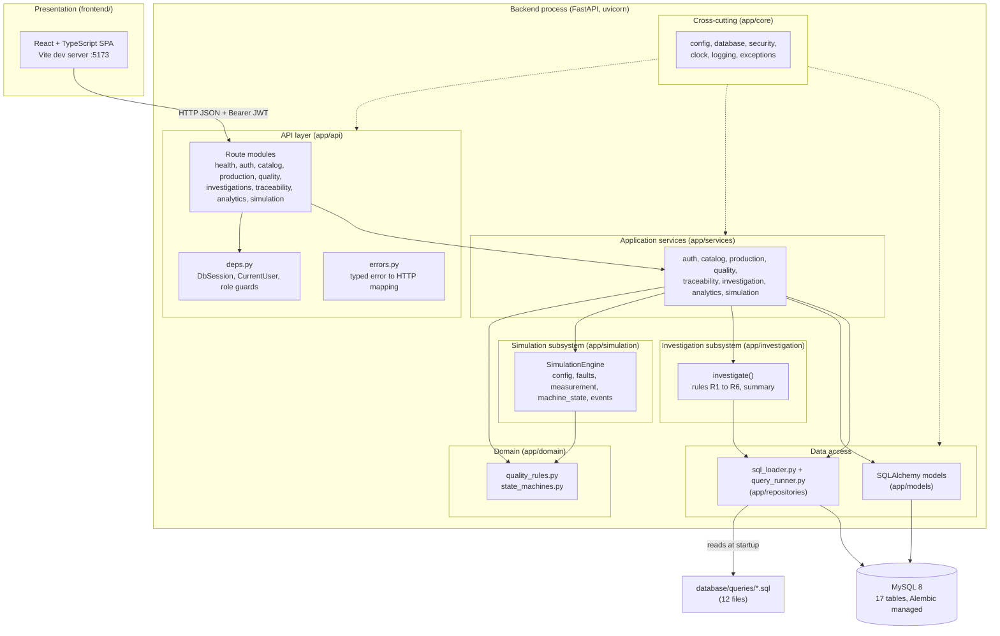

# System overview

Factory Sherlock is a manufacturing simulation, quality control, and defect investigation platform built on MySQL 8. It was developed as a university database systems final project and is structured the way a small production service would be: a FastAPI backend organised as a modular monolith, a MySQL schema managed by Alembic, SQL analysis queries kept as files that the application executes verbatim, and a React frontend that is being built alongside the backend.

The product is inspired by concepts found in manufacturing execution systems such as Rockwell Automation FactoryTalk (production orders, batches, machine events, traceability, quality investigations). It is an independent project and is not affiliated with any vendor.

This document describes the system at the level of layers, module boundaries, dependency rules, and cross-cutting concerns. Component internals are in [component-design.md](component-design.md), request and transaction flows are in [data-flow.md](data-flow.md), and a file-by-file inventory is in [repository-structure.md](repository-structure.md). Schema design, the simulation model, and the investigation rules are documented by their owners under `docs/database/`, `docs/simulation/`, and `docs/investigation/`.

## Purpose

The platform answers three kinds of question about a (simulated) machining cell:

1. What was produced, on which machine, from which material lots, and with what inspection results. This is the manufacturing execution and traceability part: production orders, production batches, production units, material lots, inspections, and defect types.
2. What is the current quality picture. Dashboard queries compute defect rates per machine, recurring defect types, daily production trends, order completion, and batches that need review.
3. Why quality deteriorated. An engineer opens an investigation over a time window and optionally a machine; a rule engine runs six SQL-backed rules (R1 to R6) and stores each finding as an evidence card together with the exact SQL and result rows that produced it.

Because the project has no physical factory, a deterministic simulation engine generates production history with injectable faults (tool wear, calibration drift, increased variation, material issues, downtime) so that the investigation engine has realistic data to work on.

## Implementation status

| Area | Status | Notes |
|------|--------|-------|
| Backend API (31 paths, 40 operations under `/api/v1`) | Implemented | `backend/app`, exported to `docs/api/openapi.json` |
| MySQL schema (17 tables) and Alembic migration | Implemented | One migration, `backend/migrations/versions/` |
| SQL query library (12 files) loaded at runtime | Implemented | `database/queries/` |
| Simulation engine | Implemented | `backend/app/simulation` |
| Investigation engine (rules R1 to R6) | Implemented | `backend/app/investigation` |
| JWT authentication, four roles | Implemented | `backend/app/core/security.py`, `backend/app/api/deps.py` |
| Seed command and demo scenario | Implemented | `backend/app/seed.py`, `database/seeds/` |
| Local MySQL scripts and docker-compose | Implemented (local script executed; compose file not executed) | `scripts/`, `docker-compose.yml`; Docker is not installed on the development machine, so the compose path is unverified |
| Frontend (React 19, TypeScript, Vite 7, Tailwind 4, React Router 7, TanStack Query 5, Recharts 3) | Implemented | `frontend/src/features/*`: Login, Overview, Machines, Orders, Batches, Inspections, Traceability, Investigations list, Investigation detail (case board with evidence cards and show-the-SQL), Analytics (charts plus SQL explorer), Simulation; `pnpm lint`, `pnpm typecheck`, and `pnpm build` pass |
| Backend automated tests | Implemented | `backend/tests`: 5 unit modules, 9 API modules, 2 integration modules (70 test functions; the last `uv run pytest` run reported 84 passed with 95 percent coverage of `app`); API and integration tests run against the `_test` database |
| Frontend automated tests | Implemented | Vitest and Testing Library (`frontend/tests/setup.ts`, `helpers.tsx`); 11 colocated test files, 34 tests passed in the last `pnpm test` run |
| Continuous integration | Implemented | `.github/workflows/backend-ci.yml`, `frontend-ci.yml`, `docs-lint.yml` |
| Root-level `tests/` (end to end, fixtures, integration) | Planned | Directories exist and are empty |

## Layers

The backend is a single deployable process. Inside it, code is arranged in layers that only depend downward (see "Dependency direction rules").

### Presentation

The React single-page application in `frontend/`. It talks to the backend over HTTP with JSON bodies and a `Bearer` JWT in the `Authorization` header; the token is kept in `localStorage` by `src/services/http.ts`. During development the Vite dev server on port 5173 proxies `/api` to `http://127.0.0.1:8000` (`vite.config.ts`); the backend's CORS configuration (`CORS_ORIGINS`, default `http://localhost:5173`) allows direct calls as well. Directory structure: `src/app` (layout, router, auth guard, providers), `components` (`ui`, `charts`), `features` (one folder per screen), `hooks` (`useAuth`, TanStack Query hooks), `services` (`http.ts`, `api.ts`), `types`, `utils` (formatting, permissions mirroring the backend role guards, transitions, chart helpers), `styles`. Frontend details are described at directory level only in this document set.

### API

`backend/app/api`. FastAPI route modules grouped by resource (health, auth, catalog, production, quality, investigations, traceability, analytics, simulation) and mounted under `/api/v1` by `router.py`. Routes validate input through Pydantic v2 schemas in `backend/app/schemas`, obtain a database session and the current user through dependencies in `deps.py`, call one service function, and convert ORM objects to response schemas. `errors.py` maps typed application errors and SQLAlchemy errors to HTTP responses that never expose SQL text or stack traces.

### Application services

`backend/app/services`. One module per bounded area: `auth_service`, `catalog_service`, `production_service`, `quality_service`, `traceability_service`, `investigation_service`, `analytics_service`, `simulation_service`. Services own orchestration: they load rows, apply domain rules, write ORM objects, run raw SQL through the repository layer, and raise typed errors. They receive a `Session` as an argument and never commit; the request-scoped session commits on success.

### Domain

`backend/app/domain`. Pure business rules with no database or HTTP dependencies. `quality_rules.py` defines how a measurement is evaluated against a specification, how a failure is classified into a defect type code, and the single definition of `defect_rate`. `state_machines.py` holds the transition tables for machines, production orders, production batches, and investigations plus `assert_transition`. Both the API services and the simulation engine use these functions, so the synthetic factory obeys the same rules as manual operations.

### Data access

Two mechanisms, deliberately kept separate:

- ORM: SQLAlchemy 2 declarative models in `backend/app/models`, one module per aggregate (product, machine, material, production, quality, investigation, user) plus shared enums and a timestamp mixin. Services use these for all writes and for simple reads.
- Raw SQL: `backend/app/repositories/sql_loader.py` reads every `.sql` file under `database/queries/` into an in-memory catalog keyed by file stem (numeric prefix removed, subdirectory as a dotted prefix, for example `investigation.defect_onset`). `query_runner.py` executes a named query with bound parameters and returns JSON-friendly rows. Analytics, traceability, and the investigation rules go through this path so the SQL the documentation describes is the SQL that runs.

### Simulation subsystem

`backend/app/simulation`. A pure engine (`SimulationEngine`) that takes a frozen `SimulationConfig` and a `Catalog` of reference rows and returns a `SimulationOutput` of plain dataclasses: orders, batches, units, inspections, machine state changes, fault events, alerts, and final machine states. All randomness flows through one `random.Random(seed)`, so the same inputs produce the same output. The engine never imports SQLAlchemy; `simulation_service.persist` maps the output onto ORM rows inside one transaction.

### Investigation subsystem

`backend/app/investigation`. `engine.investigate` runs the six rules in `rules.py` in order against a `QueryRunner` and a mutable `InvestigationContext` that later rules read from earlier rules (for example R4 uses the onset time found by R3, R6 uses the batch ids found by R5). Each rule returns an `Evidence` card holding the rule code, a title, a narrative, the query name, the query SQL, and the result rows, or `None` when it has nothing to say. `summary.py` turns the context into a short written summary. Rules only read; `investigation_service` persists the report.

### MySQL

MySQL 8 is the system of record. The schema is 17 tables created by a single Alembic migration, including three many-to-many junction tables: `batch_materials` (production batches to material lots), `inspection_defects` (inspections to defect types), and `investigation_batches` (investigations to production batches). Status columns are MySQL `ENUM`s mirroring `backend/app/models/enums.py`, and CHECK constraints guard quantities and windows. The application connects as a least-privilege user created by `scripts/setup/init_databases.sh`. Schema details are documented under `docs/database/`.

## High-level system architecture

The same diagram is kept as Mermaid source in [`docs/media/diagrams/system-architecture.mmd`](../media/diagrams/system-architecture.mmd).

## Module boundaries

| Package | May import from | Must not import from |
|---------|-----------------|----------------------|
| `app.api` | `app.services`, `app.schemas`, `app.models` (enums and `User` for typing), `app.core` | `app.simulation`, `app.investigation`, `app.repositories` directly |
| `app.services` | `app.domain`, `app.models`, `app.schemas`, `app.repositories`, `app.simulation`, `app.investigation`, `app.core` | `app.api` |
| `app.domain` | `app.models.enums`, `app.core.exceptions` | `app.services`, `app.api`, SQLAlchemy sessions, HTTP |
| `app.simulation` | `app.domain`, `app.models.enums` | SQLAlchemy sessions, `app.services`, `app.api` |
| `app.investigation` | `app.repositories.query_runner` (the `QueryRunner` protocol) | ORM models, `app.services`, `app.api` |
| `app.repositories` | `app.core`, SQLAlchemy | `app.services`, `app.api`, domain |
| `app.models` | `app.core.database` (`Base`) | everything above it |
| `app.schemas` | `app.models.enums` | services, ORM sessions |
| `app.core` | third-party libraries only | any other `app` package |

The one place where this table bends is `app.domain.state_machines`, which imports `InvalidTransitionError` from `app.core.exceptions`; `core` is treated as a leaf shared by every layer.

## Dependency direction rules

1. Dependencies point downward: API to services to domain and data access. Nothing below the service layer knows about FastAPI, HTTP status codes, or request objects.
2. Services raise typed errors from `app.core.exceptions`; only `app.api.errors` translates them into HTTP responses.
3. The simulation engine and the investigation rules are pure with respect to persistence. The engine receives a `Catalog` loaded by the service and returns dataclasses; the rules receive a `QueryRunner` protocol that tests can fake.
4. Raw SQL lives in `database/queries/`, never inline in Python. Services and rules refer to queries by name; the loader resolves the file.
5. Enumerations are defined once in `app.models.enums` and reused by ORM columns (as MySQL `ENUM`), Pydantic schemas, state machines, and the simulation.
6. Configuration is read only through `app.core.config.get_settings()`; no module reads `os.environ` directly.

## Cross-cutting concerns

### Configuration

`app/core/config.py` defines a `pydantic-settings` `Settings` class populated from environment variables and from the repository root `.env` (a `.env` in the current directory overrides it). It exposes computed fields: `effective_database` appends `_test` when `APP_ENV=test` so the test suite can never touch development data; `database_url` builds the `mysql+pymysql` URL; `cors_origin_list` splits `CORS_ORIGINS`. Secrets (`mysql_password`, `jwt_secret_key`, `seed_demo_password`) are declared with `repr=False` so they do not appear in logs or reprs. `get_settings()` is cached with `lru_cache`. Alembic's `env.py` reads the same settings, so migrations and the application always target the same database.

### Sessions and transactions

`app/core/database.py` builds one engine per process (`pool_pre_ping=True`, `pool_size=5`, `max_overflow=10`) and a `sessionmaker` with `autoflush=False` and `expire_on_commit=False`. `get_db_session` yields a request-scoped session: it commits when the route handler returns normally, rolls back when anything raises, and always closes. Services call `session.flush()` to surface constraint errors early and to obtain generated ids, but never `commit()`. The consequence is that every endpoint is one transaction: production batch creation (order status change, batch, junction rows, units), simulation persistence (orders, batches, units, inspections, events, alerts, machine status), and investigation creation (investigation, evidence cards, batch links) each either fully succeed or leave nothing behind.

### Logging

`app/core/logging.py` installs a single JSON formatter on the root logger and on uvicorn's loggers. Each line carries timestamp, level, logger, message, and, when present on the record, `request_id`, `user_id`, and `operation`. Request ids are generated inside the error handlers for integrity errors, operational errors, and unexpected exceptions; there is no middleware that assigns a request id to successful requests. Handlers and services log identifiers only, never request bodies, passwords, or tokens.

### Errors

`app/core/exceptions.py` defines `AppError` (status 400) and subclasses `NotFoundError` (404), `ConflictError` (409), `ValidationError` (422), `InvalidTransitionError` (422, raised by state machines), `AuthenticationError` (401), and `AuthorizationError` (403). Each carries a message and an optional `details` dictionary. `app/api/errors.py` registers handlers that return `{"error", "message", "details"}` for `AppError`, FastAPI `RequestValidationError` (422 with per-field messages), SQLAlchemy `IntegrityError` (409), `OperationalError` (503, database unreachable), and any other exception (500). Database-level messages are logged with a request id and never returned to clients. `catalog_service._flush_or_conflict` additionally converts duplicate-key failures during flush into a `ConflictError` with a specific message.

### Authentication and authorisation

Passwords are hashed with bcrypt (`app/core/security.py`). `POST /api/v1/auth/login` returns an HS256 JWT containing `sub` (user id), `role`, `iat`, and `exp` (`JWT_ACCESS_TOKEN_MINUTES`, default 120). `get_current_user` in `app/api/deps.py` decodes the bearer token and then loads the user row; the role in the token is informational and the database row decides whether the account is active and which role applies. Four roles exist: `ADMIN`, `ENGINEER`, `OPERATOR`, `VIEWER`. Reads require any authenticated user; writes use the `Operator` (admin, engineer, operator), `Engineer` (admin, engineer), dependencies. ADMIN is included in every write set; no route is admin-only. Alert acknowledgement requires `Operator`, so a VIEWER receives 403. The health endpoint is unauthenticated. At the database level the application user has DML plus the DDL needed to run migrations on the two project schemas only (see ADR-0007).

## Related documents

- [component-design.md](component-design.md): backend components, request flow, local deployment.
- [data-flow.md](data-flow.md): sequence diagrams for batch creation, simulation persistence, and investigation evidence generation.
- [repository-structure.md](repository-structure.md): directory tree and file inventory.
- [../decisions/README.md](../decisions/README.md): architecture decision records.
- `docs/database/`, `docs/simulation/`, `docs/investigation/`: schema, simulation model, and rule documentation (owned separately).
- `docs/api/openapi.json`: generated OpenAPI document (`scripts/development/export_openapi.py`).
