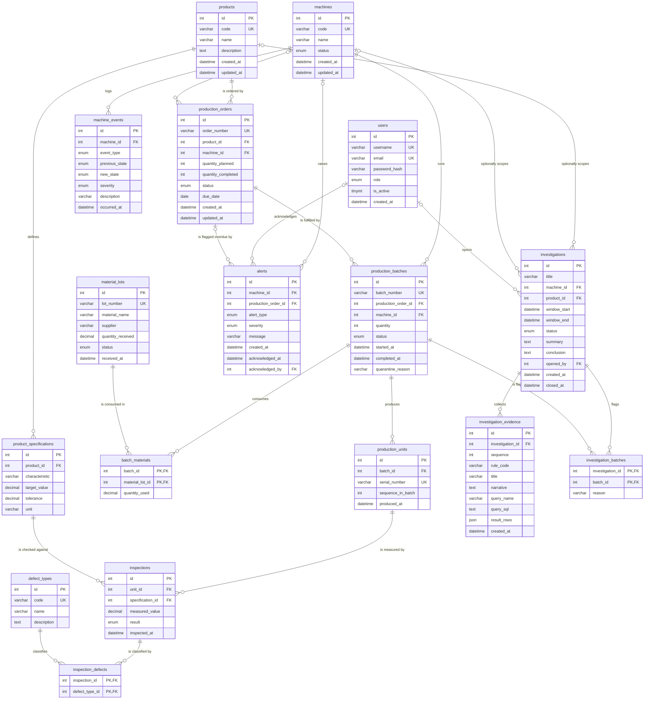

# Factory Sherlock database design

This document describes the MySQL schema behind Factory Sherlock: the tables, their keys and constraints, the indexes and the queries they serve, the business rules that live in the database versus the application, and the transaction boundaries. Every statement here is derived from the ORM models in `backend/app/models/`, the Alembic migrations in `backend/migrations/versions/`, and the generated snapshot in `database/schema/schema.sql`.

Related documents:

| Document | Contents |
|----------|----------|
| [data-dictionary.md](data-dictionary.md) | Column-level reference with exact MySQL types |
| [normalization.md](normalization.md) | Functional dependencies and normal-form analysis |
| [queries.md](queries.md) | The fourteen documented SQL files with real results |
| [seed-data.md](seed-data.md) | Reference data and demo scenario contents |
| `docs/media/diagrams/er-diagram.mmd` | Mermaid source of the ER diagram below |
| `docs/architecture/` | Application architecture (owned separately; not repeated here) |

## 1. Design goals

1. **Traceability in both directions.** A serial number must lead back to its batch, machine, order, product, and material lots; a material lot must lead forward to every batch and unit made from it. This is why `batch_materials` is a true many-to-many junction and why units exist as rows rather than as a count on the batch.
2. **Quality data that supports investigation, not just reporting.** Inspections are stored per unit per specification with a timestamp, so the investigation engine can ask time-based questions (defect rate per hour, rate before and after a machine event) with plain SQL.
3. **Integrity enforced where it is cheapest to enforce.** Value domains (ENUM), uniqueness, referential integrity, and arithmetic invariants (CHECK) are enforced by MySQL, so rows inserted outside the application are held to the same rules. Workflow rules (state transitions, quantity availability) are enforced in services where a clear error message can be produced.
4. **Explainable findings.** Every evidence card stores the SQL text that produced it and the rows it returned, so a reviewer can rerun or audit a finding later.
5. **Deterministic reproducibility.** The schema is created by three Alembic migrations (`3a5e982c3679`, the initial 17 tables; `383273c26ef7`, which adds `alerts.production_order_id`; `6c1f0d2a9b47`, which adds the list-ordering and control-chart indexes), seeded by one idempotent SQL file plus one Python command, and the demo scenario is a seeded simulation, so any grader can rebuild the identical database.

## 2. Entity-relationship diagram

The diagram shows all 17 application tables (the eighteenth table in the snapshot, `alembic_version`, is Alembic bookkeeping). Attribute types are abbreviated; exact types are in the data dictionary.

### Cardinality summary

| Relationship | Cardinality | Notes |
|--------------|-------------|-------|
| products to product_specifications | 1 to many | A product carries any number of measurable characteristics |
| products to production_orders | 1 to many | Every order is for exactly one product |
| machines to production_orders | 0..1 to many | The planned machine may be unassigned until release |
| machines to production_batches | 1 to many | The machine that actually ran the batch; mandatory |
| machines to machine_events | 1 to many | Append-only event log |
| production_orders to production_batches | 1 to many | A batch belongs to exactly one order |
| production_orders to alerts | 0..1 to many | ORDER_OVERDUE alerts name the order they are about; other alert types leave it NULL |
| production_batches to production_units | 1 to many | One row per serial number |
| production_units to inspections | 1 to many | At most one inspection per unit per specification |
| product_specifications to inspections | 1 to many | Each inspection checks one characteristic |
| investigations to investigation_evidence | 1 to many | Ordered evidence cards |
| users to investigations, users to alerts | 0..1 to many | Nullable, so audit rows survive user deletion |

### The three many-to-many relationships

| Junction table | Connects | Extra attributes | Why many-to-many |
|----------------|----------|------------------|------------------|
| `batch_materials` | production_batches and material_lots | `quantity_used` | A batch can consume several lots and a lot feeds several batches. This is what makes forward and backward traceability possible. |
| `inspection_defects` | inspections and defect_types | none | A failed inspection may carry more than one defect classification (for example `OVERSIZE_DIAMETER` plus `SURFACE_DAMAGE`), and a defect type recurs across inspections. |
| `investigation_batches` | investigations and production_batches | `reason` | An investigation flags several batches, and a batch can appear in several investigations over time. |

## 3. Table reference

Conventions used in this section:

- "PK" is the primary key. Every non-junction table uses an `int AUTO_INCREMENT` surrogate key; junction tables use a composite primary key of their two foreign keys.
- Foreign key constraint names (`<table>_ibfk_N`) are assigned by MySQL because the first migration does not name them; the one exception is `fk_alerts_production_order`, added by revision `383273c26ef7`, which is named so its downgrade can drop it. Index names shown without a prefix (for example `machine_id` on `alerts`) are the implicit indexes InnoDB creates for foreign key columns that have no explicit index.
- "Serves" names the query file (see [queries.md](queries.md)) or service function that benefits from an index.

### 3.1 users

| Item | Value |
|------|-------|
| Purpose | Application accounts and their role. Passwords are stored as hashes generated by `app.core.security.hash_password`. |
| PK | `id` |
| Foreign keys | none |
| Unique | `username`, `email` (both single-column unique keys) |
| Check | none |
| Indexes | `PRIMARY`, `username`, `email` |

The role column is a MySQL ENUM (`ADMIN`, `ENGINEER`, `OPERATOR`, `VIEWER`). Authorization is decided from the database row, not the token (`app/api/deps.py`), so an operator demoted to viewer loses write access on the next request. `is_active` is checked in `auth_service.get_active_user`.

### 3.2 products

| Item | Value |
|------|-------|
| Purpose | Catalogue of manufactured products. |
| PK | `id` |
| Foreign keys | none |
| Unique | `code` |
| Check | none |
| Indexes | `PRIMARY`, `code` (unique; serves `ORDER BY code` in `catalog_service.list_products` and the seed's `ON DUPLICATE KEY UPDATE`) |

### 3.3 product_specifications

| Item | Value |
|------|-------|
| Purpose | One measurable characteristic of a product with target and tolerance. A unit passes when `abs(measured - target) <= tolerance` (`app/domain/quality_rules.py`). |
| PK | `id` |
| Foreign keys | `product_id` to `products.id` ON DELETE CASCADE. A specification has no meaning without its product, and the ORM relationship mirrors this with `cascade="all, delete-orphan"`. |
| Unique | `uq_spec_product_characteristic (product_id, characteristic)`: a product cannot define the same characteristic twice. |
| Check | `ck_spec_tolerance_positive`: `tolerance > 0`. A zero tolerance would make every measurement fail; a negative one would make every measurement pass. |
| Indexes | `PRIMARY`, `uq_spec_product_characteristic` (also serves the FK lookup on `product_id` because it is the leading column) |

### 3.4 machines

| Item | Value |
|------|-------|
| Purpose | Production machines and their current state. |
| PK | `id` |
| Foreign keys | none |
| Unique | `code` |
| Check | none |
| Indexes | `PRIMARY`, `code` (unique; serves `ORDER BY code`) |

`status` is an ENUM (`IDLE`, `RUNNING`, `WARNING`, `STOPPED`, `FAULT`). Which transitions are legal is defined in `MACHINE_TRANSITIONS` in `app/domain/state_machines.py`, not in the database (see section 4).

### 3.5 machine_events

| Item | Value |
|------|-------|
| Purpose | Append-only log of state changes and simulated faults. `previous_state` and `new_state` are populated for `STATE_CHANGE` events and NULL for fault events. |
| PK | `id` |
| Foreign keys | `machine_id` to `machines.id` ON DELETE RESTRICT. A machine with history cannot be deleted; the history is the point of the table. |
| Unique | none |
| Check | `ck_event_state_pair`: `(event_type = 'STATE_CHANGE') = (new_state IS NOT NULL)`. A state change always records the state it moved to, and a fault or maintenance event never carries one. |
| Indexes | `PRIMARY`; `ix_machine_events_machine_time (machine_id, occurred_at)` serves query 06, `investigation/machine_events_before_onset.sql` (EXPLAIN shows a backward range scan on this index), and `catalog_service.list_machine_events`, which filters by machine and orders by `occurred_at DESC`. The composite index also acts as the FK index, so no separate `machine_id` index is created. |

### 3.6 material_lots

| Item | Value |
|------|-------|
| Purpose | Raw material received from a supplier, identified by lot number. |
| PK | `id` |
| Foreign keys | none |
| Unique | `lot_number` |
| Check | `ck_material_lot_quantity_non_negative`: `quantity_received >= 0` |
| Indexes | `PRIMARY`, `lot_number` (unique; query 04 finds the driving row through it with `type = const`) |

`status` is an ENUM (`AVAILABLE`, `QUARANTINED`, `CONSUMED`). The services set `AVAILABLE` (default) and `QUARANTINED` (`traceability_service.quarantine_lot`); no service currently sets `CONSUMED`, and `quantity_received` is never decremented. The value exists in the domain for completeness and is accepted by the database.

### 3.7 production_orders

| Item | Value |
|------|-------|
| Purpose | A request to manufacture a quantity of one product, optionally planned on a machine. |
| PK | `id` |
| Foreign keys | `product_id` to `products.id` ON DELETE RESTRICT (a product with orders cannot be removed); `machine_id` to `machines.id` ON DELETE SET NULL (the planned machine is an assignment, not a fact of production; clearing it keeps the order). |
| Unique | `order_number` |
| Check | `ck_order_quantity_planned_positive` (`quantity_planned > 0`); `ck_order_quantity_completed_non_negative` (`quantity_completed >= 0`); `ck_order_completed_within_planned` (`quantity_completed <= quantity_planned`). |
| Indexes | `PRIMARY`; `order_number` (unique); `ix_production_orders_status (status)` serves `production_service.list_orders(status=...)`; `ix_production_orders_created_id (created_at, id)` matches the `ORDER BY created_at DESC, id DESC` of `list_orders` (revision `6c1f0d2a9b47`); implicit FK indexes `product_id` and `machine_id`. |

### 3.8 production_batches

| Item | Value |
|------|-------|
| Purpose | A run of units produced for one order on one machine. The batch is the unit of traceability and of quarantine decisions. |
| PK | `id` |
| Foreign keys | `production_order_id` to `production_orders.id` ON DELETE RESTRICT; `machine_id` to `machines.id` ON DELETE RESTRICT. Both are RESTRICT because a batch is a historical production fact; deleting its parent would orphan inspections and traceability. |
| Unique | `batch_number` |
| Check | `ck_batch_quantity_positive` (`quantity > 0`); `ck_batch_completed_after_start` (`completed_at IS NULL OR completed_at >= started_at`); `ck_batch_completed_has_time` (`status <> 'COMPLETED' OR completed_at IS NOT NULL`); `ck_batch_quarantine_reason` (`(status = 'QUARANTINED') = (quarantine_reason IS NOT NULL)`) |
| Indexes | `PRIMARY`; `batch_number` (unique); `ix_production_batches_machine_time (machine_id, started_at)` serves query 06 and `investigation/defect_onset.sql` (`ref` on `machine_id`), is the index query 01 scans at demo volume, is listed but not used by query 08 because of its optional machine filter, and serves `production_service.list_batches(machine_id=...)`; `ix_production_batches_order (production_order_id)` serves query 02, `next_batch_number`, the in-progress quantity check in `create_batch`, and `list_batches(order_id=...)`; `ix_production_batches_started_id (started_at, id)` matches the `ORDER BY started_at DESC, id DESC` of the unfiltered `list_batches` (revision `6c1f0d2a9b47`). |

`quarantine_reason` is present exactly when `status = 'QUARANTINED'`, and `completed_at` is present for every `COMPLETED` batch and never precedes `started_at`; the three lifecycle CHECK constraints enforce these pairings, and the services (`complete_batch`, `quarantine_batch`, `quarantine_lot`, `simulation_service.persist`) always write the columns together. A quarantined batch that had already completed keeps its `completed_at`, which the constraints allow.

### 3.9 batch_materials (junction)

| Item | Value |
|------|-------|
| Purpose | Which material lots went into which batch, and how much. |
| PK | `(batch_id, material_lot_id)` composite; a lot is listed at most once per batch. `create_batch` also rejects duplicate lot ids before the insert so the client receives a validation error rather than a duplicate-key error. |
| Foreign keys | `batch_id` to `production_batches.id` ON DELETE RESTRICT and `material_lot_id` to `material_lots.id` ON DELETE RESTRICT. Both sides are traceability facts: a batch that consumed material and a lot that was consumed can only be removed after the link itself is removed, so neither forward nor backward traceability can vanish as a side effect of a delete. |
| Unique | the primary key |
| Check | `ck_batch_material_quantity_positive`: `quantity_used > 0` |
| Indexes | `PRIMARY (batch_id, material_lot_id)` serves lookups by batch (query 05, `investigation/shared_material_lots.sql`, `quarantine_lot`); implicit FK index `material_lot_id` serves lookups by lot (query 04, the `total_batches_using_lot` subquery). |

### 3.10 production_units

| Item | Value |
|------|-------|
| Purpose | One manufactured component with a serial number. Rows exist so that backward traceability can start from a serial and so each unit can carry one inspection per specification. |
| PK | `id` |
| Foreign keys | `batch_id` to `production_batches.id` ON DELETE RESTRICT. Units are created with their batch (`create_batch`, simulation persistence), but each unit is a serial-numbered traceability record, so a batch with units cannot be deleted; `tests/integration/test_transactions.py` exercises this. |
| Unique | `serial_number`; `uq_unit_batch_sequence (batch_id, sequence_in_batch)` |
| Check | `ck_unit_sequence_positive`: `sequence_in_batch > 0` |
| Indexes | `PRIMARY`; `serial_number` (unique; query 05 resolves the serial with `type = const`); `uq_unit_batch_sequence` doubles as the FK index on `batch_id` and is the index every batch-to-unit join uses in the EXPLAIN plans; `ix_production_units_produced_at (produced_at, batch_id)` serves the time filter of query 09, which EXPLAIN shows as a range scan when the window is selective (see section 6). |

### 3.11 defect_types

| Item | Value |
|------|-------|
| Purpose | Reference list of defect classifications. The five seeded codes are referenced by name in `app/domain/quality_rules.py`. |
| PK | `id` |
| Foreign keys | none |
| Unique | `code` |
| Check | none |
| Indexes | `PRIMARY`, `code` |

### 3.12 inspections

| Item | Value |
|------|-------|
| Purpose | A measurement of one unit against one specification, with the stored pass/fail result. |
| PK | `id` |
| Foreign keys | `unit_id` to `production_units.id` ON DELETE RESTRICT (an inspection is a recorded measurement and must not disappear with its unit); `specification_id` to `product_specifications.id` ON DELETE RESTRICT (a specification that has been used to judge units cannot be removed, which protects the meaning of stored results). |
| Unique | `uq_inspection_unit_spec (unit_id, specification_id)`: one inspection per unit per characteristic. `quality_service.record_inspection` turns a violation into a 409 through `_flush_or_conflict`. |
| Check | none |
| Indexes | `PRIMARY`; `uq_inspection_unit_spec` (also the FK index on `unit_id`; used by every unit-to-inspection join); `ix_inspections_time_result (inspected_at, result)` serves the time-window filter of query 01 when the window is selective (EXPLAIN shows a range scan on it for a one-hour window, and a walk from batches when the whole table lies inside the window); queries 03, 06, and `defect_onset` list it in `possible_keys` but reach inspections through `uq_inspection_unit_spec` or the primary key instead; `ix_inspections_time_id (inspected_at, id)` matches the `ORDER BY inspected_at DESC, id DESC` of `quality_service.list_inspections` exactly, so the paginated list can be read backwards from the index without a filesort (the `(inspected_at, result)` index cannot serve that ordering because `id` is not its second column); `ix_inspections_spec_time (specification_id, inspected_at)` covers both predicates of query 10 (`characteristic_control_chart`) and is the index behind the `specification_id` foreign key since revision `6c1f0d2a9b47`, which replaced the implicit single-column FK index (section 6). |

The result is stored rather than recomputed from the specification so that historical results remain stable if a tolerance is later edited; see [normalization.md](normalization.md) for why this is a deliberate snapshot.

### 3.13 inspection_defects (junction)

| Item | Value |
|------|-------|
| Purpose | Defect classifications attached to a failed inspection. |
| PK | `(inspection_id, defect_type_id)` |
| Foreign keys | `inspection_id` to `inspections.id` ON DELETE CASCADE; `defect_type_id` to `defect_types.id` ON DELETE RESTRICT (a classification in use cannot be deleted). |
| Unique | the primary key |
| Check | none |
| Indexes | `PRIMARY`; implicit FK index `defect_type_id` (query 03's EXPLAIN reads the junction through this index). |

### 3.14 alerts

| Item | Value |
|------|-------|
| Purpose | Notifications raised by the simulation (`HIGH_DEFECT_RATE`, `MACHINE_FAULT`), by quarantine actions (`MATERIAL_QUARANTINE`), and by the overdue order check (`ORDER_OVERDUE`, `alert_service.raise_overdue_order_alerts`). |
| PK | `id` |
| Foreign keys | `machine_id` to `machines.id` ON DELETE SET NULL; `production_order_id` to `production_orders.id` ON DELETE SET NULL (`fk_alerts_production_order`, revision `383273c26ef7`); `acknowledged_by` to `users.id` ON DELETE SET NULL. Alerts are audit rows; they should outlive the machine, order, or user they mention. |
| Unique | none |
| Check | none |
| Indexes | `PRIMARY`; implicit FK indexes `machine_id`, `acknowledged_by`; `ix_alerts_production_order (production_order_id)` backs the foreign key and the lookup of open ORDER_OVERDUE alerts per order in `alert_service._orders_with_open_alert`; `ix_alerts_created (created_at, id)` matches the `ORDER BY created_at DESC, id DESC` of `analytics_service.recent_alerts`. With the two alerts of the demo scenario EXPLAIN still shows a full scan with a filesort, which is the optimizer's choice for a table that small; the index becomes the access path as the table grows. |

### 3.15 investigations

| Item | Value |
|------|-------|
| Purpose | A quality investigation scoped to a time window and optionally to a machine and product. `summary` is written by the rule engine when the investigation is opened; `conclusion` is written by an engineer when it is closed. |
| PK | `id` |
| Foreign keys | `machine_id` to `machines.id` ON DELETE SET NULL; `product_id` to `products.id` ON DELETE SET NULL; `opened_by` to `users.id` ON DELETE SET NULL. An investigation is a record of a decision and must survive the removal of what it referenced. |
| Unique | none |
| Check | `ck_investigation_window_order`: `window_end > window_start` (the service checks the same condition first so the client gets a 422 rather than a database error); `ck_investigation_closed`: `(status = 'CLOSED') = (closed_at IS NOT NULL)`, so a closed investigation always records when it closed and `closed_at` is never set on an open one. `CLOSED` is terminal in `INVESTIGATION_TRANSITIONS`, so the pairing cannot be broken by reopening. |
| Indexes | `PRIMARY`; `ix_investigations_created_id (created_at, id)` matches the `ORDER BY created_at DESC, id DESC` of `investigation_service.list_investigations` (revision `6c1f0d2a9b47`); implicit FK indexes `machine_id`, `product_id`, `opened_by`. |

### 3.16 investigation_evidence

| Item | Value |
|------|-------|
| Purpose | One evidence card per rule that fired, in order. Stores the rule code, a narrative, the name and full text of the SQL query that produced it, and the rows it returned as JSON. |
| PK | `id` |
| Foreign keys | `investigation_id` to `investigations.id` ON DELETE CASCADE. |
| Unique | `uq_evidence_investigation_sequence (investigation_id, sequence)` keeps the case board ordered and prevents duplicate positions. It also serves as the FK index. |
| Check | none |
| Indexes | `PRIMARY`, `uq_evidence_investigation_sequence` |

### 3.17 investigation_batches (junction)

| Item | Value |
|------|-------|
| Purpose | Batches flagged by an investigation (rule R5), each with a reason. The service currently writes the constant reason "Defect rate above review threshold". |
| PK | `(investigation_id, batch_id)` |
| Foreign keys | `investigation_id` to `investigations.id` ON DELETE CASCADE (the link belongs to the investigation); `batch_id` to `production_batches.id` ON DELETE RESTRICT (a batch that an investigation flagged is evidence and cannot be deleted while the link exists). |
| Unique | the primary key |
| Check | none |
| Indexes | `PRIMARY`; implicit FK index `batch_id`, which query 08's `EXISTS` probe uses (EXPLAIN: `ref` on `batch_id`). |

### Foreign key action summary

| Action | Used on | Rationale |
|--------|---------|-----------|
| CASCADE | product_specifications.product_id, inspection_defects.inspection_id, investigation_evidence.investigation_id, investigation_batches.investigation_id | Child rows are compositional parts of the parent, are always created with it, and carry no traceability of their own: evidence belongs to its investigation, a defect classification belongs to its inspection. |
| RESTRICT | machine_events.machine_id, production_orders.product_id, production_batches.production_order_id, production_batches.machine_id, production_units.batch_id, batch_materials.batch_id, batch_materials.material_lot_id, inspections.unit_id, inspections.specification_id, inspection_defects.defect_type_id, investigation_batches.batch_id | The parent is reference or historical data, or the child is itself a traceability record (units, material links, inspections, flagged batches). Deleting the parent would destroy traceability or the meaning of stored results, so the delete is refused until the children are removed explicitly. |
| SET NULL | production_orders.machine_id, alerts.machine_id, alerts.production_order_id, alerts.acknowledged_by, investigations.machine_id, investigations.product_id, investigations.opened_by | The reference is an assignment or attribution that can be lost without invalidating the row. |

The ORM mirrors the CASCADE cases with `cascade="all, delete-orphan"` on `Product.specifications`, `Inspection.defect_links`, `Investigation.evidence`, and `Investigation.batch_links`, so deletes issued through the session and deletes issued directly in SQL behave the same way.

## 4. Business rules: database versus services

### Enforced by MySQL

| Rule | Mechanism |
|------|-----------|
| Status, role, severity, result, and event type values are limited to a known set | ENUM columns (`user_role`, `machine_status`, `machine_event_type`, `severity`, `order_status`, `batch_status`, `material_lot_status`, `inspection_result`, `alert_type`, `investigation_status`) generated from the enumerations in `app/models/enums.py` |
| Codes and numbers are unique: product code, machine code, defect code, lot number, order number, batch number, serial number, username, email | single-column UNIQUE keys |
| One characteristic per product, one inspection per unit and specification, one sequence number per batch, one evidence position per investigation | composite UNIQUE keys |
| A lot appears once per batch; a defect type once per inspection; a batch once per investigation | composite primary keys on the junction tables |
| Planned quantity is positive, completed quantity is between zero and planned, batch quantity is positive, lot quantity is non-negative, quantity used is positive, tolerance is positive, sequence is positive, investigation window is ordered | nine arithmetic CHECK constraints (listed per table above) |
| A completed batch has a completion time that is not before its start; a batch has a quarantine reason exactly when it is quarantined; a machine event carries a new state exactly when it is a state change; an investigation has a closing time exactly when it is closed | five lifecycle CHECK constraints: `ck_batch_completed_after_start`, `ck_batch_completed_has_time`, `ck_batch_quarantine_reason`, `ck_event_state_pair`, `ck_investigation_closed` |
| Rows cannot reference missing parents; deleting a parent cascades, is refused, or clears the reference as listed in section 3 | FOREIGN KEY constraints with ON DELETE actions |
| `created_at` receives the insert time; `updated_at` receives the insert time and is refreshed on every UPDATE, including updates issued as raw SQL | `DEFAULT (now())` on `created_at`; `DEFAULT CURRENT_TIMESTAMP ON UPDATE CURRENT_TIMESTAMP` on `updated_at` |

### Enforced by the services

| Rule | Where | Why not in MySQL |
|------|-------|------------------|
| Legal state transitions for machines, orders, batches, and investigations (for example `FAULT` must go to `STOPPED` before `RUNNING`; `COMPLETED` and `CANCELLED` orders are terminal; a quarantined batch does not leave quarantine) | `app/domain/state_machines.py`, applied by `assert_transition` in `catalog_service`, `production_service`, `traceability_service`, `investigation_service` | A transition table compares the old and new value of the same row; expressing it needs a trigger, and the transition tables are unit-tested as plain data |
| A batch may not exceed the order's remaining quantity after subtracting in-progress batches | `production_service.create_batch` | Requires an aggregate over sibling rows |
| Completing a batch may not push `quantity_completed` past `quantity_planned` | `production_service.complete_batch` checks first for a clear message, then increments with `UPDATE ... SET quantity_completed = quantity_completed + :q` and refreshes the ORM object, so two batches completing at once cannot lose an update; `ck_order_completed_within_planned` is the final guard | Both layers enforce it |
| An order needs a machine before release and before a batch can start | `change_order_status`, `create_batch` | Conditional NOT NULL depending on status |
| Only `AVAILABLE` lots may be consumed; the same lot may not be listed twice in one request | `create_batch` | Cross-table status check at write time |
| Orders are editable only while `PLANNED` or `RELEASED` | `update_order` | Status-dependent write permission |
| Pass or fail is computed from the specification; defect codes are rejected on a passing inspection; the specification must belong to the unit's product | `quality_service.record_inspection` with `quality_rules.evaluate_measurement` | Needs the specification row and the unit's product; the result is then stored as a snapshot |
| A conclusion is required to close an investigation | `investigation_service.change_status` | The pairing of `closed_at` with `CLOSED` is enforced by `ck_investigation_closed`; the conclusion text itself is required only by the service |
| `quantity_completed` and the order's `COMPLETED` status are maintained when batches complete | `production_service.complete_batch`, `simulation_service._complete_orders` | Derived values maintained by the writer: `complete_batch` uses an atomic SQL increment because other requests may complete sibling batches concurrently, while the simulation sets the counters on ORM objects it created in the same transaction, which no other transaction can see yet; the pairing of `quarantine_reason` with `QUARANTINED` is a CHECK constraint |
| Duplicate-key errors are reported as HTTP 409 | `catalog_service._flush_or_conflict` | The UNIQUE key is the guard; the service only translates the failure |
| `updated_at` is also set by the ORM on the updates it issues | `TimestampMixin` (`onupdate=func.now()` alongside the server-side `ON UPDATE CURRENT_TIMESTAMP`) | MySQL refreshes the column on raw SQL updates; the ORM sets it explicitly on its own updates so the value is known without a reload |

## 5. Transactions

The application uses one SQLAlchemy session per request and commits once.

### Request-scoped commit and rollback

`app/core/database.py` defines `get_db_session`: the session is created, yielded to the route handler, committed if the handler returns normally, rolled back if it raises, and closed in all cases. `SessionLocal` is configured with `autoflush=False` and `expire_on_commit=False`. Services call `session.flush()` to obtain generated ids and to surface integrity errors early, but never commit. A handler that fails halfway through a multi-table write therefore leaves nothing behind. `_flush_or_conflict` rolls the session back explicitly when a flush raises `IntegrityError`, then raises `ConflictError`, which the error handlers map to HTTP 409.

### Batch creation (`production_service.create_batch`)

In one transaction: validate the order status and machine, compute the remaining quantity minus in-progress batches, validate every material lot, move the order from `RELEASED` to `IN_PROGRESS` if needed, insert the `production_batches` row, its `batch_materials` rows, and `quantity` rows in `production_units` with generated serial numbers, then flush. Any validation error before the flush leaves the order unchanged; any integrity error during the flush rolls back all four tables.

### Simulation persistence (`simulation_service.persist`)

The engine produces plain dataclasses with no database access. `persist` then writes, in the request transaction (or the seed command's transaction): all `production_orders` through the ORM, flushed once so their ids exist; all `production_batches` with their `batch_materials` through the ORM, flushed once so the batch ids exist, after which `_complete_orders` sets each order's `quantity_completed` and marks it COMPLETED when the planned quantity is reached; then `production_units`, `inspections`, `inspection_defects`, and `machine_events` as chunked multi-row `INSERT` statements of at most 1000 rows (`_bulk_insert`, `session.execute(insert(Model), rows)`). MySQL returns no generated ids for a multi-row insert, so unit ids are selected back by `serial_number` and inspection ids by `(unit_id, specification_id)` before the dependent rows are built. Finally the `alerts` rows and each machine's final `status` are written through the ORM and flushed. A demo run touches ten tables and several thousand rows; a failure anywhere discards all of them (`tests/integration/test_transactions.py` fails the last bulk insert and asserts that nothing remains). Timings are in `docs/simulation/simulation-design.md`.

### Lot quarantine cascade (`traceability_service.quarantine_lot`)

The lot's status is set to `QUARANTINED`, every batch that consumed it (found through `batch_materials`) and is not already quarantined is moved to `QUARANTINED` with a reason that names the lot, and one `CRITICAL` alert is inserted. All of this happens in one transaction, so a failure on any batch rolls back the lot status change and the alert.

### Other multi-table writes in one transaction

- `catalog_service.change_machine_status`: the `machine_events` row and the `machines.status` update.
- `investigation_service.open_investigation`: the `investigations` row, its `investigation_evidence` rows, and its `investigation_batches` rows, after running all rules through `SqlQueryRunner` on the same session.
- `traceability_service.quarantine_batch`: the batch status, its reason, and an alert.
- `app/seed.py`: reference SQL, demo accounts, and the optional demo simulation are committed together and rolled back together.

## 6. Indexing rationale and known gaps

### Rationale

| Index | Purpose |
|-------|---------|
| Primary keys on surrogate ids | Clustered index for InnoDB; every `eq_ref` join in the EXPLAIN plans resolves through it |
| Composite primary keys on junction tables | Enforce the pairing and serve lookups by the leading column (batch, inspection, investigation) |
| Natural-key UNIQUE indexes (`code`, `lot_number`, `order_number`, `batch_number`, `serial_number`, `username`, `email`) | Enforce uniqueness and make lookups by business identifier `const` (queries 04 and 05 both start from a unique key) |
| `ix_machine_events_machine_time` | Range scans "events on machine X between T1 and T2", the core investigation question |
| `ix_production_batches_machine_time` | Reach a machine's batches, optionally in a time range, without scanning all batches |
| `ix_production_batches_order` | Batches per order for the performance query and the quantity checks |
| `ix_inspections_time_result` | Time-window filters on inspections where the result is also read (defect-rate queries 01, 03, 06); it does not serve the inspection list ordering because its second column is `result`, not `id` |
| `ix_inspections_time_id`, `ix_production_batches_started_id`, `ix_production_orders_created_id`, `ix_investigations_created_id` | The four paginated lists order by a time column and then `id DESC` as the tiebreak; each index has exactly those two columns so the page can be read as a backward index scan with no filesort. Added by revision `6c1f0d2a9b47` after the performance review. At demo volume (1,400 inspections, 35 batches, 9 orders) `EXPLAIN` still shows `type = ALL` with `Using filesort` and `key = NULL` because a table of a few pages is cheaper to scan than to seek, and `FORCE INDEX` confirms the plan the optimizer will switch to (`index`, `Backward index scan`, `rows = 50`); measured on a copy of the database grown with extra simulation runs, the inspection list reads `ix_inspections_time_id` without being forced from about 49,000 rows and the batch list reads `ix_production_batches_started_id` by 6,000 rows, while the order list still scans at 1,500 rows. `ix_alerts_created` follows the same pattern for `recent_alerts`. |
| `ix_inspections_spec_time` | Both predicates of query 10 (`characteristic_control_chart`): `specification_id = ?` as the leading column and the `inspected_at` window as a range on the second. With a one-hour window `EXPLAIN` shows `range` on this index (40 rows, `Using index condition`) and with a ten-minute window 7 rows; with the four-day demo window, where the specification's 240 rows are a sixth of the table, the optimizer prefers to walk from `machines` and `production_batches` to `inspections` by `eq_ref` on `uq_inspection_unit_spec`. The index also backs the `specification_id` foreign key: MySQL dropped the implicit single-column FK index when this one was created, and the migration's downgrade recreates it (EXPLAIN in [queries.md](queries.md)) |
| `ix_production_orders_status` | Order lists filtered by status |
| `ix_production_units_produced_at` | Time-window filter of query 09 (`produced_at` leading, `batch_id` second so the batch join reads from the index) |
| `ix_alerts_created` | `ORDER BY created_at DESC, id DESC` in `recent_alerts` |
| `ix_alerts_production_order` | Open ORDER_OVERDUE alert per order in `alert_service._orders_with_open_alert`; also the index behind `fk_alerts_production_order` |
| `uq_spec_product_characteristic`, `uq_unit_batch_sequence`, `uq_inspection_unit_spec`, `uq_evidence_investigation_sequence` | Composite unique keys whose leading column is the foreign key, so one index serves both the constraint and the join |

### Known gaps (follow-up work)

| Gap | Evidence | Suggested change |
|-----|----------|------------------|
| The optional-parameter pattern `(:machine_id IS NULL OR b.machine_id = :machine_id)` prevents a range scan | `EXPLAIN` on query 08 shows `type = ALL` on `production_batches` even though `ix_production_batches_machine_time` is listed in `possible_keys` | Acceptable at current volumes; for large tables, build two statement variants or use a dynamic `WHERE` |
| When the whole table lies inside the requested window, the optimizer walks from batches (queries 01, 09, `defect_onset`) or from the junction table (query 03) and applies the time filter as `Using where` instead of using `ix_inspections_time_result` or `ix_production_units_produced_at` | `EXPLAIN` output in [queries.md](queries.md); with a one-hour window the same statements switch to range scans on those indexes | Expected: the indexes pay off when the window is small relative to history, which is the production case |
| The lateral blocks of query 06 cannot range-scan `ix_production_batches_machine_time` on `started_at` because the bounds come from the outer event row | `EXPLAIN` shows `ref` on the `machine_id` prefix with `Using where; Using index` | The covering index still filters batches before units and inspections are joined; a constant-bound rewrite would need one statement per event |
| The list-ordering indexes are not chosen at demo volume | `EXPLAIN` on the four list statements shows `ALL` with `Using filesort` while the tables hold 1,400, 35, 9, and a handful of rows; on a grown copy the inspection list switches to `ix_inspections_time_id` by about 49,000 rows and the batch list to `ix_production_batches_started_id` by about 6,000 rows | Expected optimizer behaviour for small tables; the indexes exist so the lists stay fast as the tables grow, and `FORCE INDEX` shows the backward index scan they provide |
| A filtered list (`list_batches(machine_id=...)`, `list_orders(status=...)`) cannot use the `(time, id)` index for its ordering | `EXPLAIN` on the batch list with `machine_id = 3` reads `ix_production_batches_machine_time` by `ref` with a `Backward index scan` on `started_at`, then sorts ties on `id` | Acceptable: the filter index already delivers the primary ordering; a three-column `(machine_id, started_at, id)` index would only remove the tie sort |

### Migration lock behaviour

Each schema change in `backend/migrations/versions/` falls into one of the MySQL 8.4 online DDL classes, which decide whether a migration can run against a live database. `ADD COLUMN` at the end of a table, as in revision `383273c26ef7` (`alerts.production_order_id`), uses `ALGORITHM=INSTANT`: only the data dictionary changes, no rows are rewritten, and the statement returns in milliseconds regardless of table size. `ADD INDEX` and `DROP INDEX`, which is everything revision `6c1f0d2a9b47` does, use `ALGORITHM=INPLACE` with `LOCK=NONE`: InnoDB builds the index in the background while reads and writes continue, taking a metadata lock only for the brief prepare and commit phases, so the migration is safe to apply while the API is serving requests. `ADD FOREIGN KEY`, as in `383273c26ef7` (`fk_alerts_production_order`), is the one operation that uses `ALGORITHM=COPY` when `foreign_key_checks` is on (the default): MySQL rebuilds the table into a copy, checks every existing row against the parent, and blocks writes to `alerts` for the duration. With the demo's two alert rows this is instantaneous, but on a large table it is the step to schedule in a maintenance window, or to run with `SET foreign_key_checks = 0` so that it too becomes `INPLACE`, accepting that existing rows are then not validated. `CREATE TABLE`, which is all the first revision does, takes no lock that matters because the table has no readers yet.

## 7. How the ORM maps to MySQL and why SQL still matters

### Model-to-table mapping

| ORM class | File | Table | Notes |
|-----------|------|-------|-------|
| `User` | `models/user.py` | `users` | |
| `Product` | `models/product.py` | `products` | `TimestampMixin` |
| `ProductSpecification` | `models/product.py` | `product_specifications` | |
| `Machine` | `models/machine.py` | `machines` | `TimestampMixin` |
| `MachineEvent` | `models/machine.py` | `machine_events` | |
| `MaterialLot` | `models/material.py` | `material_lots` | |
| `BatchMaterial` | `models/material.py` | `batch_materials` | composite PK |
| `ProductionOrder` | `models/production.py` | `production_orders` | `TimestampMixin` |
| `ProductionBatch` | `models/production.py` | `production_batches` | |
| `ProductionUnit` | `models/production.py` | `production_units` | |
| `DefectType` | `models/quality.py` | `defect_types` | |
| `Inspection` | `models/quality.py` | `inspections` | |
| `InspectionDefect` | `models/quality.py` | `inspection_defects` | composite PK |
| `Alert` | `models/investigation.py` | `alerts` | |
| `Investigation` | `models/investigation.py` | `investigations` | |
| `InvestigationEvidence` | `models/investigation.py` | `investigation_evidence` | JSON column |
| `InvestigationBatch` | `models/investigation.py` | `investigation_batches` | composite PK |

All classes derive from `Base` in `app/core/database.py` (SQLAlchemy 2.0 `DeclarativeBase`) and use `Mapped[...]` annotations with `mapped_column`. Importing `app.models` registers every table on `Base.metadata`, which is what Alembic autogenerate compared against to produce the migration.

Type mapping used by the models:

| SQLAlchemy type | MySQL type in `schema.sql` |
|-----------------|----------------------------|
| `Integer` (and bare `int` primary keys) | `int`, with `AUTO_INCREMENT` on primary keys |
| `String(n)` | `varchar(n)` |
| `Text` | `text` |
| `Numeric(10, 3)` / `Numeric(10, 2)` | `decimal(10,3)` / `decimal(10,2)` |
| `Boolean` | `tinyint(1)` |
| `DateTime` | `datetime` (no time zone) |
| `Date` | `date` |
| `Enum(PythonEnum, name=...)` | `enum('A','B',...)` with the members' string values |
| `JSON` | `json` |

ORM-level defaults (`default=...`) such as `UserRole.VIEWER`, `MachineStatus.IDLE`, `is_active=True`, `quantity_completed=0`, and `unit="mm"` are applied by SQLAlchemy at insert time and do not appear as `DEFAULT` clauses in MySQL. Only the server defaults on the timestamp columns become database clauses: `server_default=func.now()` on `created_at`, and `server_default=text("CURRENT_TIMESTAMP ON UPDATE CURRENT_TIMESTAMP")` on `updated_at`, which is how SQLAlchemy's MySQL dialect renders the `ON UPDATE` clause (its `server_onupdate` parameter only tells the ORM to reload the value and emits no DDL). The data dictionary distinguishes the two.

### Which features use raw SQL, and why

| Feature | Entry point | SQL files |
|---------|-------------|-----------|
| Analytics dashboard and SQL explorer (`GET /analytics/queries`, `GET /analytics/queries/{name}`) | `analytics_service.run_dashboard_query`, `DASHBOARD_QUERIES` | 01, 02, 03, 06, 07, 08, 09, 10 |
| Forward and backward traceability (`GET /traceability/forward/{lot}`, `GET /traceability/backward/{serial}`) | `traceability_service` | 04, 05 |
| Investigation rules R1 to R7 | `app/investigation/rules.py` through `SqlQueryRunner` | 01, 03, 08, `investigation/defect_onset`, `investigation/machine_events_before_onset`, `investigation/shared_material_lots`, `investigation/hourly_defect_rates` |

These queries use window functions (`RANK`, `DENSE_RANK`, `LAG`, `SUM ... OVER`, `AVG ... OVER ()` with `STDDEV_SAMP` in query 10), `JOIN LATERAL`, `GROUP BY ... WITH ROLLUP` with `GROUPING()`, `GROUP_CONCAT`, correlated `EXISTS`, and conditional aggregation. The ORM query builder can express some of these, but the resulting Python is harder to read than the SQL and the generated text is not what a reviewer sees. More importantly, `investigation_evidence.query_sql` stores the exact text that ran, and the SQL explorer returns the same text, so the SQL on disk, the SQL executed, and the SQL shown to users are one artifact.

`app/repositories/sql_loader.py` reads `database/queries/**/*.sql` once, strips the numeric prefix from file names, and keys subdirectory files with a dotted prefix (`investigation.defect_onset`). `load_query` wraps the text in `sqlalchemy.text()` and, for `shared_material_lots`, declares `batch_ids` as an expanding bind parameter so a Python list renders as `IN (?, ?, ...)`. `SqlQueryRunner.run` executes the clause with a parameter dictionary and converts `Decimal`, `datetime`, and `bytes` into JSON-friendly values. Parameters are always bound, never interpolated, so the raw SQL path is as safe from injection as the ORM path.

Everything else (CRUD, state transitions, list endpoints with `selectinload`, and `quality_service.quality_summary`, which builds a conditional aggregate with `func.sum(case(...))`) goes through the ORM, where row identity, relationship loading, and unit-of-work flushing are the benefit.

### Inspecting the generated SQL

- **SQLAlchemy echo.** `build_engine` in `app/core/database.py` does not enable echo. To see every statement during development, either pass `echo=True` to `create_engine` locally or raise the logger level: `logging.getLogger("sqlalchemy.engine").setLevel(logging.INFO)`. Statements are printed with their bound parameters shown separately.
- **EXPLAIN.** Any file in `database/queries/` can be prefixed with `EXPLAIN` in the `mysql` client after replacing `:name` placeholders with literals. The plans captured for this documentation are in [queries.md](queries.md).
- **The application itself.** `GET /analytics/queries` returns the SQL text of every file, and every evidence card returns `query_sql` alongside its rows.

### Why the ORM does not remove the need to understand SQL

1. The ORM generates SQL; it does not replace the planner. Whether a join uses `uq_unit_batch_sequence` or scans `production_units` is decided by MySQL from the schema and statistics, and only `EXPLAIN` shows it. Whether query 09 uses `ix_production_units_produced_at` or walks from `machines` depends on how selective the window is, and that is invisible from Python.
2. Constraints are schema objects. CHECK, UNIQUE, ENUM, and ON DELETE behaviour are declared in the models but enforced by MySQL; the error that comes back (`IntegrityError`) has to be interpreted in SQL terms before it can be turned into a 409.
3. Transaction semantics are database semantics. `flush` versus `commit`, when ids become available, and what a rollback undoes are consequences of InnoDB transactions that the session wraps but does not hide.
4. Analytical questions are set operations. Rankings, running totals, before-and-after comparisons, and subtotals are naturally expressed in SQL; building them from ORM primitives obscures the intent and usually produces worse plans.
5. Reviewers and operators read SQL. Storing the exact query with each finding only works because the query is readable SQL rather than an ORM expression tree.
