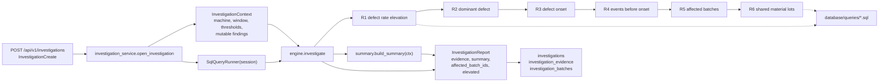
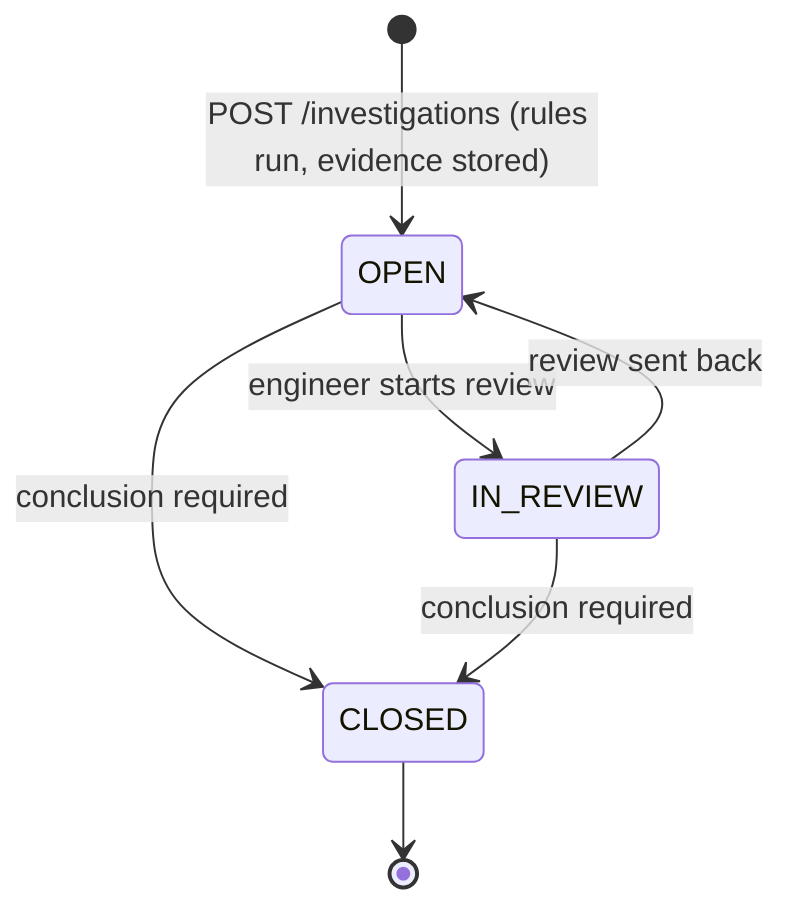
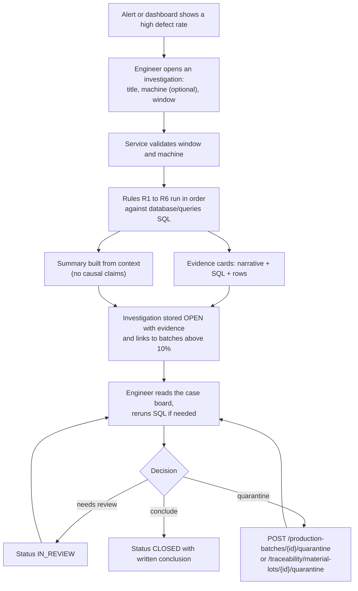

# Investigation engine

The investigation engine answers the question "why did quality deteriorate on this machine during this period" with evidence an engineer can check. It runs six fixed rules, each backed by one SQL file, and stores every finding as an evidence card that carries the rule narrative, the exact SQL text, and the result rows.

Source: `backend/app/investigation/` (`rules.py`, `summary.py`, `engine.py`), `backend/app/services/investigation_service.py` (persistence and status changes), `backend/app/repositories/query_runner.py` and `sql_loader.py` (query execution), `database/queries/` (SQL), `backend/app/schemas/investigation.py` (API contract), `backend/app/api/routes/investigations.py` (endpoints). Material traceability, which the last rule relies on, is documented in [traceability-design.md](traceability-design.md).

## Philosophy

Explainable. There is no scoring model and no hidden weighting. Each rule is a short Python function that runs one named query, reads the rows, and writes a sentence or two. The query name, the SQL, and the rows are stored with the sentence, so a reviewer can rerun the query and reach the same conclusion.

Evidence-based. A rule either produces an `Evidence` card from rows it actually retrieved or returns `None`. Rules do not infer anything that is not in the rows; thresholds are explicit constants in `RuleThresholds` and are quoted in the narratives.

Correlation is not causation. The rule wording describes associations in time ("preceded", "before the onset", "share material lot") and never says that an event or a lot caused the defects. The narrative for machine events ends with "Timing suggests a relationship worth checking; it does not prove a cause." The summary says the timing "is consistent with a relationship but does not establish one." The causal judgement belongs to the engineer who closes the investigation with a written conclusion; the system stores the generated summary and the human conclusion side by side.

Deterministic. For the same database state and the same request, the engine produces the same cards in the same order.

## Architecture

### Context

`InvestigationContext` (`rules.py`) carries the inputs (`machine_id`, `machine_code`, `window_start`, `window_end`, `thresholds`) and a set of fields that start empty and are filled as rules run: `elevated`, `machine_rate`, `fleet_rate`, `dominant_defect`, `onset_time`, `affected_batch_ids`, `affected_batch_numbers`, `related_events`, `shared_lots`. Later rules read what earlier rules wrote; this is the only coupling between rules.

`RuleThresholds` holds the tunable constants:

| Threshold | Default | Used by |
|-----------|---------|---------|
| `elevated_min_rate` | 0.05 | R1: a machine is elevated only when its defect rate is at least this absolute value. |
| `elevated_fleet_multiple` | 2.0 | R1: and at least this multiple of the fleet rate (or the fleet rate is zero). |
| `batch_review_rate` | 0.10 | R3 (hourly onset bucket) and R5 (batches requiring review). |
| `event_lookback_hours` | 6 | R4: how far before the onset to look for machine events. |

The thresholds are not exposed through the API; `open_investigation` always uses the defaults.

### Rules

A rule has the signature `rule(ctx: InvestigationContext, runner: QueryRunner) -> Evidence | None`. The tuple `RULES` fixes the order. Rules only read.

### Query runner protocol

`QueryRunner` (`repositories/query_runner.py`) is a `Protocol` with two methods: `run(name, params) -> list[dict]` and `sql(name) -> str`. `SqlQueryRunner` implements it with SQLAlchemy `text()` statements loaded from `database/queries/` by `sql_loader.py`; file stems become names (`01_machine_defect_rate_comparison.sql` is `machine_defect_rate_comparison`, `investigation/defect_onset.sql` is `investigation.defect_onset`). Rows are converted to JSON-friendly values (integral `Decimal` to `int`, other `Decimal` to `float`, dates to ISO strings, bytes to text). The `batch_ids` parameter of `investigation.shared_material_lots` is registered as an expanding bind so it renders as `IN (?, ?, ...)`. Because the rules depend only on the protocol, unit tests can run them against a fake runner that returns canned rows.

### Evidence cards

`Evidence` is a frozen dataclass: `rule_code`, `title`, `narrative`, `query_name`, `query_sql`, `rows`. The service copies each card into an `investigation_evidence` row with a `sequence` number (1-based, unique per investigation), the SQL text in `query_sql`, and the rows in a JSON column `result_rows`. `investigation_service.evidence_payload` stores the rows as `{"columns": [...], "rows": [[...], ...]}` because MySQL reorders the keys of JSON objects; `EvidenceRead` rebuilds one ordered dictionary per row, so the API still returns a list of row objects, now in SQL column order. The API returns them in `InvestigationRead.evidence` ordered by sequence, so the frontend case board can show the query behind every finding.

### Summary builder

`summary.build_summary(ctx)` assembles sentences from the context in a fixed order: machine rate versus fleet (with "elevated" only when R1 set the flag), dominant defect, onset time, the most recent preceding event, the number of affected batches (first five batch numbers listed), shared lots, and a closing line. The closing line is a recommendation to inspect the machine and tooling and review the listed batches when the rate is elevated, or "No action is indicated by the rules; continue routine monitoring." otherwise. If no rule produced a machine rate or any other finding the summary reads "No inspection data was found for the selected scope." The builder never introduces facts that the rules did not establish.

### Persistence

`open_investigation` validates the window (`window_end` must be after `window_start`, also enforced by the `ck_investigation_window_order` CHECK constraint), resolves the machine code when a machine is given, checks that an optional `product_id` exists, runs the engine, and writes the `Investigation` row with its `evidence` and `batch_links` collections in the request transaction. Every batch R5 returned is linked with the reason "Defect rate above review threshold". The investigation opens in status `OPEN` with `opened_by` set to the calling user.

`product_id` is stored on the investigation but no rule reads it; the rules scope by machine and window only.

## Rules R1 to R6

### R1: Machine defect-rate comparison

- Query: `database/queries/01_machine_defect_rate_comparison.sql` (`machine_defect_rate_comparison`), parameters `window_start`, `window_end`. One row per machine with `inspected`, `failed`, `defect_rate`, `fleet_defect_rate`, `defect_rank`.
- Inputs: window; machine id when scoped.
- Threshold: elevated when `machine_rate >= 0.05` and (`fleet_rate == 0` or `machine_rate >= 2.0 * fleet_rate`). The fleet rate includes the machine itself.
- Writes to context: `machine_rate`, `fleet_rate`, `elevated`.
- Narrative: "<machine> failed <failed> of <inspected> inspections (<rate>), rank <r> of <n> machines. This is elevated relative to | in line with the fleet rate of <fleet> (threshold: at least 5.0% and 2 times the fleet rate)." When the machine has no inspections in the window: "<machine> has no inspections in the window." and the context is left unset. Fleet-wide (no machine): names the machine with `defect_rank = 1` and its rate, and sets nothing in the context.
- Always returns a card.

### R2: Dominant defect category

- Query: `database/queries/03_recurring_defects.sql` (`recurring_defects`), parameters `window_start`, `window_end`, `machine_id` (NULL for all). One row per (machine, defect type) with `occurrences`, `machine_total`, `share_of_machine_defects`, `rank_within_machine`, ordered by machine code then rank.
- Writes to context: `dominant_defect` (the `defect_name` of the first row).
- Narrative: "<defect> was the most frequent defect on <machine>: <occurrences> of <total> recorded defects (<share>)."
- Returns `None` when there are no defect rows. Fleet-wide, the first row belongs to the alphabetically first machine with defects, not necessarily the fleet's most frequent defect.

### R3: Time of quality deterioration

- Query: `database/queries/investigation/defect_onset.sql` (`investigation.defect_onset`), parameters `machine_id`, `window_start`, `window_end`. One row per hourly bucket (`DATE_FORMAT(inspected_at, '%Y-%m-%dT%H:00:00')`, an ISO 8601 string with a `T` separator) with `defect_rate`, `previous_bucket_rate` (LAG over the buckets that exist, so the previous non-empty hour), `cumulative_rate`.
- Threshold: the onset is the first bucket, in time order, whose `defect_rate >= batch_review_rate` (0.10).
- Writes to context: `onset_time` (the bucket start, parsed with `datetime.fromisoformat`).
- Narrative: "The hourly defect rate first reached <rate> in the hour starting <bucket> (previous non-empty hour: <previous>)." or "The hourly defect rate never reached 10.0% inside the window."
- Returns `None` when no machine is selected. Buckets are calendar hours, not batches; a 30-minute batch therefore spans part of one or two buckets, and the last unit of a batch is stamped at the batch completion time, which can fall into the next bucket.

### R4: Machine events before onset

- Query: `database/queries/investigation/machine_events_before_onset.sql` (`investigation.machine_events_before_onset`), parameters `machine_id`, `onset_time`, `lookback_hours` (6). Returns non-`STATE_CHANGE` events with `occurred_at` in `[onset_time - 6 h, onset_time]`, most recent first, with `minutes_before_onset`.
- Depends on R3: returns `None` when `onset_time` is unset (and when no machine is selected).
- Writes to context: `related_events` (all rows).
- Narrative: "<n> event(s) preceded the onset. The most recent was <event_type> (<description>) <m> minutes before the defect rate rose. Timing suggests a relationship worth checking; it does not prove a cause." or "No fault or maintenance events were recorded on <machine> in the 6 hours before the onset."
- Only `TOOL_WEAR`, `CALIBRATION_DRIFT`, `MATERIAL_ISSUE`, `DOWNTIME`, and `MAINTENANCE` events qualify; state changes are excluded because every machine has many of them. A VARIATION fault from the simulator appears here as `CALIBRATION_DRIFT` with its own description, because `MachineEventType` has no VARIATION value.

### R5: Batches requiring review

- Query: `database/queries/08_batches_requiring_review.sql` (`batches_requiring_review`), parameters `window_start`, `window_end`, `threshold` (0.10), `machine_id` (NULL for all). One row per batch started in the window with `defect_rate >= threshold` and status not `QUARANTINED`, worst first, with `already_under_investigation`.
- Writes to context: `affected_batch_ids`, `affected_batch_numbers`.
- Narrative: "<n> batch(es) on <machine | all machines> reached a defect rate of 10.0% or more and are not quarantined. Worst: <batch> at <rate>."
- Always returns a card. The batch filter uses `started_at`, whereas R1 to R3 filter inspections by `inspected_at`; for simulated data these coincide within a batch duration.
- The service links every returned batch to the investigation through `investigation_batches`; batches already linked to another investigation are still listed and linked again (the flag is informational).

### R6: Shared material lots

- Query: `database/queries/investigation/shared_material_lots.sql` (`investigation.shared_material_lots`), parameter `batch_ids` (expanding list). One row per lot used by any affected batch with `affected_batches_using_lot`, `batch_numbers`, `total_batches_using_lot` (usage across all batches, not only affected ones).
- Depends on R5: returns `None` when `affected_batch_ids` is empty.
- Threshold: a lot is "shared" when `affected_batches_using_lot > 1`.
- Writes to context: `shared_lots`.
- Narrative: "Affected batches share material lot(s): L203 (3 of 6 batches), ..." or "The affected batches do not share a material lot."
- The rows include non-shared lots as well so the card shows the full picture.

### Dependency chain

| Rule | Reads from context | Writes to context | Returns `None` when |
|------|--------------------|-------------------|---------------------|
| R1 | thresholds | `machine_rate`, `fleet_rate`, `elevated` | never |
| R2 | nothing | `dominant_defect` | no defects in window |
| R3 | thresholds | `onset_time` | no machine selected |
| R4 | `onset_time` (R3) | `related_events` | no machine, or R3 found no onset |
| R5 | thresholds | `affected_batch_ids`, `affected_batch_numbers` | never |
| R6 | `affected_batch_ids` (R5) | `shared_lots` | R5 found no batches |

The summary reads every field, so a missing earlier finding silently shortens the later narrative rather than failing.

## Investigation status lifecycle

Transitions are defined in `INVESTIGATION_TRANSITIONS` in `backend/app/domain/state_machines.py` and enforced by `investigation_service.change_status` through `assert_transition`. The endpoint is `POST /api/v1/investigations/{id}/status` with `InvestigationStatusChange` (`status`, optional `conclusion` up to 4000 characters), restricted to `ENGINEER` and `ADMIN`.

Rules enforced by the service:

- Closing requires a non-empty `conclusion`; otherwise HTTP 422 "A conclusion is required to close an investigation". `closed_at` is set to the current time.
- A `conclusion` supplied with any other transition is stored without closing.
- `CLOSED` is terminal; any transition out of it fails with `InvalidTransitionError` (HTTP 422) whose details list the allowed targets.
- Evidence is generated once at creation and never regenerated; reopening does not rerun the rules.

## Investigation workflow

The same diagram is kept as Mermaid source in `docs/media/diagrams/investigation-workflow.mmd`.

## Worked example: demo scenario, CNC-03 tool wear

This section follows the code and the SQL for the default scenario in `database/seeds/demo_scenario.json` (seed 42, start 2026-11-02 06:00, 12 batches of 20 units and 30 minutes per machine, `TOOL_WEAR` on CNC-03 from batch index 4, `DOWNTIME` on CNC-02 from batch index 6). Timestamps and lot assignments below follow deterministically from the configuration and the engine's arithmetic; defect counts and rates depend on the random draws and are described as expectations only. Numbers quoted as expected come from the formulas in [../simulation/fault-models.md](../simulation/fault-models.md).

Setup produced by the simulator:

- CNC-03 produces `STEEL-SHAFT` (specifications `diameter` 20.000 +/- 0.100 and `length` 150.000 +/- 0.500; the primary characteristic is the one with the lower specification id, which is `diameter` when the seed file's rows are inserted in the order written).
- Batch index `i` runs from `06:00 + 30i` minutes to `06:30 + 30i`. Batch 4 starts at 08:00 and batch 11 ends at 12:00. Orders are `SIM0001-CNC-03-01` (batches 0 to 3), `-02` (4 to 7), `-03` (8 to 11) on a freshly seeded database; batch numbers are `<order>-B01` to `-B04`.
- At 08:00 the engine records a `TOOL_WEAR` machine event (severity `WARNING`, "Simulated cutting tool wear: dimensions drift upward over time") and a `STATE_CHANGE` `RUNNING -> WARNING`. CNC-03 remains `WARNING` at the end of the run.
- From the first unit of batch 4, the `diameter` mean shifts upward by 0.008 tolerance per unit; `length` is unaffected. The expected batch defect rate (over 40 inspections) stays below 0.05 for batches 4 to 7, is expected to be about 0.10 at batch 8 (10:00 to 10:30), 0.18 at batch 9, 0.27 at batch 10 and 0.36 at batch 11. A `HIGH_DEFECT_RATE` alert is expected at the first batch whose rate reaches 0.15, with no second alert while the rate stays above.
- Material lots for CNC-03 batches follow the rotation over `L201`, `L202`, `L203`: batch 8 uses L202 and L203, batch 9 uses L202, batch 10 uses L203, batch 11 uses L203 and L201. Across all twelve batches, L201 and L203 are each used by six batches and L202 by four.

An engineer opens an investigation with `machine_id` = CNC-03 and a window of 2026-11-02 06:00 to 2026-11-02 13:00 (the window end must be after the last inspection at 12:00:00 because the interval is half-open).

1. R1 runs `machine_defect_rate_comparison`. CNC-01 (no fault) is expected near the natural rate of 0.003 and CNC-02 (downtime only) likewise, so the fleet rate is dominated by CNC-03's own failures. If CNC-03's rate over the whole window is at least 0.05 and at least twice the fleet rate, `elevated` becomes true and the narrative reads "elevated relative to the fleet rate".
2. R2 runs `recurring_defects` for CNC-03. The tool wear shift is positive on a diameter characteristic, so `OVERSIZE_DIAMETER` ("Oversized diameter") is expected to dominate; `DIMENSIONAL_DEVIATION` from natural `length` failures may appear with a small count.
3. R3 runs `investigation.defect_onset`. Hour buckets are 06:00, 07:00, ..., 11:00, plus a 12:00 bucket containing only the last unit of batch 11. The first bucket at or above 0.10 is expected to be the 10:00 bucket (batches 8 and 9), and the narrative reports that bucket and the previous non-empty hour's rate. The actual onset bucket may differ by one hour for a given seed.
4. R4 runs `investigation.machine_events_before_onset` with the onset bucket start and a six-hour lookback. The 08:00 `TOOL_WEAR` event is inside the lookback for any onset at or before 14:00, so it is listed; with a 10:00 onset `minutes_before_onset` is 120. The narrative names the event and adds that timing does not prove a cause.
5. R5 runs `batches_requiring_review` with threshold 0.10 for CNC-03. Batches expected above 0.10 are those from about batch 8 onward (`SIM0001-CNC-03-03-B01` to `-B04`), worst first. None are quarantined yet, so all are listed and linked to the investigation.
6. R6 runs `investigation.shared_material_lots` for the linked batches. If batches 8 to 11 are the affected set, L203 appears in three of them and L202 in two, so the narrative reports shared lots such as "L203 (3 of 6 batches), L202 (2 of 4 batches)". This is the deliberate trap in the scenario: the lots are shared because of the fixed rotation, not because the material is bad. The card gives the engineer the facts; R4's event evidence and the gradual, one-characteristic pattern in R2 and R3 are what point to the tool.

The summary then reads, in order: CNC-03 recorded an elevated defect rate (fleet rate quoted); Oversized diameter was the most frequent defect; the increase began around the onset hour; a TOOL_WEAR event was recorded some minutes earlier and the timing is consistent with a relationship but does not establish one; the batches above the review threshold; the shared lots; and the recommendation to inspect the machine and tooling and decide whether to quarantine the batches. The engineer quarantines the affected batches through `POST /api/v1/production-batches/{id}/quarantine` and closes the investigation with a conclusion such as "Tool wear on CNC-03 confirmed on inspection; tool replaced." The system never writes that sentence itself.

## Extension points

### Adding a rule

1. Write the SQL under `database/queries/investigation/<name>.sql` with the documentation header convention used by the existing files (business question, tables, techniques, parameters, result). The loader picks it up automatically as `investigation.<name>`.
2. If the query takes a list parameter, register it in `EXPANDING_PARAMS` in `repositories/query_runner.py`.
3. Add a function `rule_<name>(ctx, runner) -> Evidence | None` in `rules.py` that runs the query, writes any shared findings to the context, and returns a card with a new rule code (`R7`, ...). Keep the wording associative, not causal.
4. Append it to `RULES` in the position that matches its dependencies; add any new context fields to `InvestigationContext` and, if they should be summarised, to `build_summary`.
5. Unit test the rule with a fake `QueryRunner` and add an integration test against the seeded demo scenario.

New thresholds belong in `RuleThresholds`. Exposing thresholds through `InvestigationCreate` would be a small change in the schema and service and is not implemented.

### Product-scoped rules

`InvestigationCreate.product_id` is validated and stored but unused. Rules could filter by product by joining `production_orders.product_id`; the existing queries would need a `:product_id IS NULL OR ...` clause.

### Optional LLM narrator (planned, not implemented)

A possible stretch is a narrator that takes the stored evidence cards and writes a longer prose report. If added, it would run after the rules, consume only the cards and the summary, and be stored as a separate field so that the rule-generated narratives and the deterministic summary remain the record of what the system found. It would be subject to the same wording discipline (association, not causation) and would require network access and an API key that the current deployment does not have. Nothing in the codebase implements or depends on this.
