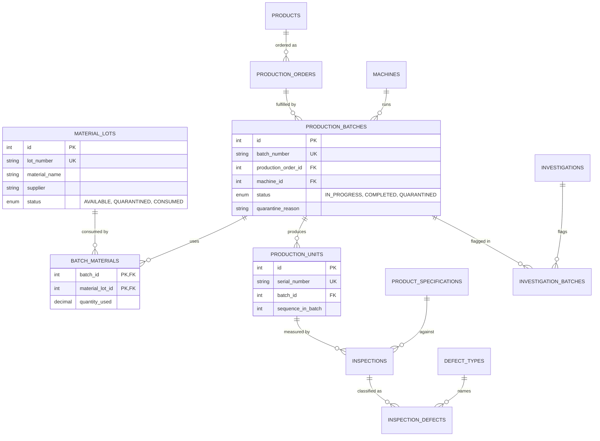

# Traceability design

Traceability links a material lot to every production unit made from it and a production unit back to the lot, batch, machine, order, and product it came from. The link is the junction table `batch_materials` between `production_batches` and `material_lots`; units hang off batches through `production_units.batch_id`. Quarantine decisions use the same links to contain a problem in one transaction.

Source: `backend/app/services/traceability_service.py`, `backend/app/api/routes/traceability.py`, the quarantine endpoint in `backend/app/api/routes/production.py`, the models in `backend/app/models/material.py` and `production.py`, and the queries `database/queries/04_material_lot_forward_trace.sql`, `05_unit_backward_trace.sql`, and `investigation/shared_material_lots.sql`. Table definitions are documented under `docs/database/` and are not repeated here.

## Material traceability relationships

The same diagram is kept as Mermaid source in `docs/media/diagrams/traceability-relationships.mmd`.



Cardinality that matters for tracing:

- A batch may consume several lots and a lot may feed several batches (`batch_materials` has a composite primary key `(batch_id, material_lot_id)`).
- A unit belongs to exactly one batch; a batch to exactly one order and one machine; an order to exactly one product.
- `batch_materials.material_lot_id` is `ON DELETE RESTRICT`, so a lot that has been used cannot be deleted; `batch_materials.batch_id` and `production_units.batch_id` are `ON DELETE RESTRICT`, so a batch cannot be deleted (the API does not offer it, and a direct SQL delete is refused) while its material links or units exist.

How links are created:

- Manual: `POST /api/v1/production-batches` requires at least one `materials` entry (`material_lot_id`, `quantity_used > 0`). The service rejects duplicate lots in the list and any lot whose status is not `AVAILABLE`, then writes the batch, its `BatchMaterial` rows, and its units in one transaction.
- Simulated: the engine assigns one or two lots per batch by a fixed rotation (see `docs/simulation/simulation-design.md`), so consecutive batches share lots and traceability has something to find.

## Forward traceability (lot to batches and units)

Endpoint: `GET /api/v1/traceability/forward/{lot_number}` (any authenticated user). The service first checks that the lot exists (404 otherwise) and then runs `material_lot_forward_trace`:

```sql
SELECT
    ml.lot_number, ml.material_name, ml.supplier, ml.status AS lot_status,
    b.id AS batch_id, b.batch_number, b.status AS batch_status, b.started_at,
    m.code AS machine_code, o.order_number, p.name AS product_name,
    bm.quantity_used,
    COUNT(DISTINCT u.id) AS units_produced,
    COUNT(DISTINCT CASE WHEN i.result = 'FAIL' THEN i.unit_id END) AS units_failed
FROM material_lots ml
JOIN batch_materials    bm ON bm.material_lot_id = ml.id
JOIN production_batches b  ON b.id = bm.batch_id
JOIN machines           m  ON m.id = b.machine_id
JOIN production_orders  o  ON o.id = b.production_order_id
JOIN products           p  ON p.id = o.product_id
LEFT JOIN production_units u ON u.batch_id = b.id
LEFT JOIN inspections      i ON i.unit_id = u.id
WHERE ml.lot_number = :lot_number
GROUP BY ml.id, ml.lot_number, ml.material_name, ml.supplier, ml.status,
         b.id, b.batch_number, b.status, b.started_at, m.code, o.order_number,
         p.name, bm.quantity_used
ORDER BY b.started_at;
```

The response is `{"lot_number": ..., "batches": [rows]}`, one row per batch that used the lot, with the number of units produced and the number of units that failed at least one inspection. The query stops at batch granularity; individual serial numbers are obtained by listing inspections for a batch (`GET /api/v1/inspections?batch_id=`) or by backward trace of a known serial. The `units_failed` count is per unit, not per inspection, so it is not the same figure as the batch defect rate.

A lot that exists but was never used returns an empty `batches` list.

## Backward traceability (unit to lot)

Endpoint: `GET /api/v1/traceability/backward/{serial_number}` (any authenticated user). The service runs `unit_backward_trace` and returns 404 when no row comes back:

```sql
SELECT
    u.serial_number, u.produced_at,
    b.batch_number, b.status AS batch_status,
    m.code AS machine_code, m.name AS machine_name,
    o.order_number, p.code AS product_code, p.name AS product_name,
    ml.lot_number, ml.material_name, ml.supplier, ml.status AS lot_status,
    (
        SELECT GROUP_CONCAT(
                   CONCAT(ps.characteristic, '=', i.measured_value, ' ', i.result)
                   ORDER BY ps.characteristic SEPARATOR '; ')
        FROM inspections i
        JOIN product_specifications ps ON ps.id = i.specification_id
        WHERE i.unit_id = u.id
    ) AS inspection_summary
FROM production_units u
JOIN production_batches b ON b.id = u.batch_id
JOIN machines           m ON m.id = b.machine_id
JOIN production_orders  o ON o.id = b.production_order_id
JOIN products           p ON p.id = o.product_id
LEFT JOIN batch_materials bm ON bm.batch_id = b.id
LEFT JOIN material_lots   ml ON ml.id = bm.material_lot_id
WHERE u.serial_number = :serial_number
ORDER BY ml.lot_number;
```

The response is `{"serial_number": ..., "lineage": [rows]}` with one row per material lot used by the unit's batch; the unit, batch, machine, order, and product columns repeat on every row. `inspection_summary` folds the unit's inspections into one string such as `diameter=20.087 PASS; length=150.120 PASS`. A unit whose batch has no material links still returns one row with NULL lot columns because of the LEFT JOINs.

## Shared lots across flagged batches

Investigation rule R6 uses `investigation.shared_material_lots` with an expanding `:batch_ids` parameter to report, for a set of affected batches, which lots they have in common and how widely each lot was used overall (`total_batches_using_lot`). See [investigation-engine.md](investigation-engine.md).

## Quarantine

Quarantine is the containment action. It is modelled as a batch status (`production_batches.status = 'QUARANTINED'` with a mandatory `quarantine_reason`) and as a lot status (`material_lots.status = 'QUARANTINED'`). Both endpoints require the `ENGINEER` or `ADMIN` role and a `QuarantineRequest` body with a `reason` of 5 to 255 characters.

### Quarantine a batch

`POST /api/v1/production-batches/{batch_id}/quarantine` calls `traceability_service.quarantine_batch`:

1. Load the batch (404 if missing).
2. `assert_transition(BATCH_TRANSITIONS, status, QUARANTINED)`: allowed from `IN_PROGRESS` and `COMPLETED`; a batch already `QUARANTINED` is rejected with HTTP 422 because `QUARANTINED` is terminal.
3. Set status and reason.
4. Insert an `alerts` row: `MATERIAL_QUARANTINE`, severity `WARNING`, message "Batch <number> quarantined: <reason>" (truncated to 255 characters), attributed to the batch's machine.
5. Flush; the request session commits.

Units are not individually marked; a unit's quarantine state is its batch's status, which backward trace exposes as `batch_status`. Quarantined batches are excluded from the investigation rule R5 and from `batches_requiring_review`.

### Quarantine a lot (transactional cascade)

`POST /api/v1/traceability/material-lots/{lot_id}/quarantine` calls `traceability_service.quarantine_lot`:

1. Load the lot (404 if missing) and set its status to `QUARANTINED`.
2. Select every batch joined through `batch_materials` to this lot whose status is not already `QUARANTINED`.
3. Set each of those batches to `QUARANTINED` with the reason "Material lot <lot_number>: <reason>" (truncated to 255 characters).
4. Insert one `alerts` row: `MATERIAL_QUARANTINE`, severity `CRITICAL`, `machine_id` NULL, message "Lot <lot_number> quarantined (<n> batches): <reason>".
5. Flush and return the newly quarantined batches. The route responds with the updated lot and the list of batches it quarantined.

All of these writes occur in the single request transaction managed by `get_db_session` (`backend/app/core/database.py`): if any statement fails (for example a database error on one batch update) the lot status change and every batch update are rolled back together, so the system never ends up with a quarantined lot whose batches are still released. Batches that were already quarantined are skipped rather than failing the cascade, and their existing reason is preserved. The lot cascade does not go through `assert_transition` for each batch because the only states it touches (`IN_PROGRESS`, `COMPLETED`) both permit the transition.

A quarantined lot can no longer be used for a new batch: `production_service.create_batch` rejects any lot whose status is not `AVAILABLE` with HTTP 422. The simulator's `load_catalog` also ignores non-available lots, so a product whose lots are all quarantined cannot be simulated until a new lot is received.

### Release from quarantine

`BATCH_TRANSITIONS` defines `QUARANTINED` as terminal and no endpoint changes a lot back to `AVAILABLE`. The comment in `state_machines.py` describes release as a deliberate manual decision to be handled by the traceability service with a recorded reason; that function is not implemented. Releasing a batch or lot today requires a database change outside the API.

## Limitations

- Traceability is at batch granularity. The schema does not record which specific lot a given unit was cut from when a batch consumed several lots; every unit of the batch is linked to all of the batch's lots.
- `quantity_used` is recorded but not reconciled against `quantity_received`; nothing prevents using more material than was received, and the `CONSUMED` lot status is never set by the application.
- There is no lot genealogy (a lot made from other lots) and no supplier-level trace beyond the `supplier` column.
- Forward trace returns one row per batch; it does not list serial numbers or per-unit inspection details.
- Backward trace repeats the unit columns once per lot; clients must de-duplicate when displaying the unit header.
- Quarantine is one-way through the API (see above). There is no audit table for quarantine actions beyond the `alerts` row and the `quarantine_reason` column; the identity of the user who quarantined is not stored.
- Quarantine does not change inspection results, investigation links, or order quantities; a quarantined batch still counts toward `quantity_completed` on its order.
- The `MATERIAL_QUARANTINE` alert type is reused for batch quarantine even when the reason is not material related.
