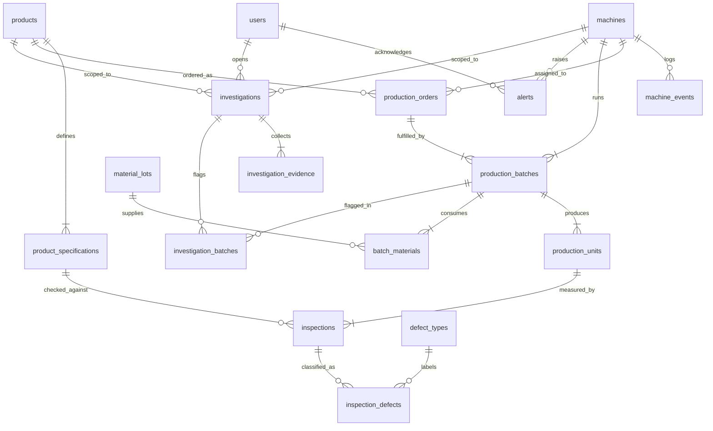

# Factory Sherlock: Manufacturing Simulation, Quality Control, and Defect Investigation on MySQL

**Course:** CS3320 Database Systems, Instructor Dr. Chibuzo Ukegbu
**Student:** Shritej Gunda (individual project)
**Milestone:** Week 8 proposal and design defense
**Date:** 2026-11-03
**Repository:** https://github.com/shritej6/factory-sherlock

## 1. Problem and intended users

A manufacturing cell produces units, inspects them, and sometimes sees its defect rate climb without an obvious reason. The facts that explain the rise (machine events, material lots, measurements) sit in separate records, so a quality engineer reconstructs the story by hand. Factory Sherlock is a MySQL-backed application that simulates a small factory, records every order, batch, unit, inspection, and machine event, and lets an engineer open an investigation whose findings are produced by SQL queries displayed beside each result. It is inspired by manufacturing execution systems such as Rockwell Automation FactoryTalk and is an independent course project with no affiliation.

Intended users and roles: quality engineer (ENGINEER: investigations, quarantine), production operator (OPERATOR: orders, batches, inspections), plant supervisor (VIEWER: read only), administrator (ADMIN: accounts, machine status).

## 2. Primary workflows

1. Production: create an order, release it, start batches on a machine with the material lots consumed, complete batches and the order. Status changes follow a state machine.
2. Quality: record one inspection per unit per specification; a unit passes when abs(measured minus target) is within tolerance; failures are classified into defect types; a batch above the alert threshold raises an alert.
3. Simulation: run a deterministic virtual factory scenario (seeded generator, injected faults such as tool wear or downtime) that writes orders, batches, units, inspections, events, and alerts in one transaction.
4. Traceability: trace forward from a material lot to every batch and unit that used it, or backward from a serial number to its batch, machine, order, and lots; quarantine a lot or batch with a recorded reason.
5. Investigation: open a case for a machine and time window; six rules run in sequence, each producing an evidence card that stores the SQL text and result rows; the engineer records a conclusion and closes the case.

## 3. MVP boundary and stretch goals

The MVP is modules 1 to 5 plus the dashboard: (1) reference catalog and accounts, (2) production orders, batches, and units, (3) quality inspections, defects, and alerts, (4) virtual factory simulation, (5) traceability and investigation, and a React dashboard over the analytics queries. Stretch goals, attempted only after the MVP is verified end to end: a live animated factory floor, a time scrubber replay, a chaos panel for injecting faults interactively, an optional LLM narrator for investigation summaries, a Docker image, and a hosted demo.

## 4. Draft ERD

## 5. Proposed normalized tables

| Table | Purpose | Keys and constraints |
|---|---|---|
| users | Accounts and roles | UNIQUE username, email; ENUM role |
| products | Catalog items | UNIQUE code |
| product_specifications | Measurable characteristics with target and tolerance | FK product; UNIQUE (product, characteristic); CHECK tolerance > 0 |
| machines | Production machines with current status | UNIQUE code; ENUM status |
| machine_events | Append-only log of state changes and faults | FK machine; index (machine_id, occurred_at) |
| material_lots | Received material with supplier and status | UNIQUE lot_number; CHECK quantity >= 0 |
| production_orders | Request to make a quantity of one product | FK product, machine; CHECK planned > 0, completed <= planned; index status |
| production_batches | Run of units for one order on one machine | FK order, machine; UNIQUE batch_number; CHECK quantity > 0; two indexes |
| batch_materials | Junction: lots consumed by a batch | PK (batch, lot); CHECK quantity_used > 0 |
| production_units | One serial-numbered unit | FK batch; UNIQUE serial; UNIQUE (batch, sequence) |
| defect_types | Defect classification catalog | UNIQUE code |
| inspections | One measurement of a unit against a specification | FK unit, specification; UNIQUE (unit, specification); index (inspected_at, result) |
| inspection_defects | Junction: defects found by an inspection | PK (inspection, defect_type) |
| alerts | Threshold and fault notifications | FK machine, acknowledged_by user |
| investigations | Case scoped to a window and optional machine or product | FK machine, product, opened_by; CHECK window_end > window_start |
| investigation_evidence | Evidence card with rule code, SQL text, and JSON rows | FK investigation; UNIQUE (investigation, sequence) |
| investigation_batches | Junction: batches flagged by a case | PK (investigation, batch) |

## 6. Relationships, assumptions, constraints, business rules, and rationale

**Normalization.** All 17 tables are in third normal form: every non-key column depends on the whole primary key and nothing else. Specifications live in their own table rather than as columns on products so a product can carry any number of characteristics without schema changes. The pass or fail result is stored on each inspection, not recomputed, so historical results remain stable if a tolerance is later changed; this is a deliberate, documented exception.

**Relationships.** One-to-many: product to specifications and orders; machine to events, orders, and batches; order to batches; batch to units; unit to inspections; investigation to evidence. Many-to-many through junction tables: batches to material lots, inspections to defect types, investigations to batches.

**Delete behavior.** RESTRICT protects production history: a machine, order, batch, unit, lot, specification, or defect type with recorded activity cannot be deleted, so units, inspections, material consumption, and investigation links all block the delete of their parent. CASCADE is limited to rows that have no meaning on their own (specifications with their product, evidence cards with their investigation, defect links with their inspection). SET NULL keeps a row when an optional reference such as the acknowledging user or an unassigned machine disappears.

**Assumptions.** Each unit is inspected on every characteristic of its product. A batch runs on exactly one machine for one order. The simulation runs machines in parallel on a shared clock with a fixed batch duration. Timestamps are stored without time zone and interpreted as plant local time.

**Business rules.** Order, machine, batch, and investigation status changes are validated by transition tables in the domain layer (a FAULT machine must be STOPPED before it runs again; completed and cancelled orders are terminal; a quarantined batch is not released by a status change). A unit passes a characteristic when abs(measured minus target) <= tolerance. The database enforces quantity_completed <= quantity_planned, positive tolerances and quantities, and ENUM-restricted statuses, so the rules hold even when rows are inserted outside the application. Investigation rules describe associations in time and never state that an event caused a defect.

**Why these decisions.** Units are rows rather than counts so backward traceability can start from one serial number. Evidence cards store the SQL text so the interface can show the query behind every finding. ENUM columns reject unknown statuses at the database boundary.

## 7. Technology stack and fit

MySQL 8 (course requirement; CHECK constraints, window functions, CTEs, and LATERAL derived tables are all used), FastAPI with SQLAlchemy 2 and Alembic (typed models, versioned migrations, raw SQL files for the twelve queries), Pydantic v2 for server-side validation, uv for reproducible Python environments, React 19 with TypeScript, Vite, Tailwind, and Recharts for the interface, pytest and Vitest for tests, and GitHub Actions for continuous integration. Every component is free and runs locally; no GPUs or paid services are needed. MySQL runs through docker-compose or through a script that starts a private mysqld without Docker.

## 8. Initial query ideas

Each query is a documented file under database/queries. (1) Which machines have the highest share of failed inspections in a window, ranked against the fleet rate? (2) How far along is each order, how long did it take, and is it on time, late, or overdue? (3) Which defect categories recur on each machine and with what share? (4) Given a material lot, which batches consumed it and how many resulting units failed? (5) Given a serial number, where did the unit come from and what did inspection find? (6) How did the defect rate change in the hours after each machine event compared with the hours before? (7) How many units are planned versus completed by product and status, with subtotals? (8) Which batches exceed a defect-rate threshold, are not quarantined, and are already under investigation or not? (9) How many units did each machine produce per day and how many failed? (10) In which hour did a machine's defect rate first rise? (11) What happened to the machine in the hours before that onset? (12) Do the affected batches share a material lot? Techniques: CTEs, window functions (RANK, DENSE_RANK, LAG, SUM OVER), LATERAL joins, EXISTS, GROUP BY WITH ROLLUP, GROUP_CONCAT, and date arithmetic.

## 9. Security plan

JSON Web Token authentication with bcrypt password hashing and four roles; every mutating endpoint declares its allowed roles, and the database row, not the token, decides whether an account is active. A least-privilege MySQL user owns only the application and test schemas. All SQL runs through SQLAlchemy with bound parameters. Pydantic validates every request on the server. Error handlers return typed, safe messages with a request identifier and log details server-side only. Secrets come from environment variables; .env is ignored by Git and documented by .env.example.

## 10. Testing plan

Unit tests for state machines, quality evaluation, fault models, and investigation rules with a fake query runner; integration tests against a dedicated MySQL test database for constraints, transactions, seeds, and each query; API tests for success paths, validation failures, duplicate keys, invalid transitions, and unauthorized actions; Vitest for interface components. The test matrix required by the assignment is kept under docs/testing.

## 11. Anticipated AI uses, risks, and verification

Claude Code (Anthropic) will be used for planning, schema and query drafting, backend and interface code, tests, and documentation, with Codex and Gemini CLI planned as secondary tools for independent review. Risks: SQL valid for another dialect but not MySQL 8, migrations that cannot be reversed, rules enforced only in the interface, and plausible but wrong explanations. Verification: every generated artifact is run against MySQL 8.4 (migrations up and down, seeds, queries on the demo scenario), checked against course concepts, and covered by a test before it is kept. Each accepted, revised, or rejected suggestion is logged in docs/ai_evidence with its verification step.

## 12. Starting-point reflection (Shritej Gunda)

[Write 250 to 400 words in your own voice; replace every bracketed prompt and delete the brackets.]

[Describe your prior SQL and database experience in two or three sentences: courses, projects, MySQL features used.]

[Describe your application development experience and your experience with AI coding tools so far, including what you have found them good and bad at.]

[Name two or three challenges you expect, for example normalizing the quality tables, writing window-function queries, or keeping the simulation deterministic.]

[Explain how and why you expect to use AI, what you will do yourself, and how you will verify its output.]

[State what you want to learn and any instructor support you may need, or write "None at this time".]
