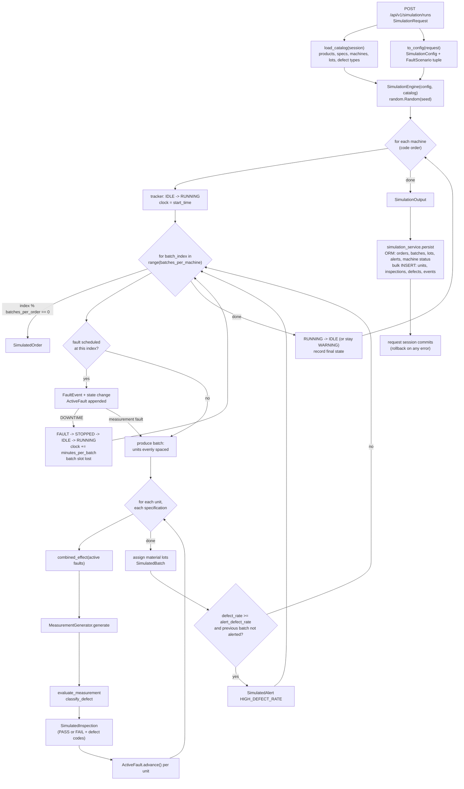
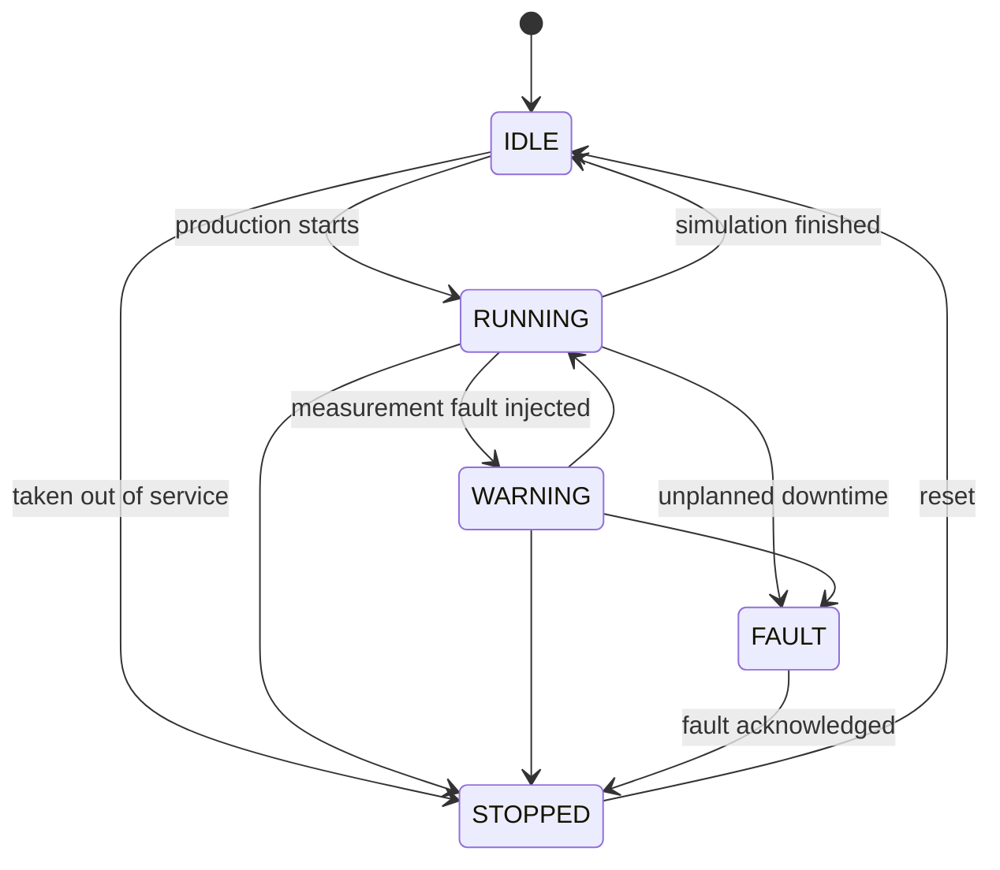

# Simulation design

The virtual factory is the part of Factory Sherlock that replaces a physical machining cell. It generates production orders, production batches, production units, inspections, machine events, and alerts that obey the same business rules as manual operations through the API, and it does so deterministically so that a scenario can be reproduced exactly for a demonstration, a test, or an investigation walkthrough.

Source: `backend/app/simulation/` (engine), `backend/app/services/simulation_service.py` (persistence), `backend/app/schemas/simulation.py` (API contract), `database/seeds/demo_scenario.json` (default scenario). Fault behaviour is detailed in [fault-models.md](fault-models.md). Layering and module boundaries are described in `docs/architecture/system-overview.md` and are not repeated here.

## Purpose

1. Provide realistic production history for every other module (manufacturing execution, quality control, investigation, traceability, analytics) without a factory.
2. Make quality problems appear in the data in a way that the investigation engine can find from SQL alone: a fault is injected on one machine at one batch index, and its effect shows up in measurements, inspections, and machine events.
3. Reuse the domain rules in `backend/app/domain/` so the synthetic data cannot violate rules that the API enforces (pass/fail evaluation, defect classification, machine state transitions, the single definition of defect rate).
4. Be reproducible: the same request produces the same rows, which is what makes the deterministic simulation test scenario and the demo scenario possible.

## Architecture

The simulation is split into a pure engine that never touches the database and a service that loads reference data, runs the engine, and persists the result in one transaction.

| Component | Module | Responsibility |
|-----------|--------|----------------|
| Configuration | `simulation/config.py` | `SimulationConfig` (seed, start time, sizes, faults, alert threshold) and `FaultScenario`; validates minimum values in `__post_init__`. |
| Catalog | `simulation/config.py`, built by `simulation_service.load_catalog` | Frozen snapshot of reference rows the engine needs: products with their specifications and usable material lot ids, machines, and a map from defect type code to id. Validates that at least one product and one machine exist and that every product has specifications and lots. |
| State tracker | `simulation/machine_state.py` | `MachineStateTracker` keeps one machine's current `MachineStatus` and its history of `StateChange` records. Every transition goes through `assert_transition(MACHINE_TRANSITIONS, ...)` from `domain/state_machines.py`, so the simulator cannot produce an illegal machine state sequence. |
| Measurement generator | `simulation/measurement.py` | `MeasurementGenerator.generate(spec, effect)` draws a measured value from a normal distribution centred on the specification target with standard deviation `tolerance / 3`, then applies the fault effect (mean offset, sigma multiplier, optional gross deviation). Values are quantised to three decimals with `ROUND_HALF_UP` to match the `NUMERIC(10, 3)` column. |
| Fault injector | `simulation/faults.py` and `SimulationEngine._inject_fault` | `ActiveFault` tracks how many units have been produced since a fault started; `combined_effect` sums the effects of all active faults into one `MeasurementEffect`. The engine records a `FaultEvent`, moves the machine state, and (for DOWNTIME) consumes the batch slot. |
| Quality evaluation | `domain/quality_rules.py` | `evaluate_measurement` decides PASS or FAIL (`abs(measured - target) <= tolerance`) and `classify_defect` maps a failure to a defect type code by characteristic name. The engine calls these for every inspection. |
| Output records | `simulation/events.py` | Plain frozen dataclasses: `SimulatedOrder`, `SimulatedBatch`, `SimulatedUnit`, `SimulatedInspection`, `StateChange`, `FaultEvent`, `SimulatedAlert`, collected in `SimulationOutput`. |
| Engine | `simulation/engine.py` | `SimulationEngine(config, catalog).run()` walks every machine through its batches and fills a `SimulationOutput`. |
| Persistence | `services/simulation_service.py` | `run_simulation` loads the catalog, converts the API request to a config, runs the engine, and calls `persist`. Orders, batches with their `BatchMaterial` links, and alerts are few and are written as ORM objects. Units, inspections, inspection defects, and machine events are written with chunked multi-row `INSERT` statements (`BULK_CHUNK_SIZE = 1000` rows per statement); see [Persistence path](#persistence-path). `persist` also updates each `Machine.status`. The request-scoped session commits when the route returns, so a failure anywhere leaves no partial rows. |

The engine imports only `app.domain`, `app.models.enums`, and its own package. It receives the catalog as data and returns data; the service is the only place where SQLAlchemy appears.

## Execution model

### Shared clock, one machine at a time

`SimulationEngine.run` iterates the machines in catalog order (machines are loaded ordered by `code`). Each machine starts its own clock at `config.start_time` and runs independently; the machines therefore run in parallel in simulated time but are generated sequentially in code. Because all machines share the same start time and batch duration, their batches line up on the same timeline, which is convenient for fleet comparisons in the analytics queries.

### Batches per machine

Each machine produces `batches_per_machine` batches, indexed from 0. A batch takes exactly `minutes_per_batch` simulated minutes: `completed_at = started_at + minutes_per_batch`, and the next batch starts when the previous one completes. There are no gaps between batches except the slot consumed by a DOWNTIME fault.

### Orders per batches_per_order

Batch index `i` belongs to order index `i // batches_per_order`. A new `SimulatedOrder` is created when `i % batches_per_order == 0`. The order's `quantity_planned` is `min(batches_per_order, remaining batches) * units_per_batch`, so the last order of a machine may be smaller when `batches_per_machine` is not a multiple of `batches_per_order`. The due date is the order's creation time plus the time its batches need plus 60 minutes, stored as a date.

The persisted order number is `{run_tag}-{machine_code}-{order_index + 1:02d}` where `run_tag` is `SIM` followed by a four-digit counter derived from the number of existing production orders (`SIM0001` on a freshly seeded database). Batch numbers are `{order_number}-B{n:02d}` with `n` counting batches persisted for that order, and serial numbers are `{batch_number}-U{sequence:04d}`.

### Product assignment

`_product_for` dedicates each machine to one product: machine index `k` (in code order) produces product index `k` (in product code order). When there are more products than machines, the extra products rotate through the machines order by order. With the seeded reference data (three machines, three products) the assignment is fixed: `CNC-01` produces `GEAR`, `CNC-02` produces `METAL-BRACKET`, `CNC-03` produces `STEEL-SHAFT`, because both lists are sorted alphabetically by code.

### Units evenly spaced

Within a batch, unit `seq` (1-based) is produced at `started_at + (minutes_per_batch / units_per_batch) * seq`. With the defaults (30 minutes, 20 units) units are 1.5 minutes apart and the last unit is stamped at the batch completion time. Every unit is inspected on every specification of its product at its production time, so a product with two specifications yields two inspections per unit. The batch defect rate used for alerts is `failed inspections / total inspections`, computed by `domain.quality_rules.defect_rate`.

### Material lots

Lots are chosen per batch from the product's lot list (lots of the matching material name that are `AVAILABLE`, ordered by lot number): batch `i` uses lot `(i // 2) % n`, so consecutive batch pairs share a lot, and every third batch (`i % 3 == 2`) additionally uses the next lot in rotation. This guarantees that forward traceability from a lot finds several batches and that the shared-lot investigation rule has something to report. The persisted `quantity_used` is the number of units in the batch. The simulation does not change lot status or decrement `quantity_received`.

### Alerts

After each batch the engine computes the batch defect rate. If it is at or above `alert_defect_rate` (0.15 by default) and the previous batch did not already alert, a `HIGH_DEFECT_RATE` alert with `WARNING` severity is recorded at the batch completion time. Consecutive batches above the threshold therefore produce one alert for the run, and a new alert only after the rate drops below the threshold and rises again.

### End of run

A machine whose tracker is still `RUNNING` is moved to `IDLE` with the reason "Simulation finished". A machine that was moved to `WARNING` by a measurement fault stays in `WARNING` so the dashboard reflects an unresolved condition. The final status of each machine is written to `machines.status` by the service.

## Simulation event flow

The same diagram is kept as Mermaid source in `docs/media/diagrams/simulation-event-flow.mmd`.

## Persistence path

`persist` runs inside the caller's transaction and never commits. The steps, in order:

1. `_persist_orders` adds one `ProductionOrder` per `SimulatedOrder` through the ORM and flushes so the order ids exist.
2. `_persist_batches` adds one `ProductionBatch` (status `COMPLETED`) with its `BatchMaterial` rows per `SimulatedBatch` and flushes once so the batch ids exist. `_complete_orders` then sets each order's `quantity_completed` from its batches and marks the order `COMPLETED` when the planned quantity is reached.
3. `_unit_rows` builds one dictionary per unit (`batch_id`, `serial_number`, `sequence_in_batch`, `produced_at`) and `_bulk_insert` writes them with `session.execute(insert(ProductionUnit), rows)`, at most `BULK_CHUNK_SIZE` (1000) rows per statement. MySQL does not return generated ids for a multi-row `INSERT`, so `_unit_ids_by_serial` selects `serial_number, id` for the run's batches; the serial number is unique and keys the next step.
4. `_inspection_rows` builds the inspection dictionaries with the mapped `unit_id`, counts failures, and `_bulk_insert` writes them. `_inspection_ids_by_unit_and_spec` selects `unit_id, specification_id, id` for the run's batches; the pair is unique (`uq_inspection_unit_spec`).
5. `_defect_rows` maps every defect code to `(inspection_id, defect_type_id)` and `_bulk_insert` writes `inspection_defects`.
6. `_event_rows` turns state changes and fault events into `machine_events` rows and writes them the same way. `_persist_alerts` adds `Alert` objects through the ORM, the final machine states are applied, and one last `flush()` writes the order counters, the alerts, and the machine statuses.

The counts in `SimulationResult` are taken from the rows built in memory, so they equal what the engine produced. A unit or inspection row that the two selects do not find raises `KeyError` while the dependent rows are built, which fails the request and rolls the transaction back; `tests/integration/test_simulation_persistence.py` checks the counts across chunk boundaries and compares stored inspections with the engine output unit by unit, and `tests/integration/test_transactions.py` fails the last bulk insert and asserts that no rows remain.

Measured with `scripts/development/benchmark_simulation.py` (`make benchmark-sim`): MySQL 8.4 on `127.0.0.1`, same machine as the client, median of 3 runs per shape, every run rolled back, rows per second counting units plus inspections over the whole `run_simulation` call. The engine alone takes under 0.01 s for the demo shape and 0.03 s for the large shape, so the times below are almost entirely persistence.

| Shape | Units | Inspections | Before (ORM, one object per row) | After (chunked bulk inserts) |
|-------|-------|-------------|----------------------------------|------------------------------|
| demo (3 machines x 12 batches x 20 units, 2 faults) | 700 | 1400 | 0.29 s, 7266 rows/s | 0.04 s, 57274 rows/s |
| large (3 machines x 40 batches x 50 units, 1 fault) | 6000 | 12000 | 1.71 s, 10517 rows/s | 0.25 s, 72173 rows/s |

A second run of each benchmark agreed with these figures within 0.03 s. The numbers are specific to the development machine and a local MySQL; a networked database would widen the gap because the old path issued one `INSERT` per row.

## Determinism guarantees and limits

Guarantees:

- All randomness comes from one `random.Random(config.seed)` instance created in `SimulationEngine.__init__` and shared with the `MeasurementGenerator`. Python's `random` module uses a Mersenne Twister whose sequence is fully determined by the seed, and `gauss` and `random` are consumed in a fixed order (machines in code order, batches in index order, units in sequence order, specifications in id order).
- The engine's inputs are frozen dataclasses. For the same `(SimulationConfig, Catalog)` pair, `SimulationOutput` is identical: same measured values, same results, same timestamps, same events.
- Decimal arithmetic for the offset and quantisation is exact; the only floating point steps are the Gaussian and uniform draws, whose results are converted through `Decimal(str(...))` so the conversion is reproducible across runs on the same platform.

Limits:

- Determinism holds for the same catalog. The catalog depends on the database: product order, specification ids and order, machine order, and which lots are `AVAILABLE`. Quarantining a lot before running a simulation changes which lot ids the product sees and therefore the batch to lot assignment. Adding a product or machine changes the assignment.
- Persisted identifiers are not deterministic across databases: order numbers depend on how many production orders already exist (`SIM0001`, `SIM0002`, ...), and primary keys depend on auto-increment state.
- Determinism is not guaranteed across Python versions if the `random` module's `gauss` implementation changes, or across platforms with different floating point behaviour for `math.exp` and `math.log` used by `gauss`. The project targets Python 3.12 on one development machine, where this is not a concern.
- Wall-clock time (`datetime.now()`) is used only by manual operations through the API (batch start, inspection entry, machine status changes, quarantine, investigation creation), never inside the simulation, so the simulated timeline is fully controlled by `start_time`.

## Configuration parameters

The API contract is `SimulationRequest` in `backend/app/schemas/simulation.py`; the engine contract is `SimulationConfig` in `backend/app/simulation/config.py`. Two engine fields are not exposed through the API.

| Parameter | Default | API validation (`SimulationRequest`) | Engine validation (`SimulationConfig`) | Notes |
|-----------|---------|--------------------------------------|----------------------------------------|-------|
| `seed` | 42 | integer, `>= 0` | none | Seeds the single random generator. |
| `start_time` | required | ISO 8601 datetime | none | Start of every machine's clock. Naive datetime stored as MySQL `DATETIME`. |
| `batches_per_machine` | 12 | `1 <= n <= 200` | `>= 1` | Batches per machine, including slots lost to downtime. |
| `units_per_batch` | 20 | `1 <= n <= 500` | `>= 1` | Units per batch; each unit yields one inspection per specification. |
| `minutes_per_batch` | 30 | `1 <= n <= 600` | `>= 1` | Simulated duration of one batch and of one downtime slot. |
| `batches_per_order` | 4 | not exposed | `>= 1` | Batches grouped into one production order. Fixed at 4 through the API. |
| `alert_defect_rate` | 0.15 | not exposed | none | Batch defect rate that raises a `HIGH_DEFECT_RATE` alert. Fixed at 0.15 through the API. |
| `faults` | empty list | list of `FaultScenario`; `start_batch_index >= 0`; unknown fields rejected | machine code must exist in the catalog, else `ValueError` (mapped to HTTP 422) | `fault` is a string in the API and converted to `FaultKind`; an unknown kind yields a 422 `ValidationError`. |

Additional validation performed by the service: every product must have at least one `AVAILABLE` material lot whose `material_name` matches the product in `PRODUCT_MATERIALS` (`STEEL-SHAFT` to "Steel bar stock 4140", `METAL-BRACKET` to "Sheet steel 3 mm", `GEAR` to "Alloy gear blank 8620"), otherwise the request fails with 422 before the engine runs. A product not listed in `PRODUCT_MATERIALS` has no lots and also fails this check.

A `start_batch_index` at or beyond `batches_per_machine` is accepted and simply never fires. Two faults with the same machine and start index collide in the engine's `faults_by_batch` dictionary and only the last one is applied; this is a known limitation rather than a validated condition.

The endpoint is `POST /api/v1/simulation/runs`, restricted to the `ENGINEER` and `ADMIN` roles, and returns a `SimulationResult` with counts of orders, batches, units, inspections, failed inspections, events, and alerts created.

## Machine state machine

The transition table is `MACHINE_TRANSITIONS` in `backend/app/domain/state_machines.py`. The same table is used by `POST /api/v1/machines/{id}/status` and by the simulator's `MachineStateTracker`, so an illegal transition raises `InvalidTransitionError` in both places.

How the simulator uses it:

- Every machine starts the run with `IDLE -> RUNNING` ("Simulation started").
- A measurement fault (`TOOL_WEAR`, `CALIBRATION_DRIFT`, `VARIATION`, `MATERIAL_ISSUE`) moves a `RUNNING` machine to `WARNING`; a machine already in `WARNING` stays there.
- `DOWNTIME` executes `RUNNING -> FAULT`, then after one batch duration `FAULT -> STOPPED -> IDLE -> RUNNING`, all three stamped at the same simulated time. The transition table forbids `FAULT -> RUNNING` directly, which is why the stop and reset steps exist. Note that `WARNING -> FAULT` is also legal, so a DOWNTIME fault scheduled after a measurement fault on the same machine passes through `FAULT` and comes back to `RUNNING`, which clears the `WARNING` state even though the measurement fault is still active.
- At the end, `RUNNING -> IDLE` ("Simulation finished"); `WARNING` is kept.

Each transition is persisted as a `machine_events` row with `event_type = STATE_CHANGE`, `previous_state`, `new_state`, and severity `CRITICAL` when the new state is `FAULT`, otherwise `INFO`.

## Simplifications and non-goals

- Machines are never shared and never idle between batches; there is no scheduling, changeover, or queueing.
- A batch always takes exactly `minutes_per_batch`; cycle time does not vary with product, fault, or operator.
- Every unit is inspected on every characteristic at the moment it is produced; there is no sampling plan and no inspection delay.
- Measurements are independent normal draws; there is no autocorrelation within a batch beyond the deterministic tool wear trend.
- Faults never resolve on their own and there is no maintenance event that clears them; `MAINTENANCE` exists in `MachineEventType` but the simulator never emits it.
- Material lots are not consumed: lot status stays `AVAILABLE` and `quantity_received` is not decremented. `quantity_used` is recorded as the unit count, not a mass or length.
- Orders are persisted directly in `IN_PROGRESS` and marked `COMPLETED` when `quantity_completed >= quantity_planned`; batches are persisted directly as `COMPLETED`. The simulator does not walk orders through `PLANNED` and `RELEASED`. An order that loses a batch slot to `DOWNTIME` stays `IN_PROGRESS` because its planned quantity is never reached.
- The simulator does not model operators, shifts, calendars, costs, or energy.
- There is no real-time or streaming mode; a run is a single synchronous request that writes a finished history.

## Learning objectives mapped to code

| Objective | Where to look |
|-----------|---------------|
| Separation of a pure computation from persistence | `simulation/engine.py` returns dataclasses; `services/simulation_service.py::persist` writes rows. |
| Reproducible randomness with a seeded generator | `SimulationEngine.__init__` (`random.Random(config.seed)`), `measurement.py`. |
| Reusing domain rules across subsystems | `engine.py` imports `evaluate_measurement`, `defect_rate`, `DEFECT_SURFACE`; `machine_state.py` imports `MACHINE_TRANSITIONS`, `assert_transition`. |
| Modelling process variation and faults | `measurement.py` (`NATURAL_SIGMA_FRACTION`), `faults.py` (`combined_effect`), documented in [fault-models.md](fault-models.md). |
| State machines as data | `domain/state_machines.py` tables and `MachineStateTracker.transition`. |
| Many-to-many relationships populated by generated data | `SimulatedBatch.material_lot_ids` to `BatchMaterial` rows; `SimulatedInspection.defect_codes` to `InspectionDefect` rows. |
| Single transaction for a multi-table write | `persist` flushes but never commits; `core/database.py::get_db_session` commits or rolls back. |
| Bulk inserts and id mapping without `RETURNING` | `_bulk_insert` (chunked `insert(Model)` with a list of dictionaries), `_unit_ids_by_serial`, `_inspection_ids_by_unit_and_spec`. |
| Input validation at two levels | Pydantic ranges in `schemas/simulation.py`; invariants in `SimulationConfig.__post_init__` and `Catalog.__post_init__`. |
